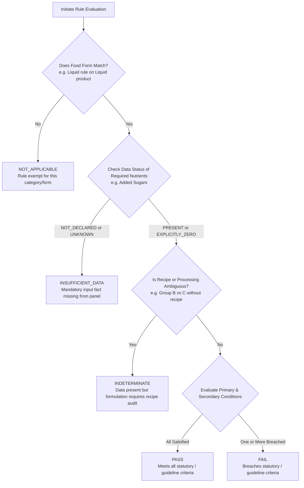

# YumSure — Phase 1B.2: Database & Research Compatibility Review (Revised)

**Document Version**: 2.0.0 (Phase 1B.2 Revisions)  
**Review Date**: November 2026 (Verified as of 3 November 2026)  
**Author**: Senior Backend Database Architect & Nutrition Regulatory Intelligence Lead  
**Collaborator for Coordination**: Tejas (Backend Core Lead)  
**Governing Research Documents**:
- `NUTRIENT_REFERENCE_AUDIT.md` (v3.0.0)
- `NUTRIENT_CLASSIFICATION_RESEARCH.md` (v4.0.0)
- `ICMR_TABLE_15_2_VERIFICATION.md` (v4.0.0)
- `SOURCE_PROVENANCE_REGISTER.md` (v4.0.0)
- `INGREDIENT_CATALOGUE.md`
- `DATABASE_DESIGN.md`

---

## 1. Executive Summary & Purpose of Revision

This document reviews the existing SQLAlchemy 2.0 models authored by Tejas in `backend/app/models/` against the finalized regulatory and nutritional intelligence research. In this Phase 1B.2 revision, the review is expanded into an actionable technical contract covering:
1. Complete structural segregation between **FSSAI Statutory Claims** (binding food law) and **ICMR-NIN HFSS Guidelines** (institutional public health framework).
2. Elimination of restrictive operators and inclusion of **`LT` (<)**, **`LTE` (<=)**, **`GT` (>)**, **`GTE` (>=)**, and **`EQ` (==)**.
3. Modeling of compound logic (nested AND/OR conditions, secondary percentage-of-energy limits, and alternative measurement bases).
4. Explicit definition of standard measurement bases (`PER_100G`, `PER_100ML`, `PER_100KCAL`, `PER_SERVING`, `PCT_TOTAL_ENERGY`, `PCT_TOTAL_FAT`).
5. Rich, evidence-based ingredient classification replacing naive boolean flags.
6. A unified five-state evaluation status protocol (`PASS`, `FAIL`, `INSUFFICIENT_DATA`, `INDETERMINATE`, `NOT_APPLICABLE`).

---

## 2. Existing Model Inventory & Architectural Assessment

| Model Class | Python File | Database Table | Primary Key | Key Relationships | Assessment & Architectural Health |
| :--- | :--- | :--- | :--- | :--- | :--- |
| **`DataSource`** | `data_source.py` | `data_sources` | `source_id` (VARCHAR 50) | `products` (1:N) | **RETAIN AS-IS**: Provenance and legal license tracking are robust. |
| **`Product`** | `product.py` | `products` | `id` (UUID) | `data_source`, `nutrients`, `ingredients`, `ai_explanations`, `scan_history` | **RETAIN WITH MINOR ENHANCEMENTS**: Core entity; needs optional foreign key or enum for product food category mapping. |
| **`Nutrient`** | `nutrient.py` | `nutrients` | `nutrient_code` (VARCHAR 50) | `product_nutrients`, `interpretation_rules` | **MODIFY**: Deprecate biological `icmr_nin_rda_adult`; add FSSAI 2,000 kcal adult daily reference values and citation. |
| **`ProductNutrient`**| `product_nutrient.py`| `product_nutrients` | `id` (UUID) | `product`, `nutrient` | **RETAIN AS-IS**: Preserves the mandatory **4-state nutrient semantics** (`PRESENT`, `UNKNOWN`, `EXPLICITLY_ZERO`, `NOT_DECLARED`). |
| **`Ingredient`** | `ingredient.py` | `ingredients` | `ingredient_code` (VARCHAR 100) | `product_ingredients`, `ingredient_rules` | **ENHANCE**: Add processing classification evidence, technological function, and sugar-type taxonomy. |
| **`ProductIngredient`**| `product_ingredient.py`| `product_ingredients`| `id` (UUID) | `product`, `ingredient` | **RETAIN AS-IS**: 3NF bridge preserving mandatory FSSAI descending-weight sequence order (`sequence_order`). |
| **`NutritionRule`** | `nutrition_rule.py` | `nutrition_interpretation_rules` | `rule_id` (VARCHAR 100) | `nutrient` | **DEPRECATE & REPLACE**: Rigid Low/Mod/High scalars conflict with Indian regulations; replace with dedicated `icmr_hfss_rules`. |
| **`RegulatoryClaimRule`**| `regulatory_claim_rule.py`| `regulatory_claim_rules`| `claim_id` (VARCHAR 100) | *None* (Missing FKs) | **UPGRADE**: Support Schedule I criteria, Schedule II synonyms, `'LT'` operator, secondary % energy conditions, and multi-base alternatives. |
| **`IngredientRule`** | `ingredient_rule.py` | `ingredient_rules` | `rule_id` (VARCHAR 100) | `ingredient` (FK) | **RETAIN & STRUCTURE**: Separate 1:N model for additive limits (GMP) and mandatory Schedule II warning statements. |
| **`AIExplanation`** | `ai_explanation.py` | `ai_explanations` | `id` (UUID) | `product` | **RETAIN AS-IS**: Caching and fallback tracking. |
| **`ScanHistory`** | `scan_history.py` | `scan_history` | `id` (UUID) | `product` | **RETAIN AS-IS**: Scan logging with client IP hashing. |

---

## 3. Discrepancies and Required Technical Corrections

### 3.1 Separation of FSSAI Claims vs. ICMR-NIN HFSS Framework
- **Defect in Existing Schema**:  
  `NutritionRule` conflates statutory FSSAI claims with daily RDAs under a generic "nutrition interpretation" banner.
- **Correction**:  
  Completely decouple the two engines into independent relational tables:
  1. `regulatory_claim_rules`: Strictly governs voluntary marketing claims under **FSSAI (Advertising and Claims) Regulations, 2018 (Consolidated Version III, 2022)**.
  2. `icmr_hfss_rules`: Strictly models public health nutritional risk and processing extent under **ICMR-NIN Dietary Guidelines for Indians (DGI) 2024, Guideline 15 (Tables 15.1 and 15.2)**.

### 3.2 FSSAI Schedule I Conditions vs. Schedule II Synonyms
- **Defect in Existing Schema**:  
  The docstring in `regulatory_claim_rule.py` cites "Schedule II conditions", repeating an old citation error.
- **Correction**:  
  - **Schedule I** establishes the legally binding quantitative thresholds (e.g. Low Fat $\le 3\text{g/100g}$, Source of Protein $\ge 10\%$ RDA).
  - **Schedule II** defines authorized synonyms (e.g. for "Free": "Zero", "No", "Without", "Negligible"; for "Source": "Provides", "Contains"; for "High": "Rich in").
  - The model must store Schedule I threshold conditions while maintaining an array/JSON list of authorized Schedule II synonyms to validate manufacturer marketing copy.

### 3.3 Inclusion of the Strictly Less-Than (`LT`) Operator
- **Defect in Existing Schema**:  
  `CheckConstraint("operator IN ('LTE', 'GTE', 'EQ')")` rejects `'LT'`.
- **Correction**:  
  Under FSSAI Schedule I, Item 2, "Trans Fat Free" requires **strictly less than 0.2 g** (`< 0.2 g`) of trans fat per 100g/ml. The check constraint must be updated to:
  ```sql
  CHECK (operator IN ('LT', 'LTE', 'GT', 'GTE', 'EQ'))
  ```

### 3.4 Nested AND/OR Conditions & Compound Secondary Limits
- **Defect in Existing Schema**:  
  `RegulatoryClaimRule` contains only single scalar columns (`operator`, `threshold_value`, `unit`).
- **Correction**:  
  Real-world claims require compound logic:
  1. **Secondary AND Condition (Percentage-of-Energy)**:
     - *Low Saturated Fat*: Primary condition ($\text{Saturated Fat} \le 1.5\text{g/100g}$) **AND** secondary condition ($\text{Energy from Saturated Fat} \le 10\%$ of total energy).
     - *Trans Fat Free*: Primary condition ($\text{Trans Fat} < 0.2\text{g/100g}$) **AND** secondary condition ($\text{Saturated Fat} \le 1.5\text{g/100g}$) **AND** secondary percentage condition ($\text{Energy from Saturated Fat} \le 10\%$).
  2. **Alternative OR Conditions (Multi-Base Equivalents)**:
     - *Source of Protein*: Solids $\ge 5.4\text{g/100g}$ **OR** Liquids $\ge 2.7\text{g/100ml}$ **OR** Energy Basis $\ge 2.7\text{g / 100 kcal}$.
  - The schema must support compound evaluation either through explicit relational secondary condition fields or a structured JSONB condition expression tree.

### 3.5 Explicit Measurement Bases
- **Defect in Existing Schema**:  
  Units are loosely stored as strings (`'g'`, `'mg'`, `'%'`), obscuring the physical measurement denominator.
- **Correction**:  
  Enforce explicit measurement bases via check constraints:
  - `PER_100G`: Solid food density (g or mg per 100g).
  - `PER_100ML`: Liquid beverage density (g or mg per 100ml).
  - `PER_100KCAL`: Energy-normalized density (g or mg per 100 kcal).
  - `PER_SERVING`: Declared single-portion basis.
  - `PCT_TOTAL_ENERGY`: Macronutrient caloric contribution ($\% = \frac{\text{Nutrient (g)} \times \text{Atwater Factor}}{\text{Total Energy (kcal)}} \times 100$).
  - `PCT_TOTAL_FAT`: Weight percentage of lipid fraction ($\% = \frac{\text{Trans Fat (g)}}{\text{Total Fat (g)}} \times 100$).

### 3.6 Evidence-Based Ingredient Classification
- **Defect in Existing Schema**:  
  `ingredients` table only contains a broad technological `category` string (`SWEETENER`, `EMULSIFIER`).
- **Correction**:  
  To avoid naive boolean shortcuts that produce false-positive UPF classifications:
  1. Add `processing_classification` enum: `WHOLE_FOOD`, `CULINARY_PROCESSED`, `FUNCTIONAL_ADDITIVE`, `COSMETIC_ADDITIVE`, `INDUSTRIAL_FRACTION`.
  2. Add `sugar_classification` enum: `NOT_SUGAR`, `INTRINSIC_SUGAR`, `ADDED_FREE_SUGAR`, `SUGAR_SUBSTITUTE_SWEETENER`, `NON_NUTRITIVE_SWEETENER`, `POLYOL`.
  3. Add `classification_evidence` text describing the scientific justification and literature citation (e.g. "Synthetic azo dye classified as cosmetic additive per ICMR-NIN DGI 2024 Table 15.2").

---

## 4. Standardized Five-State Evaluation Protocol

When evaluating products against statutory claims or ICMR-NIN guidelines, rule engines must return one of five standardized execution outcomes:



### Protocol Specifications:
1. **`PASS`**: All statutory conditions, secondary percentage-of-energy limits, and ingredient-level criteria are verified and satisfied.
2. **`FAIL`**: Declared nutrient or ingredient values definitively breach the statutory ceiling or threshold conditions.
3. **`INSUFFICIENT_DATA`**: A required nutrient or ingredient declaration is missing (`NOT_DECLARED` or `UNKNOWN`). The engine halts evaluation without guessing or asserting a negative claim.
4. **`INDETERMINATE`**: Nutrient values are present, but recipe-level details (e.g. distinction between natural vs added fat, or industrial shear/extrusion extent) cannot be deduced from packaging text alone.
5. **`NOT_APPLICABLE`**: The rule explicitly targets a different food format (e.g. evaluating a liquid-only claim condition against a solid biscuit).

---

## 5. Summary of Recommended Field Actions

| Model | Field Name | Action | Rationale |
| :--- | :--- | :--- | :--- |
| `Nutrient` | `icmr_nin_rda_adult` | **Deprecate** | Conflates biological RDA with labelling reference values. |
| `Nutrient` | `fssai_standard_daily_rdi` | **Add** | Standardized 2,000 kcal adult daily reference values under FSSAI Labelling 2020 Reg 5(3)(b). |
| `Nutrient` | `rdi_citation` | **Add** | Legal provenance tracking. |
| `Ingredient` | `processing_classification` | **Add** | Distinguishes functional additives from cosmetic additives (UPF markers). |
| `Ingredient` | `sugar_classification` | **Add** | Distinguishes free added sugars from polyols, intense sweeteners, and intrinsic sugars. |
| `Ingredient` | `classification_evidence` | **Add** | Scientific evidence base for public health accountability. |
| `RegulatoryClaimRule` | `operator` | **Modify Check** | Add `'LT'` and `'GT'`. |
| `RegulatoryClaimRule` | `food_form` | **Modify Check** | Add `'both'`. |
| `RegulatoryClaimRule` | `measurement_basis` | **Add** | Supports `PER_100G`, `PER_100ML`, `PER_100KCAL`, `PER_SERVING`. |
| `RegulatoryClaimRule` | `secondary_condition` | **Add** | Supports percentage-of-energy calculations and saturated fat constraints. |
| `RegulatoryClaimRule` | `alternative_group_id`| **Add** | Groups multi-base statutory alternatives (Protein & Fibre per 100g / 100ml / 100 kcal). |
| `RegulatoryClaimRule` | `permitted_synonyms` | **Add** | Stores Schedule II authorized marketing synonyms. |
| `NutritionRule` | *All Fields* | **Deprecate** | Replace with dedicated `icmr_hfss_rules` table. |

---

**Next Action**: Detailed DDL specifications, SQLAlchemy model classes, and compound condition examples are codified in the accompanying [`DATABASE_CONTRACT_PROPOSAL.md`](file:///d:/Hackthon/hack-sudo-chaos/DATABASE_CONTRACT_PROPOSAL.md).
