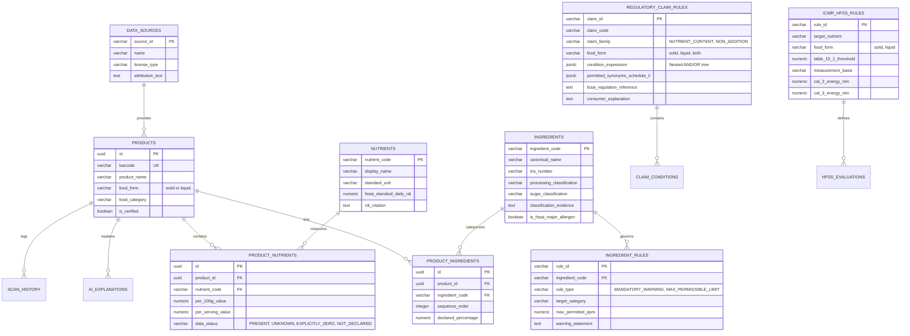

# YumSure — Phase 1B.2: Database Contract Proposal

**Document Version**: 1.0.0  
**Effective Date**: November 2026 (Verified as of 3 November 2026)  
**Author**: Senior Backend Database Architect & Nutrition Regulatory Intelligence Lead  
**Recipient / Collaborator**: Tejas (Backend Core Lead)  
**Governing Research Documents**:
- `NUTRIENT_REFERENCE_AUDIT.md` (v3.0.0)
- `NUTRIENT_CLASSIFICATION_RESEARCH.md` (v4.0.0)
- `ICMR_TABLE_15_2_VERIFICATION.md` (v4.0.0)
- `SOURCE_PROVENANCE_REGISTER.md` (v4.0.0)
- `INGREDIENT_CATALOGUE.md`
- `DATABASE_COMPATIBILITY_REVIEW.md` (v2.0.0)

---

## 1. Executive Summary & Architectural Goals

This document establishes the official database contract between the **Nutrition & Regulatory Intelligence Engine** and the **FastAPI/PostgreSQL Backend Core** developed by Tejas.

### Architectural Goals:
1. **Preserve Tejas's Strong Foundation**: Maintain 100% of the core entity structure (`products`, `nutrients`, `product_nutrients`, `ingredients`, `product_ingredients`, `data_sources`).
2. **Statutory Integrity**: Decouple legally binding FSSAI statutory claims from institutional ICMR-NIN public health guidance into dedicated, purpose-built relational models.
3. **Compound Rule Evaluation**: Support primary and secondary thresholds, nested AND/OR logic, multi-base statutory alternatives (`PER_100G`, `PER_100ML`, `PER_100KCAL`, `PER_SERVING`), and the strictly less-than (`LT`) operator.
4. **Evidence-Based Ingredients**: Replace naive boolean flags with structured scientific classifications (`processing_classification`, `sugar_classification`, `classification_evidence`) to prevent false-positive ultra-processed classifications.
5. **Standardized Five-State Execution Protocol**: Uniformly return `PASS`, `FAIL`, `INSUFFICIENT_DATA`, `INDETERMINATE`, or `NOT_APPLICABLE`.

---

## 2. Complete Model Inventory & Domain Responsibilities



### Model Responsibilities:
1. **`DataSource`**: Custodian of external data provenance, legal copyright licenses, and attribution requirements (e.g. Open Food Facts ODbL v1.0).
2. **`Product`**: Core normalized entity representing a packaged food item. Barcode is unique; `is_verified` guards against external API overwrites.
3. **`Nutrient`**: Master catalog of standardized chemical nutrients. Holds the **FSSAI standardized 2,000 kcal adult daily reference values** (`fssai_standard_daily_rdi`) for package labelling.
4. **`ProductNutrient`**: Normalized 3NF product-to-nutrient bridge maintaining the strict **4-state nutrient semantics** (`PRESENT`, `UNKNOWN`, `EXPLICITLY_ZERO`, `NOT_DECLARED`).
5. **`Ingredient`**: Master catalog of ingredients, INS additives, allergens, and scientific processing classifications.
6. **`ProductIngredient`**: Sequence-ordered bridge capturing the ingredient list on a specific product label, strictly preserving descending-weight order mandated by FSSAI.
7. **`RegulatoryClaimRule`**: Evaluates voluntary marketing claims under **FSSAI (Advertising and Claims) Regulations, 2018 (Consolidated Version III, 2022)**.
8. **`ICMRHFSSRule`**: Encapsulates institutional public health thresholds and energy bands under **ICMR-NIN Dietary Guidelines for Indians (DGI) 2024, Guideline 15 (Tables 15.1 and 15.2)**.
9. **`IngredientRule`**: 1:N entity storing statutory additive safety limits (GMP) and mandatory warning statements (e.g., Aspartame PKU warnings under FSSAI Labelling Schedule II).
10. **`AIExplanation`**: Audit log and response cache for plain-English AI explanations.
11. **`ScanHistory`**: Telemetry log for consumer barcode lookups with IP privacy hashing.

---

## 3. Proposed Schema Specifications (PostgreSQL 18 DDL)

### 3.1 Enhanced `nutrients` Table
```sql
-- Replace icmr_nin_rda_adult with explicit FSSAI labelling reference values
ALTER TABLE nutrients
    ADD COLUMN IF NOT EXISTS fssai_standard_daily_rdi NUMERIC(10, 2),
    ADD COLUMN IF NOT EXISTS rdi_citation TEXT DEFAULT 'FSSAI Labelling and Display Regulations 2020, Reg 5(3)(b)';

-- Comment on column
COMMENT ON COLUMN nutrients.fssai_standard_daily_rdi IS 
'Standardized 2,000 kcal adult daily reference intake for package labelling (e.g., Protein: 54g, Fat: 67g, Sat Fat: 22g, Trans Fat: 2g, Added Sugars: 50g, Sodium: 2000mg)';
```

---

### 3.2 Enhanced `ingredients` Table
```sql
-- Add scientific evidence fields to prevent naive boolean UPF shortcuts
CREATE TYPE ingredient_processing_class AS ENUM (
    'WHOLE_FOOD',
    'CULINARY_PROCESSED',
    'FUNCTIONAL_ADDITIVE',
    'COSMETIC_ADDITIVE',
    'INDUSTRIAL_FRACTION'
);

CREATE TYPE ingredient_sugar_class AS ENUM (
    'NOT_SUGAR',
    'INTRINSIC_SUGAR',
    'ADDED_FREE_SUGAR',
    'SUGAR_SUBSTITUTE_SWEETENER',
    'NON_NUTRITIVE_SWEETENER',
    'POLYOL'
);

ALTER TABLE ingredients
    ADD COLUMN IF NOT EXISTS processing_classification VARCHAR(30) DEFAULT 'FUNCTIONAL_ADDITIVE',
    ADD COLUMN IF NOT EXISTS sugar_classification VARCHAR(30) DEFAULT 'NOT_SUGAR',
    ADD COLUMN IF NOT EXISTS classification_evidence TEXT;

ALTER TABLE ingredients
    ADD CONSTRAINT chk_ingredient_proc_class 
    CHECK (processing_classification IN ('WHOLE_FOOD', 'CULINARY_PROCESSED', 'FUNCTIONAL_ADDITIVE', 'COSMETIC_ADDITIVE', 'INDUSTRIAL_FRACTION')),
    ADD CONSTRAINT chk_ingredient_sugar_class 
    CHECK (sugar_classification IN ('NOT_SUGAR', 'INTRINSIC_SUGAR', 'ADDED_FREE_SUGAR', 'SUGAR_SUBSTITUTE_SWEETENER', 'NON_NUTRITIVE_SWEETENER', 'POLYOL'));
```

---

### 3.3 Upgraded `regulatory_claim_rules` Table
```sql
-- Comprehensive FSSAI Schedule I & Regulation 6(1) Claim Model
DROP TABLE IF EXISTS regulatory_claim_rules CASCADE;

CREATE TABLE regulatory_claim_rules (
    claim_id VARCHAR(100) PRIMARY KEY,
    claim_code VARCHAR(50) NOT NULL,
    claim_title VARCHAR(150) NOT NULL,
    claim_family VARCHAR(50) NOT NULL CHECK (claim_family IN ('NUTRIENT_CONTENT_CLAIM', 'NON_ADDITION_CLAIM')),
    food_form VARCHAR(20) NOT NULL CHECK (food_form IN ('solid', 'liquid', 'both')),
    applicable_category VARCHAR(100) DEFAULT 'ALL',
    
    -- Structured Expression Tree supporting nested AND/OR logic
    condition_expression JSONB NOT NULL,
    
    -- Schedule II Synonyms
    permitted_synonyms_schedule_ii JSONB NOT NULL DEFAULT '[]'::jsonb,
    
    -- Provenance & Effective Dates
    fssai_regulation_reference TEXT NOT NULL,
    official_source_version VARCHAR(50) NOT NULL DEFAULT 'Version III (04-10-2022)',
    effective_from DATE NOT NULL DEFAULT '2019-07-01',
    effective_to DATE,
    is_active BOOLEAN DEFAULT TRUE,
    consumer_explanation TEXT NOT NULL
);

CREATE INDEX idx_rcr_claim_code ON regulatory_claim_rules(claim_code);
CREATE INDEX idx_rcr_active ON regulatory_claim_rules(is_active);
```

---

### 3.4 New `icmr_hfss_rules` Table (Replacing `nutrition_interpretation_rules`)
```sql
-- Dedicated ICMR-NIN DGI 2024 Guideline 15 Model (Tables 15.1 and 15.2)
DROP TABLE IF EXISTS nutrition_interpretation_rules CASCADE;

CREATE TABLE icmr_hfss_rules (
    rule_id VARCHAR(100) PRIMARY KEY,
    rule_code VARCHAR(50) NOT NULL,
    target_nutrient_code VARCHAR(50) NOT NULL REFERENCES nutrients(nutrient_code),
    food_form VARCHAR(20) NOT NULL CHECK (food_form IN ('solid', 'liquid')),
    
    -- Table 15.1 Threshold of Concern
    table_15_1_threshold NUMERIC(10, 3) NOT NULL,
    measurement_basis VARCHAR(30) NOT NULL CHECK (measurement_basis IN ('PER_100G', 'PER_100ML')),
    
    -- Table 15.2 Energy Tiers (Solid Foods Only)
    cat_2_energy_min NUMERIC(10, 3), -- 250.0 kcal
    cat_3_energy_min NUMERIC(10, 3), -- 500.0 kcal
    
    -- Provenance
    guideline_reference TEXT NOT NULL DEFAULT 'ICMR-NIN Dietary Guidelines for Indians (2024), Guideline 15, Tables 15.1 & 15.2',
    is_active BOOLEAN DEFAULT TRUE
);

CREATE INDEX idx_icmr_target_nutrient ON icmr_hfss_rules(target_nutrient_code);
```

---

### 3.5 Structured `ingredient_rules` Table
```sql
-- Structured Additive Safety & Warning Statements
DROP TABLE IF EXISTS ingredient_rules CASCADE;

CREATE TABLE ingredient_rules (
    rule_id VARCHAR(100) PRIMARY KEY,
    ingredient_code VARCHAR(100) NOT NULL REFERENCES ingredients(ingredient_code) ON DELETE CASCADE,
    rule_type VARCHAR(50) NOT NULL CHECK (rule_type IN ('MANDATORY_LABEL_WARNING', 'MAX_PERMISSIBLE_LIMIT', 'POPULATION_PROHIBITION')),
    target_food_category VARCHAR(100) DEFAULT 'ALL',
    max_permitted_ppm NUMERIC(10, 2),
    warning_statement TEXT,
    regulatory_reference TEXT NOT NULL,
    consumer_guidance TEXT NOT NULL
);

CREATE INDEX idx_ir_ingredient ON ingredient_rules(ingredient_code);
CREATE INDEX idx_ir_type ON ingredient_rules(rule_type);
```

---

## 4. Compound Rule Evaluation Structure: Nested AND/OR Representation

To model complex statutory conditions (like multi-base alternatives for protein, secondary percentage-of-energy limits for saturated fat, and four-part non-addition checks), `regulatory_claim_rules.condition_expression` uses a validated JSONB AST (Abstract Syntax Tree).

### 4.1 Schema Definition for `condition_expression`
```json
{
  "$schema": "http://json-schema.org/draft-07/schema#",
  "title": "ClaimConditionExpression",
  "type": "object",
  "properties": {
    "logical_operator": { "type": "string", "enum": ["AND", "OR"] },
    "conditions": {
      "type": "array",
      "items": {
        "type": "object",
        "properties": {
          "type": { "type": "string", "enum": ["NUTRIENT_THRESHOLD", "ENERGY_PERCENTAGE", "INGREDIENT_CHECK", "EXPRESSION_GROUP"] },
          "nutrient_code": { "type": "string" },
          "operator": { "type": "string", "enum": ["LT", "LTE", "GT", "GTE", "EQ"] },
          "threshold_value": { "type": "number" },
          "measurement_basis": { "type": "string", "enum": ["PER_100G", "PER_100ML", "PER_100KCAL", "PER_SERVING", "PCT_TOTAL_ENERGY", "PCT_TOTAL_FAT"] },
          "ingredient_criteria": { "type": "object" },
          "nested_expression": { "$ref": "#" }
        }
      }
    }
  }
}
```

---

### 4.2 Concrete Example 1: Protein Claim (Multi-Base OR Alternatives)
*Rule: Source of Protein is satisfied if solid $\ge 5.4\text{g/100g}$ OR liquid $\ge 2.7\text{g/100ml}$ OR $\ge 2.7\text{g/100 kcal}$*.

```json
{
  "logical_operator": "OR",
  "conditions": [
    {
      "type": "NUTRIENT_THRESHOLD",
      "nutrient_code": "protein",
      "operator": "GTE",
      "threshold_value": 5.4,
      "measurement_basis": "PER_100G",
      "food_form": "solid"
    },
    {
      "type": "NUTRIENT_THRESHOLD",
      "nutrient_code": "protein",
      "operator": "GTE",
      "threshold_value": 2.7,
      "measurement_basis": "PER_100ML",
      "food_form": "liquid"
    },
    {
      "type": "NUTRIENT_THRESHOLD",
      "nutrient_code": "protein",
      "operator": "GTE",
      "threshold_value": 2.7,
      "measurement_basis": "PER_100KCAL",
      "food_form": "both"
    }
  ]
}
```

---

### 4.3 Concrete Example 2: Low Saturated Fat (Primary + Secondary % Energy AND Condition)
*Rule: Low Saturated Fat requires $\le 1.5\text{g/100g}$ (solids) AND saturated fat provides $\le 10\%$ of total energy*.

```json
{
  "logical_operator": "AND",
  "conditions": [
    {
      "type": "NUTRIENT_THRESHOLD",
      "nutrient_code": "saturated_fat",
      "operator": "LTE",
      "threshold_value": 1.5,
      "measurement_basis": "PER_100G",
      "food_form": "solid"
    },
    {
      "type": "ENERGY_PERCENTAGE",
      "nutrient_code": "saturated_fat",
      "operator": "LTE",
      "threshold_value": 10.0,
      "measurement_basis": "PCT_TOTAL_ENERGY",
      "formula": "(saturated_fat_g * 9.0 / total_energy_kcal) * 100"
    }
  ]
}
```

---

### 4.4 Concrete Example 3: Trans Fat Free (Compound AND Conditions with `< 0.2g`)
*Rule: Trans Fat Free requires strictly $< 0.2\text{g/100g}$ AND saturated fat $\le 1.5\text{g/100g}$ AND saturated fat $\le 10\%$ of total energy*.

```json
{
  "logical_operator": "AND",
  "conditions": [
    {
      "type": "NUTRIENT_THRESHOLD",
      "nutrient_code": "trans_fat",
      "operator": "LT",
      "threshold_value": 0.2,
      "measurement_basis": "PER_100G"
    },
    {
      "type": "NUTRIENT_THRESHOLD",
      "nutrient_code": "saturated_fat",
      "operator": "LTE",
      "threshold_value": 1.5,
      "measurement_basis": "PER_100G"
    },
    {
      "type": "ENERGY_PERCENTAGE",
      "nutrient_code": "saturated_fat",
      "operator": "LTE",
      "threshold_value": 10.0,
      "measurement_basis": "PCT_TOTAL_ENERGY"
    }
  ]
}
```

---

### 4.5 Concrete Example 4: No Added Sugar (Regulation 6(1) Ingredient Non-Addition Check)
*Rule: Added sugar declared $= 0\text{g}$ AND zero added-sugar ingredients (Reg 6(1)(a,b,c))*.

```json
{
  "logical_operator": "AND",
  "conditions": [
    {
      "type": "NUTRIENT_THRESHOLD",
      "nutrient_code": "added_sugars",
      "operator": "LTE",
      "threshold_value": 0.0,
      "measurement_basis": "PER_100G"
    },
    {
      "type": "INGREDIENT_CHECK",
      "disallowed_sugar_classes": ["ADDED_FREE_SUGAR", "SUGAR_SUBSTITUTE_SWEETENER"],
      "allow_intrinsic_sugars": true,
      "mandatory_disclosure_required": "CONTAINS NATURALLY OCCURRING SUGARS"
    }
  ]
}
```

---

## 5. Standardized Five-State Evaluation Protocol

Every rule evaluation in YumSure outputs a standardized result object matching the following Pydantic contract:

```python
from enum import Enum
from typing import Optional, List, Any
from pydantic import BaseModel

class EvaluationStatus(str, Enum):
    PASS = "PASS"
    FAIL = "FAIL"
    INSUFFICIENT_DATA = "INSUFFICIENT_DATA"
    INDETERMINATE = "INDETERMINATE"
    NOT_APPLICABLE = "NOT_APPLICABLE"

class RuleEvaluationResult(BaseModel):
    rule_id: str
    rule_code: str
    status: EvaluationStatus
    satisfied_basis: Optional[str] = None
    declared_value: Optional[float] = None
    threshold_condition: str
    statutory_citation: str
    failure_or_neutral_reason: Optional[str] = None
    missing_data_fields: List[str] = []
    evidence_notes: Optional[str] = None
```

### Execution Rules:
1. **Handling Missing Nutrients**: If a product has `added_sugars = NOT_DECLARED`, evaluating a claim or HFSS rule dependent on added sugars immediately returns:
   ```json
   {
     "status": "INSUFFICIENT_DATA",
     "missing_data_fields": ["added_sugars"],
     "failure_or_neutral_reason": "Mandatory nutrient declaration missing under FSSAI Labelling Regulations 2020."
   }
   ```
2. **Handling Ambiguous Processing (Group B vs Group C)**: If a product contains whole food as the primary ingredient and only simple functional additives (e.g. INS 330 citric acid), the engine returns:
   ```json
   {
     "status": "INDETERMINATE",
     "evidence_notes": "Contains functional additives without proof of industrial matrix deconstruction or cosmetic formulation. Requires recipe audit."
   }
   ```

---

## 6. Migration Impact on Tejas's Backend

| Database Object | Type of Change | Impact Level | Backwards Compatibility & Data Preservation |
| :--- | :--- | :--- | :--- |
| `data_sources` | None | None | 100% Preserved. |
| `products` | None | None | 100% Preserved. |
| `product_nutrients` | None | None | 100% Preserved. 4-state nutrient status unchanged. |
| `product_ingredients` | None | None | 100% Preserved. Descending sequence order unchanged. |
| `nutrients` | Column Additions | Very Low | Add `fssai_standard_daily_rdi` and `rdi_citation`. Nullable with default values. Non-breaking. |
| `ingredients` | Column Additions | Very Low | Add `processing_classification`, `sugar_classification`, `classification_evidence`. Non-breaking. |
| `regulatory_claim_rules` | Re-create / Alter | Low | Upgrade check constraints and replace single threshold columns with `condition_expression JSONB`. Non-breaking to product data. |
| `nutrition_interpretation_rules` | Deprecate & Replace | Medium | Drop deprecated Low/Mod/High table; create clean `icmr_hfss_rules` table. |
| `ingredient_rules` | Refine Columns | Low | Structure warning statements and maximum permissible limits. |

---

## 7. Open Questions for Tejas

We submit the following four questions to Tejas for agreement before generating migrations:

1. **Alembic Migration Sequencing**:
   - Would Tejas prefer:
     - *Approach 1*: A single clean migration `0002_enhance_rules_and_ingredients.py` that executes the column additions and table replacements simultaneously?
     - *Approach 2*: Two separate migrations (`0002_ingredient_enhancements.py` followed by `0003_rule_engine_revisions.py`)?  
     *Architecture Recommendation*: Approach 1 minimizes intermediate migration states and keeps test seeds atomic.
2. **JSONB Condition Expression Validation**:
   - Do you agree with storing compound AND/OR expressions in `condition_expression JSONB` validated by Pydantic schemas in the FastAPI application layer?  
     *Architecture Recommendation*: Highly recommended. It completely eliminates table-join overhead for complex claims while allowing zero-downtime additions of new FSSAI amendments.
3. **Database Seed Strategy**:
   - We have prepared seed files for:
     - All statutory FSSAI Schedule I claims (Version III, 2022).
     - FSSAI Schedule II authorized synonyms.
     - ICMR-NIN DGI 2024 Tables 15.1 and 15.2 rules.
     - 40 common Indian packaged food additives with scientific evidence tags.  
     Should these seeds be placed in `backend/app/db/seeds/` as Python seeding scripts?
4. **Liquid per-100ml Value Convention in `ProductNutrient`**:
   - We confirmed retaining the column name `per_100g_value` in PostgreSQL to avoid renaming churn, with the API serializer aliasing it to `per_100_value` when `food_form == 'liquid'`. Does Tejas concur?

---

**Next Action**: Both [`DATABASE_COMPATIBILITY_REVIEW.md`](file:///d:/Hackthon/hack-sudo-chaos/DATABASE_COMPATIBILITY_REVIEW.md) and [`DATABASE_CONTRACT_PROPOSAL.md`](file:///d:/Hackthon/hack-sudo-chaos/DATABASE_CONTRACT_PROPOSAL.md) are saved and ready for team review. In strict adherence to restrictions, no code changes or migrations were executed. Awaiting your approval.

