# YumSure — Database Design & Schema Specification

This document defines the relational database architecture for YumSure in PostgreSQL 18. It enforces third normal form (3NF), foreign key referential integrity, explicit provenance tracking, and strict distinction between missing, unknown, and explicitly absent data.

---

## 1. Entity-Relationship Diagram

```mermaid
erDiagram
    DATA_SOURCES ||--o{ PRODUCTS : "provides"
    PRODUCTS ||--o{ PRODUCT_NUTRIENTS : "contains"
    NUTRIENTS ||--o{ PRODUCT_NUTRIENTS : "measured by"
    PRODUCTS ||--o{ PRODUCT_INGREDIENTS : "lists"
    INGREDIENTS ||--o{ PRODUCT_INGREDIENTS : "categorizes"
    NUTRIENTS ||--o{ NUTRITION_INTERPRETATION_RULES : "governed by"
    NUTRIENTS ||--o{ REGULATORY_CLAIM_RULES : "evaluated against"
    PRODUCTS ||--o{ AI_EXPLANATIONS : "explained in"
    PRODUCTS ||--o{ SCAN_HISTORY : "logged in"

    DATA_SOURCES {
        varchar source_id PK
        varchar name
        varchar license_type
        text license_url
        varchar attribution_text
        boolean permits_redistribution
        timestamp created_at
    }

    PRODUCTS {
        uuid id PK
        varchar barcode UK "EAN-13 / UPC"
        varchar product_name
        varchar brand_name
        varchar package_size
        numeric serving_size_value
        varchar serving_size_unit "g or ml"
        varchar food_form "solid or liquid"
        varchar food_category "beverage, dairy, cereal, snack, etc."
        boolean is_verified "Locks record against external overwrite"
        varchar source_id FK
        timestamp source_retrieval_date
        jsonb raw_source_payload
        timestamp created_at
        timestamp updated_at
    }

    NUTRIENTS {
        varchar nutrient_code PK "energy, protein, carbohydrates, total_sugars, added_sugars, total_fat, saturated_fat, trans_fat, sodium, dietary_fibre, cholesterol"
        varchar display_name
        varchar standard_unit "g, mg, kcal"
        boolean is_fssai_mandatory "Mandatory under FSSAI Labelling Regs 2020"
        numeric icmr_nin_rda_adult "Standard daily RDA"
    }

    PRODUCT_NUTRIENTS {
        uuid id PK
        uuid product_id FK
        varchar nutrient_code FK
        numeric per_100g_value
        numeric per_serving_value
        varchar unit
        varchar data_status "PRESENT, UNKNOWN, EXPLICITLY_ZERO, NOT_DECLARED"
        timestamp recorded_at
    }

    INGREDIENTS {
        varchar ingredient_code PK
        varchar canonical_name
        varchar ins_number "e.g., INS 330, INS 415"
        varchar category "SWEETENER, PRESERVATIVE, EMULSIFIER, FLAVOUR_ENHANCER, REFINED_CARB, FAT_OIL, PROTEIN, FIBRE, OTHER"
        boolean is_fssai_major_allergen
        text functional_description
        timestamp created_at
    }

    PRODUCT_INGREDIENTS {
        uuid id PK
        uuid product_id FK
        varchar ingredient_code FK
        integer sequence_order "1-indexed by descending weight"
        numeric declared_percentage
        boolean is_allergen_declared
        varchar declared_label_text
    }

    NUTRITION_INTERPRETATION_RULES {
        varchar rule_id PK "e.g. NIR_SUGAR_SOLID_2020"
        varchar nutrient_code FK
        varchar food_form "solid or liquid"
        numeric low_threshold_max
        numeric moderate_threshold_max
        numeric high_threshold_min
        varchar unit "g or mg per 100g/ml"
        varchar concern_level "POSITIVE, NEUTRAL, CONCERN"
        text regulatory_citation "ICMR-NIN 2020 / FSSAI Labelling 2020"
    }

    REGULATORY_CLAIM_RULES {
        varchar claim_id PK "e.g. CLAIM_HIGH_PROTEIN_SOLID"
        varchar claim_code "HIGH_PROTEIN, SOURCE_PROTEIN, LOW_SUGAR, SUGAR_FREE, NO_ADDED_SUGAR, LOW_FAT, FAT_FREE, LOW_SAT_FAT, LOW_SODIUM, HIGH_FIBRE, SOURCE_FIBRE"
        varchar food_form "solid or liquid"
        varchar operator "LTE, GTE, EQ"
        numeric threshold_value
        varchar unit "%_RDA_PER_100G, G_PER_100G, G_PER_100ML, MG_PER_100G"
        text fssai_regulation_reference "FSSAI (Advertising and Claims) Regulations, 2018 - Schedule II"
        text consumer_explanation
    }

    AI_EXPLANATIONS {
        uuid id PK
        uuid product_id FK
        varchar provider "xai_grok, nvidia_nim, local_template"
        varchar model_name
        varchar prompt_sha256
        text generated_explanation
        boolean is_fallback
        integer latency_ms
        timestamp created_at
    }

    SCAN_HISTORY {
        uuid id PK
        uuid product_id FK
        varchar barcode
        varchar client_ip_hash
        timestamp scanned_at
    }
```



---

## 2. DDL Schema Definition (PostgreSQL 18)

```sql
-- Create schema and extensions
CREATE EXTENSION IF NOT EXISTS "uuid-ossp";

-- Data Sources & Licenses
CREATE TABLE data_sources (
    source_id VARCHAR(50) PRIMARY KEY,
    name VARCHAR(150) NOT NULL,
    license_type VARCHAR(100) NOT NULL,
    license_url TEXT NOT NULL,
    attribution_text TEXT NOT NULL,
    permits_redistribution BOOLEAN DEFAULT TRUE,
    created_at TIMESTAMPTZ DEFAULT CURRENT_TIMESTAMP
);

-- Products Table
CREATE TABLE products (
    id UUID PRIMARY KEY DEFAULT uuid_generate_v4(),
    barcode VARCHAR(32) NOT NULL UNIQUE,
    product_name VARCHAR(255) NOT NULL,
    brand_name VARCHAR(255),
    package_size VARCHAR(100),
    serving_size_value NUMERIC(10, 2),
    serving_size_unit VARCHAR(20) DEFAULT 'g',
    food_form VARCHAR(20) NOT NULL CHECK (food_form IN ('solid', 'liquid')),
    food_category VARCHAR(100),
    is_verified BOOLEAN DEFAULT FALSE,
    source_id VARCHAR(50) REFERENCES data_sources(source_id),
    source_retrieval_date TIMESTAMPTZ,
    raw_source_payload JSONB,
    created_at TIMESTAMPTZ DEFAULT CURRENT_TIMESTAMP,
    updated_at TIMESTAMPTZ DEFAULT CURRENT_TIMESTAMP
);

CREATE INDEX idx_products_barcode ON products(barcode);
CREATE INDEX idx_products_verified ON products(is_verified);

-- Nutrients Master Table
CREATE TABLE nutrients (
    nutrient_code VARCHAR(50) PRIMARY KEY,
    display_name VARCHAR(100) NOT NULL,
    standard_unit VARCHAR(20) NOT NULL,
    is_fssai_mandatory BOOLEAN DEFAULT FALSE,
    icmr_nin_rda_adult NUMERIC(10, 2)
);

-- Product Nutrient Values (3NF Normalized)
CREATE TABLE product_nutrients (
    id UUID PRIMARY KEY DEFAULT uuid_generate_v4(),
    product_id UUID NOT NULL REFERENCES products(id) ON DELETE CASCADE,
    nutrient_code VARCHAR(50) NOT NULL REFERENCES nutrients(nutrient_code),
    per_100g_value NUMERIC(10, 3),
    per_serving_value NUMERIC(10, 3),
    unit VARCHAR(20) NOT NULL,
    data_status VARCHAR(30) NOT NULL CHECK (data_status IN ('PRESENT', 'UNKNOWN', 'EXPLICITLY_ZERO', 'NOT_DECLARED')),
    recorded_at TIMESTAMPTZ DEFAULT CURRENT_TIMESTAMP,
    CONSTRAINT uq_product_nutrient UNIQUE(product_id, nutrient_code)
);

CREATE INDEX idx_product_nutrients_lookup ON product_nutrients(product_id, nutrient_code);

-- Ingredients Master Table
CREATE TABLE ingredients (
    ingredient_code VARCHAR(100) PRIMARY KEY,
    canonical_name VARCHAR(255) NOT NULL,
    ins_number VARCHAR(50),
    category VARCHAR(50) NOT NULL CHECK (category IN (
        'SWEETENER', 'PRESERVATIVE', 'EMULSIFIER', 'FLAVOUR_ENHANCER', 
        'REFINED_CARB', 'FAT_OIL', 'PROTEIN', 'FIBRE', 'COLOUR', 'FORTIFICATION', 'OTHER'
    )),
    is_fssai_major_allergen BOOLEAN DEFAULT FALSE,
    functional_description TEXT,
    created_at TIMESTAMPTZ DEFAULT CURRENT_TIMESTAMP
);

CREATE INDEX idx_ingredients_ins ON ingredients(ins_number);

-- Product Ingredients Bridge Table
CREATE TABLE product_ingredients (
    id UUID PRIMARY KEY DEFAULT uuid_generate_v4(),
    product_id UUID NOT NULL REFERENCES products(id) ON DELETE CASCADE,
    ingredient_code VARCHAR(100) NOT NULL REFERENCES ingredients(ingredient_code),
    sequence_order INT NOT NULL,
    declared_percentage NUMERIC(5, 2),
    is_allergen_declared BOOLEAN DEFAULT FALSE,
    declared_label_text VARCHAR(255),
    CONSTRAINT uq_product_ingredient UNIQUE(product_id, sequence_order)
);

CREATE INDEX idx_product_ingredients_pid ON product_ingredients(product_id);

-- Nutrition Interpretation Rules
CREATE TABLE nutrition_interpretation_rules (
    rule_id VARCHAR(100) PRIMARY KEY,
    nutrient_code VARCHAR(50) NOT NULL REFERENCES nutrients(nutrient_code),
    food_form VARCHAR(20) NOT NULL CHECK (food_form IN ('solid', 'liquid')),
    low_threshold_max NUMERIC(10, 3),
    moderate_threshold_max NUMERIC(10, 3),
    high_threshold_min NUMERIC(10, 3),
    unit VARCHAR(20) NOT NULL,
    concern_level VARCHAR(20) NOT NULL CHECK (concern_level IN ('POSITIVE', 'NEUTRAL', 'CONCERN')),
    regulatory_citation TEXT NOT NULL
);

-- Regulatory Claim Rules
CREATE TABLE regulatory_claim_rules (
    claim_id VARCHAR(100) PRIMARY KEY,
    claim_code VARCHAR(50) NOT NULL,
    food_form VARCHAR(20) NOT NULL CHECK (food_form IN ('solid', 'liquid')),
    operator VARCHAR(10) NOT NULL CHECK (operator IN ('LTE', 'GTE', 'EQ')),
    threshold_value NUMERIC(10, 3) NOT NULL,
    unit VARCHAR(30) NOT NULL,
    fssai_regulation_reference TEXT NOT NULL,
    consumer_explanation TEXT NOT NULL
);

-- AI Explanation Cache & Log
CREATE TABLE ai_explanations (
    id UUID PRIMARY KEY DEFAULT uuid_generate_v4(),
    product_id UUID NOT NULL REFERENCES products(id) ON DELETE CASCADE,
    provider VARCHAR(50) NOT NULL,
    model_name VARCHAR(100) NOT NULL,
    prompt_sha256 VARCHAR(64) NOT NULL,
    generated_explanation TEXT NOT NULL,
    is_fallback BOOLEAN DEFAULT FALSE,
    latency_ms INT,
    created_at TIMESTAMPTZ DEFAULT CURRENT_TIMESTAMP
);

CREATE INDEX idx_ai_explanations_pid ON ai_explanations(product_id);

-- Scan History
CREATE TABLE scan_history (
    id UUID PRIMARY KEY DEFAULT uuid_generate_v4(),
    product_id UUID REFERENCES products(id) ON DELETE SET NULL,
    barcode VARCHAR(32) NOT NULL,
    client_ip_hash VARCHAR(64),
    scanned_at TIMESTAMPTZ DEFAULT CURRENT_TIMESTAMP
);

CREATE INDEX idx_scan_history_barcode ON scan_history(barcode);
```

---

## 3. Data Integrity & Provenance Protection

1. **Preserving Verified Records**:
   To guarantee that third-party automated updates never degrade curated product data:
   ```sql
   CREATE OR REPLACE FUNCTION prevent_overwrite_of_verified_product()
   RETURNS TRIGGER AS $$
   BEGIN
       IF OLD.is_verified = TRUE AND NEW.is_verified = FALSE THEN
           RAISE EXCEPTION 'Cannot downgrade or overwrite verified product record with unverified external data.';
       END IF;
       NEW.updated_at = CURRENT_TIMESTAMP;
       RETURN NEW;
   END;
   $$ LANGUAGE plpgsql;

   CREATE TRIGGER trg_protect_verified_products
   BEFORE UPDATE ON products
   FOR EACH ROW
   EXECUTE FUNCTION prevent_overwrite_of_verified_product();
   ```

2. **Data Semantics: Missing vs Unknown vs Absent**:
   - `PRESENT`: Value is explicitly extracted from the nutritional facts panel (e.g., Protein: 8.5g).
   - `EXPLICITLY_ZERO`: Label explicitly states 0g (e.g., Trans fat: 0g).
   - `NOT_DECLARED`: Label did not declare the nutrient (e.g., Potassium not declared on a biscuit label).
   - `UNKNOWN`: The data source had garbled or unparsable values (e.g., OCR corrupted text).

