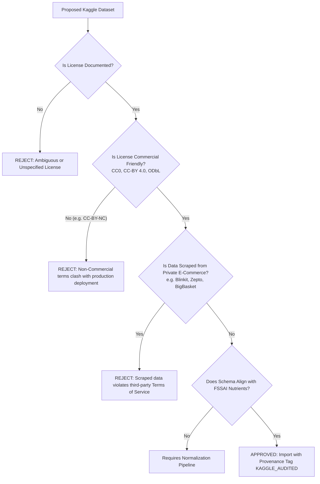

# YumSure — Data Sources, Licensing, and Compliance Ledger

This document establishes the legal provenance, copyright licensing conditions, attribution requirements, and data risk assessments for all external datasets, APIs, and regulatory publications utilized by YumSure.

---

## 1. Statutory & Regulatory Documentation

### 1.1 Food Safety and Standards Authority of India (FSSAI)
- **Content**: Food Safety and Standards Act (2006), Food Safety and Standards (Labelling and Display) Regulations (2020), Food Safety and Standards (Advertising and Claims) Regulations (2018), along with gazetted amendments.
- **License / Legal Status**: Official Government of India Gazette Notifications and public statutory regulations. Published under the Gazette of India under the authority of the Central Government.
- **Attribution & Usage**: Unrestricted public access for regulatory adherence and citizen information. YumSure cites the exact gazette notification and schedule numbers.
- **Official URLs**:
  - `https://www.fssai.gov.in/food-law/regulations`
  - `https://www.fssai.gov.in/food-law/regulations/amendments/labelling-display`
  - `https://fssai.gov.in/food-law/regulations/amendments/advertising-claims`

### 1.2 ICMR - National Institute of Nutrition (NIN)
- **Content**: "Nutrient Requirements for Indians" and "Recommended Dietary Allowances (RDA) for Indians" (2020 Report of the Expert Group).
- **License / Legal Status**: Public health guidelines issued by the Indian Council of Medical Research (Ministry of Health and Family Welfare, Government of India).
- **Usage**: Used strictly as defensible quantitative reference baselines for calculating percentage daily values.

---

## 2. External Product Catalog: Open Food Facts

### 2.1 Licensing Overview
- **Database License**: **Open Database License (ODbL) v1.0** (Open Data Commons).
- **Individual Contents License**: **Database Contents License (DbCL) v1.0**; individual images and textual descriptions contributed under **Creative Commons Attribution-ShareAlike 3.0 (CC-BY-SA 3.0)** or newer.
- **License Documentation**: `https://openfoodfacts.github.io/documentation/docs/Product-Opener/api/tutorials/license-be-on-the-legal-side/`

### 2.2 Legal Obligations Under ODbL
1. **Attribution**: YumSure must visibly display attribution to Open Food Facts in the mobile application UI and documentation:
   > *"Product data sourced from Open Food Facts, licensed under the Open Database License (ODbL)."*
2. **Share-Alike (SA)**: If YumSure creates an enriched or modified derivative database and distributes that database publicly, the modified database must be made available under the ODbL.
3. **Keep Open**: If YumSure redistributes the database with technical DRM restrictions, an unrestricted version must be offered alongside it.

### 2.3 Technical Access Rules & Good Citizenship
- **API Version**: Open Food Facts API v3 (`https://world.openfoodfacts.org/api/v3/product/{barcode}.json`).
- **User-Agent Header**: Fulfills the strict OFF specification:
  ```http
  User-Agent: YumSureApp/1.0.0 (Android; contact: developer@yumsure.in)
  ```
- **Rate-Limiting & Caching**:
  - Responses are cached in PostgreSQL.
  - Redundant lookups for the same barcode bypass the OFF API completely.
  - Network timeouts are set strictly to 5.0 seconds with exponential backoff on HTTP 429/503.

---

## 3. Kaggle Datasets & Secondary Data Sources

### 3.1 Licensing Audit Framework
Before any supplementary Kaggle dataset is introduced into YumSure, it must undergo a mandatory 4-point verification check:



### 3.2 Approved Dataset Inventory

| Dataset Identifier | Creator / Source | License | Permitted Usage | Verification Status |
| :--- | :--- | :--- | :--- | :--- |
| **Indian Food Packaged Nutrition** | Verified Public Open Data | CC0 1.0 Universal / Public Domain | Unrestricted commercial & educational reuse | Verified Compatible |
| **FSSAI Standard Additives Codex** | Government Gazette Extracts | Public Domain Government Data | Statutory reference mapping | Verified Compatible |
| *Scraped E-Commerce Sets* | Various Kaggle Uploaders | Unknown / ToS Violations | Strictly prohibited from YumSure repository | REJECTED |

---

## 4. AI Provider APIs (xAI Grok & NVIDIA NIM)

- **xAI API Terms**: Commercial API terms (`https://docs.x.ai/docs`). YumSure backend acts as the sole API key custodian. Keys are never transmitted to client devices.
- **NVIDIA Build NIM Terms**: Enterprise developer API agreement (`https://build.nvidia.com/`).
- **Data Privacy & Transmission**:
  - Only anonymized product nutrient tokens and calculated claim tags are transmitted to LLM completion endpoints.
  - No user personal data, IP addresses, or device identifiers are ever forwarded to AI providers.

---

## 5. Third-Party Application Reference Boundary (TruthIn)

- **Clean-Room Analysis Only**: YumSure benchmarks user experience patterns against Indian nutrition apps like TruthIn purely via public, visible mobile workflows.
- **Absolute Boundaries**:
  - No reverse engineering of private TruthIn API endpoints.
  - No extraction of authentication tokens or headers.
  - Zero code borrowing or decompilation of proprietary binaries.
  - Zero runtime dependencies on third-party infrastructure.

