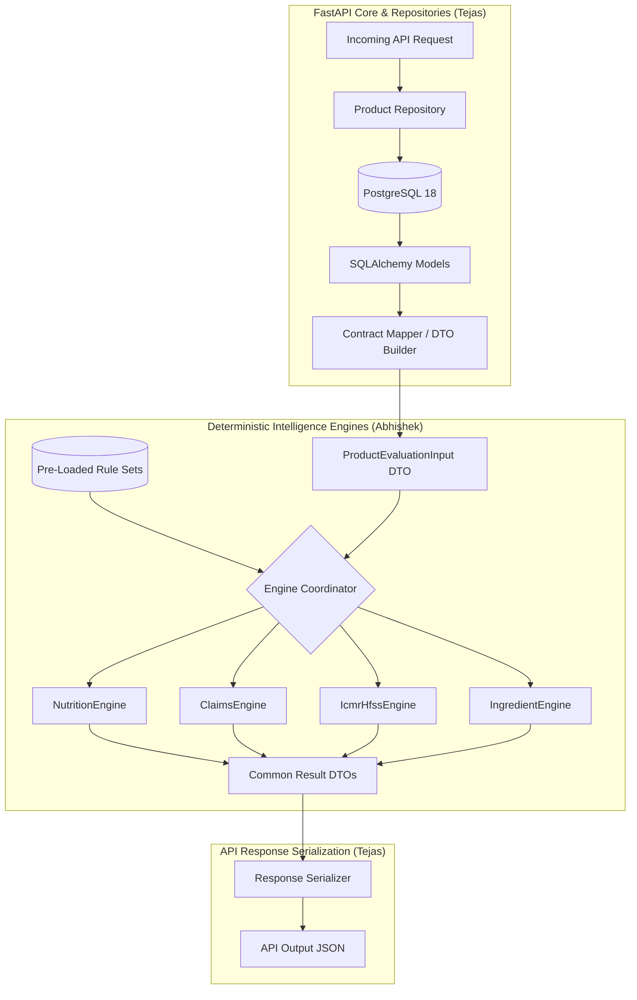

# YumSure — Phase 1B.4: Engine Contracts Specification

**Document Version**: 1.0.0  
**Status**: DRAFT CONTRACT FOR REVIEW  
**Author**: Senior Backend Architect & Nutrition Regulatory Intelligence Lead  
**Collaborator**: Tejas (Backend Foundation Lead)  
**Governing Documents**:
- `NUTRIENT_REFERENCE_AUDIT.md` (v3.0.0)
- `NUTRIENT_CLASSIFICATION_RESEARCH.md` (v4.0.0)
- `ICMR_TABLE_15_2_VERIFICATION.md` (v4.0.0)
- `DATABASE_CONTRACT_PROPOSAL.md` (v1.0.0)
- `PHASE_1B_3_REMEDIATION_REPORT.md` (v2.0.0)
- `PHASE_1B_3_SECOND_INDEPENDENT_AUDIT.md` (v1.0.0)

---

## 1. Architectural Boundaries & Guarantees

The evaluation engines in YumSure are designed as **pure, deterministic, stateless domain components**. 

### Strict Engineering Guarantees:
1. **Zero Framework Dependencies**: Engines have **no dependency on FastAPI**, HTTP request/response objects, Starlette, or Pydantic server middleware.
2. **Zero Database / ORM Dependencies**: Engines have **no dependency on SQLAlchemy**, database sessions, queries, connection pools, or lazy-loaded ORM entities. All required product data and rule definitions are passed explicitly into engine functions.
3. **Zero AI / External Network Dependencies**: Engines contain **no calls to LLMs, Grok, OpenAI, NVIDIA NIM, external APIs, or network sockets**. All evaluation logic is strictly deterministic, rule-based, and offline-capable.
4. **No Aggregate Health Scores**: Engines **never generate a composite health grade, star rating, or single "traffic light" score**. Indian statutory law and ICMR-NIN guidelines do not define or authorize aggregate product scores. Every evaluated rule produces an independent, auditable outcome.
5. **Strict Data Semantics**:
   - Preserves Tejas's four-state nutrient semantics: `PRESENT`, `EXPLICITLY_ZERO`, `NOT_DECLARED`, `UNKNOWN`. Missing values are never converted to zero.
   - Standardizes on five evaluation outcomes: `PASS`, `FAIL`, `INSUFFICIENT_DATA`, `INDETERMINATE`, `NOT_APPLICABLE`.



---

## 2. Common Input Contract (`ProductEvaluationInput`)

The engines operate on a unified, framework-independent input data transfer object (DTO). This contract decouples the engines from database schemas and external API payloads (such as Open Food Facts JSON).

```python
"""
Common Input Contract DTOs for YumSure Evaluation Engines.
Pure Python / Pydantic V2 definitions with zero database or HTTP dependencies.
"""

from enum import Enum
from decimal import Decimal
from typing import List, Optional, Dict, Any
from pydantic import BaseModel, Field, field_validator


class FoodForm(str, Enum):
    SOLID = "solid"
    LIQUID = "liquid"


class NutrientDataStatus(str, Enum):
    """Strict four-state nutrient declaration semantics."""
    PRESENT = "PRESENT"
    EXPLICITLY_ZERO = "EXPLICITLY_ZERO"
    NOT_DECLARED = "NOT_DECLARED"
    UNKNOWN = "UNKNOWN"


class MeasurementBasis(str, Enum):
    """Allowlisted statutory and analytical measurement bases."""
    PER_100G = "PER_100G"
    PER_100ML = "PER_100ML"
    PER_100KCAL = "PER_100KCAL"
    PER_SERVING = "PER_SERVING"
    PCT_TOTAL_ENERGY = "PCT_TOTAL_ENERGY"
    PCT_TOTAL_FAT = "PCT_TOTAL_FAT"


class IngredientProcessingClass(str, Enum):
    """Scientific processing classification for ICMR Table 15.2 UPF matrix."""
    WHOLE_FOOD = "WHOLE_FOOD"
    CULINARY_PROCESSED = "CULINARY_PROCESSED"
    FUNCTIONAL_ADDITIVE = "FUNCTIONAL_ADDITIVE"
    COSMETIC_ADDITIVE = "COSMETIC_ADDITIVE"
    INDUSTRIAL_FRACTION = "INDUSTRIAL_FRACTION"
    INSUFFICIENT_EVIDENCE = "INSUFFICIENT_EVIDENCE"
    UNKNOWN = "UNKNOWN"


class IngredientSugarClass(str, Enum):
    """Chemical sugar classification for FSSAI claims & ICMR HFSS evaluation."""
    NOT_SUGAR = "NOT_SUGAR"
    INTRINSIC_SUGAR = "INTRINSIC_SUGAR"
    ADDED_FREE_SUGAR = "ADDED_FREE_SUGAR"
    SUGAR_SUBSTITUTE_SWEETENER = "SUGAR_SUBSTITUTE_SWEETENER"
    NON_NUTRITIVE_SWEETENER = "NON_NUTRITIVE_SWEETENER"
    POLYOL = "POLYOL"
    INSUFFICIENT_EVIDENCE = "INSUFFICIENT_EVIDENCE"
    UNKNOWN = "UNKNOWN"


class NutrientObservationInput(BaseModel):
    """
    Standardized observation of a single nutrient for a product.
    Strictly preserves four-state declaration status.
    """
    nutrient_code: str = Field(..., description="Canonical nutrient slug, e.g. 'protein', 'added_sugars', 'sodium'")
    per_100g_value: Optional[Decimal] = Field(None, description="Quantitative value per 100g or 100ml")
    per_serving_value: Optional[Decimal] = Field(None, description="Quantitative value per serving")
    unit: str = Field(..., description="Measurement unit, e.g. 'g', 'mg', 'kcal'")
    data_status: NutrientDataStatus = Field(..., description="Four-state declaration status from product label")

    @field_validator("per_100g_value", "per_serving_value", mode="after")
    def validate_status_value_consistency(cls, v: Optional[Decimal], info) -> Optional[Decimal]:
        # Values must be None if status is NOT_DECLARED or UNKNOWN
        return v


class IngredientObservationInput(BaseModel):
    """
    Standardized observation of a single ingredient from the product label.
    Preserves descending weight sequence order mandated by FSSAI.
    """
    ingredient_code: str = Field(..., description="Canonical ingredient slug or INS number")
    declared_label_text: str = Field(..., description="Exact verbatim text from packaging")
    sequence_order: int = Field(..., ge=1, description="1-based descending weight order")
    declared_percentage: Optional[Decimal] = Field(None, ge=0, le=100, description="Quantitative QUID percentage if declared")
    ins_number: Optional[str] = Field(None, description="INS additive number, e.g. '330', '951'")
    is_fssai_major_allergen: bool = Field(False, description="Flag for FSSAI Schedule II major allergens")
    processing_classification: IngredientProcessingClass = Field(
        default=IngredientProcessingClass.UNKNOWN,
        description="Scientific processing classification"
    )
    sugar_classification: IngredientSugarClass = Field(
        default=IngredientSugarClass.UNKNOWN,
        description="Chemical sugar classification"
    )
    classification_evidence: Optional[str] = Field(None, description="Scientific provenance for classifications")


class DeclaredClaimInput(BaseModel):
    """Voluntary marketing claims printed on product packaging."""
    claim_code: str = Field(..., description="Claim slug, e.g. 'TRANS_FAT_FREE', 'NO_ADDED_SUGAR'")
    raw_label_statement: str = Field(..., description="Verbatim marketing statement from front of pack")


class ProductEvaluationInput(BaseModel):
    """
    Root framework-independent input contract for all YumSure evaluation engines.
    """
    product_id: Optional[str] = Field(None, description="Unique internal UUID or external barcode")
    product_name: str = Field(..., description="Product commercial name")
    brand_name: Optional[str] = Field(None, description="Brand name")
    food_form: FoodForm = Field(..., description="Physical state: 'solid' or 'liquid'")
    food_category: Optional[str] = Field(None, description="Standard category, e.g. 'BEVERAGE', 'CEREAL'")
    package_size: Optional[str] = Field(None, description="Package declaration, e.g. '200g', '1L'")
    serving_size_value: Optional[Decimal] = Field(None, description="Serving size numeric value")
    serving_size_unit: str = Field("g", description="Serving unit, e.g. 'g', 'ml'")
    
    # Normalized Observations
    nutrients: Dict[str, NutrientObservationInput] = Field(
        default_factory=dict,
        description="Nutrient observations keyed by canonical nutrient_code"
    )
    ingredients: List[IngredientObservationInput] = Field(
        default_factory=list,
        description="Ordered ingredient observations"
    )
    declared_claims: List[DeclaredClaimInput] = Field(
        default_factory=list,
        description="Marketing claims printed on the label requiring verification"
    )
    data_source_id: Optional[str] = Field(None, description="Provenance tracking ID (e.g. 'open_food_facts')")
```

---

## 3. Common Evaluation Result Contract (`RuleEvaluationResult`)

All four engines output results conforming to a single, standardized structure.

### 3.1 Standardized Five Outcomes
Every rule evaluated across all engines yields exactly one of the five legal/analytical outcomes:
1. **`PASS`**: The product fully satisfies the statutory condition, threshold, or criteria.
2. **`FAIL`**: The product conclusively breaches or fails the criteria.
3. **`INSUFFICIENT_DATA`**: A required nutrient declaration or ingredient evidence is missing from the label (e.g. `added_sugars = NOT_DECLARED`).
4. **`INDETERMINATE`**: The declared facts are present, but ambiguous scientific evidence prevents conclusive classification without recipe audits (e.g. simple functional additives in whole foods).
5. **`NOT_APPLICABLE`**: The rule explicitly does not apply to this food form, category, or claim scope (e.g. evaluating Table 15.2 solid-matrix calorie bands on a beverage).

### 3.2 Output DTOs
```python
"""
Common Output Contract DTOs for YumSure Evaluation Engines.
"""

from enum import Enum
from typing import List, Optional, Dict, Any
from pydantic import BaseModel, Field


class EvaluationStatus(str, Enum):
    PASS = "PASS"
    FAIL = "FAIL"
    INSUFFICIENT_DATA = "INSUFFICIENT_DATA"
    INDETERMINATE = "INDETERMINATE"
    NOT_APPLICABLE = "NOT_APPLICABLE"


class RuleEvaluationResult(BaseModel):
    """
    Standard atomic evaluation result emitted for a single rule by any engine.
    """
    engine_name: str = Field(..., description="Engine generating result: 'NUTRITION', 'CLAIMS', 'ICMR_HFSS', 'INGREDIENT'")
    rule_id: str = Field(..., description="Unique persistent identifier of the rule")
    rule_code: str = Field(..., description="Human-readable rule code, e.g. 'TRANS_FAT_FREE', 'HFSS_TABLE_15_1_SUGAR'")
    outcome: EvaluationStatus = Field(..., description="Standardized five-state evaluation outcome")
    
    # Human-Readable Explanations & Evidence
    title: str = Field(..., description="Plain-language title, e.g. 'Trans Fat Free Claim Eligibility'")
    human_readable_explanation: str = Field(..., description="Factual, neutral, evidence-grounded consumer explanation")
    evidence_used: Dict[str, Any] = Field(default_factory=dict, description="Observed values, thresholds, and ingredients evaluated")
    missing_evidence: List[str] = Field(default_factory=list, description="List of missing fields causing INSUFFICIENT_DATA")
    
    # Statutory & Source Provenance
    statutory_citation: str = Field(..., description="Exact legal or institutional citation, e.g. 'FSSAI Claims Reg 2018, Sch I, Entry 4(b)'")
    official_source_url: str = Field(..., description="Direct link to official gazette or institutional document")
    source_version: str = Field(..., description="Document publication or amendment version")
    
    # Limitations & Warnings
    warnings_or_limitations: Optional[str] = Field(None, description="Contextual warnings, e.g. 'Labelling RDI is based on adult 2,000 kcal diet'")


class EngineBatchResult(BaseModel):
    """
    Collection of atomic rule results from an engine run.
    Explicitly does NOT compute a composite score or product grade.
    """
    engine_name: str
    product_id: Optional[str]
    food_form: str
    results: List[RuleEvaluationResult] = Field(default_factory=list)
    summary_counts: Dict[EvaluationStatus, int] = Field(
        default_factory=dict,
        description="Factual count of PASS, FAIL, INSUFFICIENT_DATA, INDETERMINATE, NOT_APPLICABLE"
    )
```

---

## 4. Specific Engine Interfaces & Protocols

Each engine exposes a clean, callable interface accepting `ProductEvaluationInput` and dedicated rule definition dictionaries, returning `EngineBatchResult`.

### 4.1 Nutrition Engine (`nutrition_engine.py`)
- **Module Responsibilities**:
  1. Compares observed nutrient values against official reference values where legally authorized (specifically, **FSSAI 2,000 kcal Standard Adult Daily Reference Intakes** under Labelling Regulations 2020, Reg 5(3)(b)).
  2. Calculates `% Daily Contribution` per serving and per 100g for statutory mandatory nutrients.
  3. Evaluates nutrient observations against explicit solid (`PER_100G`) and liquid (`PER_100ML`) measurement bases.
  4. Never produces arbitrary Low/Moderate/High labels for negative nutrients, as no statutory tripartite system exists in Indian law.
- **Interface Definition**:
```python
def evaluate_nutrition(
    product: ProductEvaluationInput,
    nutrient_catalogue: Dict[str, Any]
) -> EngineBatchResult:
    """
    Evaluates product nutrient declarations against FSSAI standard reference values.
    Returns per-nutrient daily contribution percentages and missing-declaration notices.
    """
```

### 4.2 FSSAI Claims Engine (`claims_engine.py`)
- **Module Responsibilities**:
  1. Evaluates declared marketing claims against **FSSAI (Advertising and Claims) Regulations 2018 (Consolidated Version III, 2022)** Schedule I.
  2. Evaluates permitted claim synonyms under Schedule II separately from numerical threshold conditions.
  3. Executes compound AST condition expressions (`ClaimConditionGroup`) using allowlisted operators (`LT`, `LTE`, `GT`, `GTE`, `EQ`) and logical operators (`AND`, `OR`).
  4. Evaluates ingredient-dependent claims, specifically Regulation 6(1) "No Added Sugar" (validating absence of added sugars, absence of sugar-substitute ingredients, presence of naturally occurring sugars statement).
  5. Correctly applies statutory multi-base alternatives (e.g. Protein claim satisfying $\ge 5.4\text{g/100g}$ OR $\ge 2.7\text{g/100ml}$ OR $\ge 2.7\text{g/100 kcal}$).
- **Interface Definition**:
```python
def evaluate_claims(
    product: ProductEvaluationInput,
    rules: List[Dict[str, Any]],
    synonym_registry: Dict[str, List[str]]
) -> EngineBatchResult:
    """
    Evaluates voluntary marketing claims against statutory FSSAI Schedule I & Schedule II conditions.
    """
```

### 4.3 ICMR-HFSS Engine (`icmr_hfss_engine.py`)
- **Module Responsibilities**:
  1. Evaluates nutrient densities against **ICMR-NIN Dietary Guidelines for Indians (DGI) 2024, Guideline 15, Table 15.1** Thresholds of Concern (Energy, Salt, Added Sugar, Added Fat).
  2. Evaluates the independent **Table 15.2 Food Classification Matrix** ($3 \times 3$ grid of Groups A, B, C $\times$ Categories 1, 2, 3).
  3. Preserves the strict demarcation between Ultra-Processed Foods (Group C) and HFSS calorific density (Categories 2 and 3). Cell C1 is conclusively reported as `is_upf=True, is_hfss=False`.
  4. Evaluates Table 15.2 as `NOT_APPLICABLE` for liquid products, as the source text provides no Category 1–3 energy bands for beverages.
  5. Never infers added fat from total fat. If `added_fat` declaration is missing, returns `INSUFFICIENT_DATA`.
  6. Emits `INDETERMINATE` when ingredient evidence is insufficient to distinguish between culinary processed foods (Group B) and matrix-deconstructed UPF (Group C).
- **Interface Definition**:
```python
def evaluate_icmr_hfss(
    product: ProductEvaluationInput,
    threshold_rules: List[Dict[str, Any]],
    matrix_rules: List[Dict[str, Any]]
) -> EngineBatchResult:
    """
    Evaluates product against ICMR-NIN DGI 2024 Guideline 15 (Tables 15.1 and 15.2).
    Outputs both nutrient-specific concern thresholds and 2D matrix classification.
    """
```

### 4.4 Ingredient Engine (`ingredient_engine.py`)
- **Module Responsibilities**:
  1. Evaluates ingredient lists for statutory safety rules under FSSAI Additive Regulations 2011 (Good Manufacturing Practice vs Maximum Permissible Limits in ppm).
  2. Detects mandatory packaging warning statements mandated by FSSAI Labelling Regulations 2020 Schedule II (e.g. Aspartame phenylketonurics warning, polyol laxative warning, added caffeine warning).
  3. Audits declared ingredients against FSSAI Major Allergen declarations (Cereals containing gluten, Crustaceans, Eggs, Fish, Peanuts, Soybeans, Milk, Tree nuts).
  4. Classifies sweetener and sugar chemistry into intrinsic sugars vs added free sugars vs non-nutritive intense sweeteners.
  5. Returns `UNKNOWN` or `INSUFFICIENT_EVIDENCE` for uncharacterized ingredients, never guessing functional class.
- **Interface Definition**:
```python
def evaluate_ingredients(
    product: ProductEvaluationInput,
    ingredient_rules: List[Dict[str, Any]],
    ingredient_catalogue: Dict[str, Any]
) -> EngineBatchResult:
    """
    Evaluates ingredient list for additive limits, mandatory warnings, allergen disclosures,
    and sweetener chemistry.
    """
```

---

## 5. Architectural Alignment with Tejas's Backend Core

| Engine Input / Output Component | Backend Relational Source / Model | Serializer / DTO Bridge |
| :--- | :--- | :--- |
| `ProductEvaluationInput.nutrients` | `ProductNutrient` (`product_nutrients`) | Maps 4-state `data_status`, `per_100g_value`, and `unit`. |
| `ProductEvaluationInput.ingredients` | `ProductIngredient` (`product_ingredients`) joined with `Ingredient` (`ingredients`) | Maps sequence order, INS code, and scientific classification fields. |
| `claims_engine` Rules | `RegulatoryClaimRule` (`regulatory_claim_rules`) | Maps `condition_expression JSONB` and `permitted_synonyms_schedule_ii JSONB`. |
| `icmr_hfss_engine` Thresholds | `IcmrNutrientThresholdRule` (`icmr_nutrient_threshold_rules`) | Maps Table 15.1 threshold records. |
| `icmr_hfss_engine` Matrix | `IcmrMatrixRule` (`icmr_matrix_rules`) | Maps Table 15.2 A1–C3 cells and guidance. |
| `ingredient_engine` Rules | `IngredientRule` (`ingredient_rules`) | Maps warning statements and ppm limits. |
| `RuleEvaluationResult` | `AIExplanation` / FastAPI Response Schema | Serialized to client response or cached in database telemetry. |

