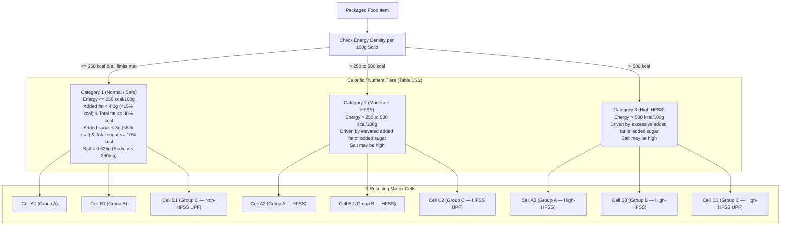

# YumSure — Phase 1A.4: ICMR-NIN Table 15.2 Verification & Logic Correction Report

**Document Version**: 4.0.0 (Phase 1A.4 Logic Corrections)  
**Date**: November 2026 (Verified as of 3 November 2026)  
**Investigator**: Nutrition Research Analyst, YumSure Technical & Regulatory Architecture Team  
**Official Document**: ICMR-National Institute of Nutrition, *Dietary Guidelines for Indians (DGI)* (May 2024), Guideline 15, pp. 93–102 (specifically Table 15.1 on p. 95 and Table 15.2 on pp. 97–98).  
**Official Source URL**: `https://nin.res.in/dietaryguidelines/pdfjs/locale/DGI_2024.pdf`

---

## 1. Executive Summary of Corrections

Following a rigorous re-audit of the original ICMR-NIN text against Phase 1A.3, six critical corrections have been established:

1. **Energy Bands are the Primary Determinants of Categories 2 and 3**:  
   Categories 2 and 3 in Table 15.2 are defined strictly by **energy density thresholds driven by added fat or added sugar** ($>250\text{ to } 500\text{ kcal/100g}$ for Category 2; $>500\text{ kcal/100g}$ for Category 3). An isolated breach of salt in a low-calorie solid food ($\le 250\text{ kcal/100g}$) violates the Table 15.1 nutrient threshold of concern, but **does not automatically reclassify the product into Category 2 or 3**.
2. **Dual Added vs. Total Fat/Sugar Conditions in Table 15.2**:  
   Table 15.2 codifies conditions on both added and total nutrients:
   - Added fat $< 4.2\text{ g/100g}$ ($< 15\%$ energy) **AND** total fat $\le 30\%$ energy.
   - Added sugar $< 3.0\text{ g/100g}$ ($< 5\%$ energy) **AND** total sugar $\le 10\%$ energy.
   - Salt $< 0.625\text{ g/100g}$ ($< 250\text{ mg}$ sodium).
3. **Rejection of Additive-Based UPF Shortcuts**:  
   The presence of a single additive or INS number (e.g., INS 330 citric acid, INS 500 sodium bicarbonate, or mandatory vitamin fortification) **does not** classify a product as Group C (Ultra-Processed). Group C requires extensive whole-food matrix deconstruction and cosmetic formulation.
4. **Mandatory `INDETERMINATE` Status for Ambiguous Processing**:  
   Standard packaging labels do not declare industrial shear, extrusion temperatures, or recipe-level deconstruction. When processing extent cannot be verified from label text alone, the classification must be marked **`INDETERMINATE (RESEARCH_REQUIRED)`**.
5. **Limits of Automated Classification**:  
   While Table 15.1 numeric nutrient breaches and Table 15.2 calorific bands are 100% deterministically calculable, **processing group assignment (Group A vs B vs C) cannot be fully automated from packaging labels alone**.
6. **ICMR-NIN Copyright & Prior Permission Barrier**:  
   ICMR-NIN holds strict copyright over the 2024 Guidelines. Commercial software product integration requires **prior written authorization from the Director, ICMR-NIN**.

---

## 2. Official Definitions of Processing Groups A, B, and C (Table 15.2, pp. 97–98)

*Transcribed faithfully from the official text:*

* **Group A: Minimally Processed Foods**:  
  > *"Edible portion is unaltered for consumption, and nutrient and fibre losses are minimal. Foods prepared using common traditional culinary ingredients (local spices, salt, sugar, oils) without industrial additives (preservatives, artificial colours, artificial flavours, synthetic sweeteners, chemical emulsifiers)."*  
  - *Scope*: Fresh whole foods, minimally polished rice, whole wheat flour from local mills, whole pulses, fresh milk, unpreserved frozen produce, fresh meat, fish, eggs, and freshly cooked dishes made from whole ingredients.
* **Group B: Moderately Processed Foods**:  
  > *"Foods that have undergone moderate industrial or culinary processing (milling, cracking, drying, pressing, parboiling, baking) without chemical or cosmetic additives. May involve basic culinary ingredients like salt, vegetable oils, or sugar."*  
  - *Scope*: Foods where the edible portion may be combined or altered, but **contain no chemical/cosmetic additives** (e.g., artisan whole-grain breads made without improvers, unflavored rolled oats, plain curd, paneer, traditional preparations).
* **Group C: Extensively / Ultra-Processed Foods (UPFs)**:  
  > *"Edible portion is completely altered and does not resemble its original state. These foods undergo heavy industrial processing, resulting in a significant loss of fibre and micronutrients, and are mass-produced formulations containing multiple industrial ingredients and cosmetic additives (artificial colours, flavours, preservatives, emulsifiers, synthetic sweeteners, and bleaching agents)."*  
  - *Scope*: Formulations deconstructing whole foods into isolated fractions (maltodextrin, protein isolates, inverted sugars, hydrogenated fats), mass-produced commercial sweet biscuits, extruded snacks, instant noodles, carbonated beverages, confectionery, reconstructed nuggets.

---

## 3. Verified Criteria for Categories A1 Through C3 (Table 15.2)

### 3.1 Group A Cells
* **Cell A1**: Group A processing + Category 1 criteria ($\text{Energy} < 250\text{ kcal}$, added fat $<4.2\text{g}$, total fat $\le 30\%$ kcal, added sugar $<3\text{g}$, total sugar $\le 10\%$ kcal, salt $<0.625\text{g}$).  
  *Classification*: **Non-HFSS, Minimally Processed Food**.
* **Cell A2**: Group A processing + Category 2 energy ($>250\text{ to } 500\text{ kcal/100g}$) driven by cooking oils/ghee/sugar.  
  *Examples*: Freshly made puris, samosas, traditional halwa.  
  *Classification*: **HFSS Food (Category 2), Minimally Processed**.
* **Cell A3**: Group A processing + Category 3 energy ($> 500\text{ kcal/100g}$) driven by concentrated ghee/sugar.  
  *Examples*: Ghee laddus, mysore pak.  
  *Classification*: **High-HFSS Food (Category 3), Minimally Processed**.

### 3.2 Group B Cells
* **Cell B1**: Group B processing + Category 1 criteria ($\text{Energy} < 250\text{ kcal/100g}$, all nutrient thresholds respected).  
  *Examples*: Plain rolled oats, parboiled rice, plain curd, paneer without additives.  
  *Classification*: **Non-HFSS, Moderately Processed Food**.
* **Cell B2**: Group B processing + Category 2 energy ($>250\text{ to } 500\text{ kcal/100g}$).  
  *Examples*: Baked goods with simple butter/sugar without improvers, roasted namkeens.  
  *Classification*: **HFSS Food (Category 2), Moderately Processed**.
* **Cell B3**: Group B processing + Category 3 energy ($> 500\text{ kcal/100g}$).  
  *Examples*: Oil-roasted salted nuts, high-fat nut/seed pastes.  
  *Classification*: **High-HFSS Food (Category 3), Moderately Processed**.

### 3.3 Group C Cells
* **Cell C1**: Group C processing + Category 1 criteria ($\text{Energy} < 250\text{ kcal/100g}$, all nutrient thresholds respected).  
  *Examples*: Sliced commercial bread with preservatives/emulsifiers, plain breakfast flakes.  
  *Classification*: **Non-HFSS, Ultra-Processed Food (UPF)**.  
  *(Confirms that processing level and HFSS status are independent!)*
* **Cell C2**: Group C processing + Category 2 energy ($>250\text{ to } 500\text{ kcal/100g}$) driven by added sugars/fats.  
  *Examples*: Mass-manufactured sweet biscuits, cakes, instant noodles, extruded snacks.  
  *Classification*: **HFSS Food (Category 2) & Ultra-Processed Food (UPF)**.
* **Cell C3**: Group C processing + Category 3 energy ($> 500\text{ kcal/100g}$) driven by excessive industrial fats/sugars.  
  *Examples*: Commercial potato chips, cream biscuits, chocolate confectionery.  
  *Classification*: **High-HFSS Food (Category 3) & Ultra-Processed Food (UPF)**.

---

## 4. Disentangling Nutrient Breaches vs. Category Assignment

A fundamental correction from Phase 1A.3:
- **Table 15.1 Thresholds of Concern**:
  - Energy: $>250\text{ kcal}$ (solids) / $>70\text{ kcal}$ (liquids)
  - Salt: $>625\text{ mg}$ (solids) / $>175\text{ mg}$ (liquids)
  - Added Sugar: $>3.0\text{ g}$ (solids) / $>2.0\text{ g}$ (liquids)
  - Added Fat: $>4.2\text{ g}$ (solids) / $>1.5\text{ g}$ (liquids)
- **Table 15.2 Category Assignment**:
  - Breaching a single nutrient threshold in Table 15.1 flags that nutrient as a **"Nutrient of Concern in Excess"**.
  - However, **Category 2 is NOT assigned merely because salt $>625\text{ mg}$**.
  - Category 2 is explicitly defined by **energy density between $>250$ and $500\text{ kcal/100g}$** driven by added fat or added sugar.
  - Category 3 is explicitly defined by **energy density $>500\text{ kcal/100g}$** driven by added fat or added sugar.
  - A food with $180\text{ kcal/100g}$ and $700\text{ mg}$ salt has a **salt breach under Table 15.1**, but stays within **Category 1 calorific bounds**. The engine must report:  
    `hfss_threshold_breaches: ["SALT_EXCESS"]`, while `energy_tier: "Category 1 (<250 kcal)"`.

---

## 5. Feasibility of Automated Classification & Mandatory `INDETERMINATE` Handling

| Pipeline Component | Data Available on Standard Indian Packaging | Feasibility of Automated Classification | Engine Handling |
| :--- | :--- | :--- | :--- |
| **Table 15.1 Energy Breach** | Mandatory declared energy (kcal) | **100% Deterministic** | Auto-evaluated |
| **Table 15.1 Salt Breach** | Mandatory declared sodium (mg) | **100% Deterministic** ($\text{Salt} = \text{Na} \times 2.5$) | Auto-evaluated |
| **Table 15.1 Added Sugar** | Declared added sugars (g) | **Deterministic where declared** | Auto-evaluated if declared; else `UNDECLARED` |
| **Table 15.1 Added Fat** | Only *Total Fat* declared; *Added Fat* not segregated | **Non-Deterministic** without recipe | Flagged `INDETERMINATE_ADDED_FAT` |
| **Table 15.2 Energy Tiers** | Mandatory declared energy (kcal) | **100% Deterministic for Solids** | Auto-evaluated |
| **Group A vs B vs C Assignment** | Ingredient list & INS additive numbers | **Partially Deterministic** | If clear industrial markers (HFCS, maltodextrin, artificial sweeteners), flag Group C. **If ambiguous or simple functional additives, flag `INDETERMINATE`**. |

> **Engine Rule**: YumSure must **never invent processing shortcuts**. When processing level or ingredient deconstruction cannot be proven from label facts, the system must emit:  
> `"processing_group": "INDETERMINATE (RESEARCH_REQUIRED: Insufficient formulation data to distinguish Group B vs Group C)"`.

---

## 6. ICMR-NIN Copyright & Commercial Permission Requirement

### 6.1 Legal Status of the 2024 Guidelines
- **Publisher**: ICMR-National Institute of Nutrition (NIN), Hyderabad (Department of Health Research, Government of India).
- **Copyright Notice**: **© Copyright: ICMR-National Institute of Nutrition (NIN), Hyderabad. All rights reserved.**
- **Legal Terms**:
  1. The publication is protected under the Indian Copyright Act, 1957.
  2. Free download and dissemination are permitted for **personal, non-profit, educational, and public health awareness**.
  3. **Commercial Prohibition**: Commercial exploitation, reproduction, or incorporation into commercial products/software is **strictly prohibited without prior written authorization**.
  4. Institutional and software adaptation historically requires prior intimation and formal clearance from the **Director, ICMR-NIN, Hyderabad**.

### 6.2 Architectural Risk & Remediation for YumSure
- If YumSure is deployed commercially, hardcoding proprietary ICMR-NIN matrix scoring or commercializing an "ICMR-NIN Certified Interpretation" exposes the project to copyright infringement claims.
- **Remediation**:
  1. Maintain ICMR-NIN references as **public health educational citations** only.
  2. The software must not claim endorsement, certification, or proprietary licensing from ICMR-NIN.
  3. Formal written intimation must be submitted to the Director, ICMR-NIN before any production commercial launch.
