# YumSure — Implementation Progress Tracker

This document provides a live tracking ledger for the phased delivery of YumSure under the strict 24-hour hackathon timeline.

---

## 1. Project Phase Breakdown

```mermaid
gantt
    title YumSure 24-Hour Phased Delivery Plan
    dateFormat  HH:mm
    axisFormat  %H:%M
    section Foundation
    Phase 0 - Arch & Docs Foundation :done, p0, 00:00, 01:30
    section Core Backend
    Phase 1 - PostgreSQL Schema & Core Models :active, p1, 01:30, 03:00
    Phase 2 - Deterministic Nutrition & Claims Engines :p2, 03:00, 06:00
    Phase 3 - Open Food Facts API v3 Integration :p3, 06:00, 08:30
    Phase 4 - Ingredient & Allergen Parser Engine :p4, 08:30, 11:00
    section Intelligence & Client
    Phase 5 - AI Explanation Layer & Safe Fallback :p5, 11:00, 13:30
    Phase 6 - Flutter Android App & Barcode Scanner :p6, 13:30, 19:00
    section Verification
    Phase 7 - End-to-End Runtime Demo & Presentation :p7, 19:00, 22:00
```

---

## 2. Phase-by-Phase Deliverables Status

| Phase | Description | Scope & Major Deliverables | Status |
| :--- | :--- | :--- | :--- |
| **Phase 0** | **Architecture, Docs & Project Structure** | System architecture, ER diagrams, 10 statutory docs, folder structures for FastAPI and Flutter, venv establishment. | **COMPLETED** |
| **Phase 1** | **PostgreSQL Setup & Database Models** | Async SQLAlchemy models for Products, Nutrients, Ingredients, Rules, Migrations, Seed baseline ICMR-NIN & FSSAI rules. | *PENDING APPROVAL* |
| **Phase 2** | **Deterministic Nutrition & Claims Engines** | Implementation of `nutrition_engine.py` (Low/Mod/High classifications per 100g) and `claims_engine.py` (Schedule II FSSAI checks). | *PENDING* |
| **Phase 3** | **Open Food Facts API v3 Client & API Layer** | Custom User-Agent HTTPX client, rate limiter, payload normalizer, GET `/api/v1/products/{barcode}` endpoint. | *PENDING* |
| **Phase 4** | **Ingredient & Allergen Intelligence Engine** | Additive INS decoder, FSSAI major allergen detector, functional group aggregator (refined carbs, fats, sweeteners). | *PENDING* |
| **Phase 5** | **AI Explanation Layer with Local Fallback** | Grok (xAI) and NVIDIA NIM service abstraction, strict prompt guardrails, zero hallucination checks, offline template fallback. | *PENDING* |
| **Phase 6** | **Flutter Android Application** | Camera barcode scanner UI, nutrient cards, claims verification badges, allergen warning tags, plain-English summary sheet. | *PENDING* |
| **Phase 7** | **End-to-End Validation & Judge Deck** | Manual end-to-end verification across 5 real Indian packaged products (Biscuits, Noodles, Health Drink, Juice, Namkeen), demo script. | *PENDING* |

---

## 3. Detailed Audit Log of Completed Actions

### Phase 0: Workspace Foundation & Architecture
- **Environment Discovery**: Verified Python 3.14.6 (`C:\Python314\python.exe`), Dart SDK 3.8.1 (`D:\Download\flutter_windows_3.32.8-stable\flutter\bin\cache\dart-sdk`), and PostgreSQL 18.4 (`C:\Program Files\PostgreSQL\18\bin\psql.exe`).
- **Backend Directory Setup**: Re-created clean virtual environment `backend\venv` with Python 3.14, created modular backend architecture directories: `app/api/v1/endpoints`, `app/core`, `app/db`, `app/models`, `app/schemas`, `app/services`.
- **Frontend Directory Setup**: Created structured Flutter project layout: `frontend/lib/core`, `frontend/lib/models`, `frontend/lib/services`, `frontend/lib/ui/screens`, `frontend/lib/ui/widgets`, `frontend/assets`.
- **Documentation Suite Created**:
  1. `README.md`
  2. `PROJECT_ARCHITECTURE.md`
  3. `DATABASE_DESIGN.md`
  4. `API_DOCUMENTATION.md`
  5. `NUTRITION_RULES.md`
  6. `INGREDIENT_CATALOGUE.md`
  7. `DATA_SOURCES_AND_LICENCES.md`
  8. `IMPLEMENTATION_PROGRESS.md`
  9. `JUDGE_PRESENTATION_GUIDE.md`
  10. `KNOWN_LIMITATIONS.md`

