# YumSure — Implementation Progress Tracker

This document provides a live tracking ledger for the phased delivery of YumSure under the strict 24-hour hackathon timeline.

---

## 1. Project Phase Breakdown

```mermaid
gantt
    title YumSure 24-Hour Phased Delivery Plan
    dateFormat  HH:mm
    axisFormat  %H:%M
    section Foundation
    Phase 0 - Arch & Docs Foundation :done, p0, 00:00, 01:30
    section Core Backend
    Phase 1A - Environment & DB Foundation :done, p1a, 01:30, 02:45
    Phase 1B - PostgreSQL Migrations & 13 Tables :done, p1b, 02:45, 03:30
    Phase 2 - Deterministic Nutrition & Claims Engines :active, p2, 03:30, 06:00
    Phase 3 - Open Food Facts API v3 Integration :p3, 06:00, 08:30
    Phase 4 - Ingredient & Allergen Parser Engine :p4, 08:30, 11:00
    section Intelligence & Client
    Phase 5 - AI Explanation Layer & Safe Fallback :p5, 11:00, 13:30
    Phase 6 - Flutter Android App & Barcode Scanner :p6, 13:30, 19:00
    section Verification
    Phase 7 - End-to-End Runtime Demo & Presentation :p7, 19:00, 22:00
```

---

## 2. Phase-by-Phase Deliverables Status

| Phase | Description | Scope & Major Deliverables | Status |
| :--- | :--- | :--- | :--- |
| **Phase 0** | **Architecture, Docs & Project Structure** | System architecture, ER diagrams, 10 statutory docs, folder structures for FastAPI and Flutter, venv establishment. | **COMPLETED** |
| **Phase 1A** | **Backend Environment & Database Foundation** | Virtual environment, dependencies, configuration, SQLAlchemy 2.0 foundation, 11 ORM models with 4-state nutrient semantics, Alembic configuration. | **COMPLETED & VERIFIED** |
| **Phase 1B** | **PostgreSQL Migrations & 13 Tables** | Live migration to PostgreSQL 18 (`yumsure_db`), revisions `0001_initial_foundation` and `0002_enhance_rules` applied. All 13 tables verified. | **COMPLETED & VERIFIED** |
| **Phase 2** | **Deterministic Nutrition & Claims Engines** | Implementation of `nutrition_engine.py` (ICMR-NIN Tables 15.1 and 15.2) and `claims_engine.py` (FSSAI Schedule I & II AST checks). | **READY TO IMPLEMENT** |
| **Phase 3** | **Open Food Facts API v3 Client & API Layer** | Custom User-Agent HTTPX client, rate limiter, payload normalizer, GET `/api/v1/products/{barcode}` endpoint. | *PENDING* |
| **Phase 4** | **Ingredient & Allergen Intelligence Engine** | Additive INS decoder, FSSAI major allergen detector, functional group aggregator (refined carbs, fats, sweeteners). | *PENDING* |
| **Phase 5** | **AI Explanation Layer with Local Fallback** | Grok (xAI) and NVIDIA NIM service abstraction, strict prompt guardrails, zero hallucination checks, offline template fallback. | *PENDING* |
| **Phase 6** | **Flutter Android Application** | Camera barcode scanner UI, nutrient cards, claims verification badges, allergen warning tags, plain-English summary sheet. | *PENDING* |
| **Phase 7** | **End-to-End Validation & Judge Deck** | Manual end-to-end verification across 5 real Indian packaged products (Biscuits, Noodles, Health Drink, Juice, Namkeen), demo script. | *PENDING* |

---

## 3. Detailed Audit Log of Completed Actions

### Phase 0: Workspace Foundation & Architecture
- **Environment Discovery**: Verified Python 3.13.11, PostgreSQL 18.0.4.0 CLI (`C:\Program Files\PostgreSQL\18\bin\psql.exe`).
- **Documentation Suite Created**: 10 statutory documents specifying database design, statutory nutrition rules, ingredient catalogue, and architecture.

### Phase 1A: Backend Environment & Database Foundation
- **Virtual Environment**: Created project-local `backend/venv` with Python 3.13.11.
- **Dependencies Installed**: FastAPI 0.162.0, Uvicorn 0.54.0, SQLAlchemy 2.0.55, Alembic 1.20.1, Psycopg 3.3.7 with binary C-extensions, Pydantic 2.14.2, Pydantic-settings 2.16.2, Python-dotenv 1.2.4. Verified clean imports.
- **Environment Configuration**: Created `backend/.env.example`, `backend/.env`, and implemented `app.core.config.Settings` with password masking.
- **Database Engine & Session**: Synchronous engine with connection pooling (`pool_pre_ping=True`, `pool_recycle=1800`), sessionmaker, `get_db` FastAPI dependency, and `check_db_connectivity`.
- **Declarative ORM Models**: Implemented 11 models registering cleanly in `Base.metadata`.

### Phase 1B: PostgreSQL Migrations & 13 Tables
- **PostgreSQL Connectivity**: Connected to live PostgreSQL 18 server at `localhost:5432/yumsure_db`.
- **Alembic Revisions Applied**:
  - `0001_initial_foundation`: Created baseline tables (`products`, `nutrients`, `product_nutrients`, `ingredients`, `product_ingredients`, `data_sources`, `nutrition_interpretation_rules`, `regulatory_claim_rules`, `ingredient_rules`, `ai_explanations`, `scan_history`).
  - `0002_enhance_rules`: Added ICMR Table 15.1 (`icmr_nutrient_threshold_rules`) and Table 15.2 (`icmr_matrix_rules`), AST JSONB column to `regulatory_claim_rules`, and ingredient processing/sugar classifications.
- **Table Verification**: All 13 tables confirmed present in PostgreSQL `information_schema`.
- **Current Revision**: `0002_enhance_rules (head)` verified in `alembic_version`.
- **Automated Tests**: 8/8 tests passing in `backend/tests/test_remediation_audit.py`.
