# YumSure — Implementation Progress Tracker

This document provides a live tracking ledger for the phased delivery of YumSure under the strict 24-hour hackathon timeline.

---

## 1. Project Phase Breakdown

```mermaid
gantt
    title YumSure 24-Hour Phased Delivery Plan
    dateFormat  HH:mm
    axisFormat  %H:%M
    section Foundation & Arch
    Phase 0 - Arch & Docs Foundation :done, p0, 00:00, 01:30
    section Frontend
    Flutter Phase 1 - UI System & Nutrition Screen :done, fp1, 01:30, 04:30
    Flutter Phase 2 - Home Screen Implementation :done, fp2, 04:30, 06:30
    Flutter Phase 3 - Search Screen Implementation :done, fp3, 06:30, 08:00
    section Core Backend
    Phase 1A - Environment & DB Foundation :done, p1a, 01:30, 02:45
    Phase 1B - PostgreSQL Migrations & 13 Tables :done, p1b, 02:45, 03:30
    Phase 2 - Deterministic Nutrition & Claims Engines :active, p2, 03:30, 06:00
    Phase 3 - Open Food Facts API v3 Integration :p3, 06:00, 08:30
    Phase 4 - Ingredient & Allergen Parser Engine :p4, 08:30, 11:00
    section Intelligence & Client
    Phase 5 - AI Explanation Layer & Safe Fallback :p5, 14:30, 16:30
    Phase 6 - Camera Barcode Scanner & Comparison Screens :p6, 16:30, 19:30
    section Verification
    Phase 7 - End-to-End Runtime Demo & Presentation :p7, 19:30, 22:00
```

---

## 2. Phase-by-Phase Deliverables Status

| Phase | Description | Scope & Major Deliverables | Status |
| :--- | :--- | :--- | :--- |
| **Phase 0** | **Architecture, Docs & Project Structure** | System architecture, ER diagrams, 10 statutory docs, folder structures for FastAPI and Flutter, venv establishment. | **COMPLETED** |
| **Phase 1A** | **Backend Environment & Database Foundation** | Virtual environment, dependencies, configuration, SQLAlchemy 2.0 foundation, 11 ORM models with 4-state nutrient semantics, Alembic configuration. | **COMPLETED & VERIFIED** |
| **Phase 1B** | **PostgreSQL Migrations & 13 Tables** | Live migration to PostgreSQL 18 (`yumsure_db`), revisions `0001_initial_foundation` and `0002_enhance_rules` applied. All 13 tables verified. | **COMPLETED & VERIFIED** |
| **Flutter Phase 1** | **Flutter Foundation + Nutrition Visualization Screen** | Reusable design system, tokens, typography, GoRouter navigation, Dio API client, Riverpod state, complete 10-section Nutrition Screen matching `nutrition_reference.png`, loading/error/empty states. | **COMPLETED** |
| **Flutter Phase 2** | **Home Screen Implementation & Final Visual Refinement** | Reference-accurate Home Screen matching `home_reference.png` 1:1. Reconstructed background with left orange glow orb and top-right lavender wave, floating frosted hero card with 64dp gradient-rim scan button, authentic category photography crops, 84dp editorial scan insights card, continuous recent scans card, and 68dp floating bottom navigation pill. | **COMPLETED & VERIFIED** |
| **Flutter Phase 3** | **Search Screen Implementation** | Reference-accurate Search screen matching `search_reference.png` 1:1. Search header with YumSure branding, 42x42 filter/tune squircle, 48dp search pill with debounced query, separate 48x48 barcode squircle, 5 category filter capsules (All, Snacks, Beverages, Biscuits, Dairy), Popular Searches chips, Trending Products carousel with offline fallback, and search results cards with 4 nutrition badge severities. | **COMPLETED & VERIFIED** |
| **Phase 2** | **Deterministic Nutrition & Claims Engines** | Implementation of `nutrition_engine.py` (ICMR-NIN Tables 15.1 and 15.2) and `claims_engine.py` (FSSAI Schedule I & II AST checks). | **READY TO IMPLEMENT** |
| **Phase 3** | **Open Food Facts API v3 Client & API Layer** | Custom User-Agent HTTPX client, rate limiter, payload normalizer, GET `/api/v1/products/{barcode}` endpoint. | *PENDING* |
| **Phase 4** | **Ingredient & Allergen Intelligence Engine** | Additive INS decoder, FSSAI major allergen detector, functional group aggregator (refined carbs, fats, sweeteners). | *PENDING* |
| **Phase 5** | **AI Explanation Layer with Local Fallback** | Grok (xAI) and NVIDIA NIM service abstraction, strict prompt guardrails, zero hallucination checks, offline template fallback. | *PENDING* |
| **Phase 6** | **Camera Barcode Scanner & Comparison Screens** | Camera barcode scanner UI (`mobile_scanner`), Saved products, Comparison screen UI. | *PENDING* |
| **Phase 7** | **End-to-End Validation & Judge Deck** | Manual end-to-end verification across 5 real Indian packaged products (Biscuits, Noodles, Health Drink, Juice, Namkeen), demo script. | *PENDING* |

---

## 3. Detailed Audit Log of Completed Actions

### Phase 0: Workspace Foundation & Architecture
- **Environment Discovery**: Verified Python 3.13.11, PostgreSQL 18.0.4.0 CLI (`C:\Program Files\PostgreSQL\18\bin\psql.exe`).
- **Documentation Suite Created**: 10 statutory documents specifying database design, statutory nutrition rules, ingredient catalogue, and architecture.

### Phase 1A: Backend Environment & Database Foundation
- **Virtual Environment**: Created project-local `backend/venv` with Python 3.13.11.
- **Dependencies Installed**: FastAPI 0.162.0, Uvicorn 0.54.0, SQLAlchemy 2.0.55, Alembic 1.20.1, Psycopg 3.3.7 with binary C-extensions, Pydantic 2.14.2, Pydantic-settings 2.16.2, Python-dotenv 1.2.4. Verified clean imports.
- **Environment Configuration**: Created `backend/.env.example`, `backend/.env`, and implemented `app.core.config.Settings` with password masking.
- **Database Engine & Session**: Synchronous engine with connection pooling (`pool_pre_ping=True`, `pool_recycle=1800`), sessionmaker, `get_db` FastAPI dependency, and `check_db_connectivity`.
- **Declarative ORM Models**: Implemented 11 models registering cleanly in `Base.metadata`.

### Phase 1B: PostgreSQL Migrations & 13 Tables
- **PostgreSQL Connectivity**: Connected to live PostgreSQL 18 server at `localhost:5432/yumsure_db`.
- **Alembic Revisions Applied**:
  - `0001_initial_foundation`: Created baseline tables (`products`, `nutrients`, `product_nutrients`, `ingredients`, `product_ingredients`, `data_sources`, `nutrition_interpretation_rules`, `regulatory_claim_rules`, `ingredient_rules`, `ai_explanations`, `scan_history`).
  - `0002_enhance_rules`: Added ICMR Table 15.1 (`icmr_nutrient_threshold_rules`) and Table 15.2 (`icmr_matrix_rules`), AST JSONB column to `regulatory_claim_rules`, and ingredient processing/sugar classifications.
- **Table Verification**: All 13 tables confirmed present in PostgreSQL `information_schema`.
- **Current Revision**: `0002_enhance_rules (head)` verified in `alembic_version`.
- **Automated Tests**: 8/8 tests passing in `backend/tests/test_remediation_audit.py`.

### Flutter Phase 1: Flutter Foundation & Nutrition Visualization Screen
- Initialized Flutter with Android platform.
- Implemented complete design system (`app_colors.dart`, `app_spacing.dart`, `app_typography.dart`, `app_theme.dart`).
- Created Dio `ApiClient`, `ProductRepository`, Riverpod providers, and all 10 sections of `ProductDetailsScreen`.

### Flutter Phase 2: Home Screen Implementation & Milestones 1-2 Asset Reconstruction
- **Milestone 1 (Asset Audit & Finalization)**:
  - Audited and locked all 5 asset groups in `frontend/assets/`:
    - Brand Logo: Vector SVG `assets/images/yumsure_logo.svg` and high-res PNG fallback `assets/images/yumsure_logo.png`
    - Background: Static WebP `assets/backgrounds/home_bg.webp` (8.5 KB) and vector SVG `home_bg.svg` (2.5 KB) reproducing the warm ivory canvas, peach orb, and lavender planes with zero runtime blur overhead.
    - Hero Illustration: Barcode bracket vector `assets/illustrations/barcode_bracket.svg`.
    - Category Imagery: 4 curated studio photographs for Snacks, Beverages, Biscuits, and Dairy locked as `.webp` assets.
    - Typography: Complete Manrope variable and weighted TTF font family under `assets/fonts/manrope/`.
  - Documented statutory licenses and source tracking in `DATA_SOURCES_AND_LICENCES.md`.
- **Milestone 2B (Reference-Accurate Visual Reconstruction)**:
  - **Reference Analysis & Measurements**: Measured full-resolution `home_reference.png` component coordinates, spacing, ratios, and font hierarchies.
  - **Category Assets Extracted**: Extracted 4 category images directly out of `design_references/home_reference.png` into `assets/images/` as optimized WebP files (`cat_snacks.webp`, `cat_beverages.webp`, `cat_biscuits.webp`, `cat_dairy.webp`) with seamless color extensions.
  - **Logo Reconstruction**: Re-engineered `HomeHeader` with Manrope 800 wordmark (`fontSize: 25`, `letterSpacing: -0.6`, color `#141414`), orange curved smile (`#F47A38`, `strokeWidth: 2.5`) centered strictly under the `mS` junction, and a 42×42 `#EAE2F3` 2×2 grid button with 1.2px white border and soft shadow.
  - **Background Composition**: `#FDF8F4` base with top-right lavender wave (`screenWidth * 0.52` down to `220` with `LinearGradient` `#DDD2EC` to `#C7B6E2`) and left orange glow orb (`-60, 100`, `210x210`, `RadialGradient` `#FF985E` -> `#FFC89E` -> `#00FDF8F4`).
  - **Hero Card Proportions & Construction**: Rebuilt `ScanProductHeroCard` to `margin: 34`, `height: 204`, `borderRadius: 30`, frosted taupe/lavender gradient, 1.5px white border, custom-drawn 66×46 barcode illustration (4 white brackets + 6 vertical bars `[2.5, 1.5, 3.0, 1.5, 2.5, 2.0]`), and overlapping 64×64 floating circular scanner button (`bottom: -28`) with tricolor gradient rim and 4 rounded viewfinder corner brackets.
  - **Explore Categories Section**: Card `aspectRatio: 0.88`, `borderRadius: 20`, 1.0px white border, 10px horizontal spacing, authentic reference crops with warm bottom vignette overlays (Snacks `#D96E4726`, Beverages `#E61F0D09`, Biscuits `#D95C3A1E`, Dairy `#CC7D756C`), and 12.5sp white labels.
  - **Scan Insights Section**: Reconstructed compact editorial banner geometry (84dp height, 24dp radius, `#FFF9F6` with bottom-right `#FFE5DF` curved wave, 48×48 coral icon box with 3 vertical bars + dot in `#F05442`, and 34×34 white action button).
  - **Recent Scans Section**: Restructured into a continuous container (`borderRadius: 22.0`, fill `#FBF8F6`, border 1.5px white) with "See all ->" header action and compact offline fallback.
  - **Bottom Navigation**: Scaled to 68dp floating pill (`margin: 20, 0, 20, 16`, `borderRadius: 34`, fill `#FAF7F5`, 1.5px white border) with soft feathered radial lavender glow for the active Home tab.
  - **Verification**: Verified with `flutter analyze` (0 issues found), compiled debug APK, deployed to Android emulator (`emulator-5554`), and captured live verification screenshot.

### Flutter Phase 3: Search Screen Implementation (Milestone 3)
- **Background Artwork**: `#FDF8F4` Warm Ivory base with top-right lavender curve (`_SearchLavenderWavePainter`, `screenWidth * 0.48` down to 320) and ambient peach glow tint on the left.
- **Top Branding & Header**: 26px YumSure wordmark with orange smile on top-left, title row with `"Search"` (28sp, Manrope 800) and subtitle (`"Find, explore and compare packaged foods."`), and a 42×42 `#EAE2F3` filter/tune squircle button with 1.2px white border and soft shadow.
- **Search Bar Row**: 48dp expanded search pill (`#FAF7F5`, 1.5px white border, debounced input, clear action) paired with a standalone 48×48 `#EAE2F3` barcode shortcut squircle (custom 4-bracket + vertical bars barcode icon).
- **Category Filter Capsules**: 5 horizontal capsules (`All`, `Snacks`, `Beverages`, `Biscuits`, `Dairy`) with active/unselected visual states and actual Riverpod category filtering.
- **Discovery Sections**: Popular searches row with hot flame icon chip, and trending products carousel with clean offline fallback container matching Home's editorial card styling.
- **Search Results Section**: Dynamic count header, product cards with category subtitles, nutrition badges (Danger Red, Warning Amber, Good Green, Neutral Grey), chevron, and empty/offline fallback states.
- **Floating Bottom Nav Bar**: Reused with `Search` (index 1) active.
- **Verification**: `flutter analyze` passed with 0 issues. Compiled debug APK and verified.
