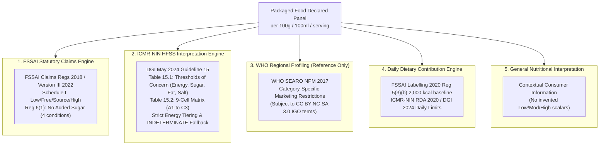

# YumSure — Phase 1A.4: Nutrient Classification & Interpretation Research (Corrected)

**Document Version**: 4.0.0 (Phase 1A.4 Logic Corrections)  
**Effective Date**: November 2026 (Verified as of 3 November 2026)  
**Auditor**: Nutrition Research Analyst, YumSure Technical & Regulatory Architecture Team  
**Governing Mandate**: Strict segregation of five nutritional domains:
1. **FSSAI Statutory Claims** (Mandatory/Binding Food Law for marketing claims).
2. **ICMR-NIN HFSS Guidance** (Institutional public health thresholds for identifying unhealthy foods).
3. **WHO Regional Nutrient Profiling** (Category-specific marketing restriction models).
4. **Daily Dietary Recommendations** (Population-level daily aggregate intake targets).
5. **General Nutrient Interpretation** (Contextual consumer density communication).

---

## 1. Five-Tier Nutritional Intelligence Framework

---

## 2. Dedicated Section: ICMR-NIN 2024 Table 15.2 Verified Methodology

### 2.1 Table 15.1: Threshold Criteria for Nutrients of Concern (PDF Page 95)
Table 15.1 prescribes quantitative upper limits per 100g (solids) and per 100ml (liquids). Exceeding these values indicates an excess in a nutrient of concern:

| Nutrient of Concern | Solids (per 100 g) | Liquids (per 100 ml) | Measurement Basis & Regulatory Scope |
| :--- | :--- | :--- | :--- |
| **Energy (Calories)** | **$> 250\text{ kcal}$** | **$> 70\text{ kcal}$** | Total caloric density from all macronutrients |
| **Salt (Sodium Chloride)** | **$> 625\text{ mg}$** | **$> 175\text{ mg}$** | Equivalent to $> 250\text{ mg}$ sodium (solids) / $> 70\text{ mg}$ sodium (liquids) |
| **Added Sugar** | **$> 3.0\text{ g}$** | **$> 2.0\text{ g}$** | Added mono- and disaccharides; intrinsic fruit/milk sugars excluded |
| **Added Fat** | **$> 4.2\text{ g}$** | **$> 1.5\text{ g}$** | Added visible cooking fats/oils; intrinsic grain/pulse lipids excluded |

---

### 2.2 Table 15.2: The Complete $3 \times 3$ Food Categorization Matrix (PDF Pages 97–98)

Table 15.2 cross-references **Processing Extent (Groups A, B, C)** with **Calorific / Nutrient Density (Categories 1, 2, 3)**, yielding 9 distinct cells:

| Processing Group | Category 1 (Normal / Safe: $\le 250\text{ kcal}$) | Category 2 (Moderate HFSS: $250\text{--}500\text{ kcal}$) | Category 3 (High HFSS: $> 500\text{ kcal}$) |
| :--- | :--- | :--- | :--- |
| **Group A: Minimally Processed** *(Unaltered whole matrix; zero chemical/cosmetic additives)* | **Cell A1: Non-HFSS Minimally Processed** Whole grains, raw pulses, fresh vegetables, fresh milk, lean meat, fresh fruits. | **Cell A2: Moderate-HFSS Minimally Processed** Traditional dishes cooked with high oil, ghee, or sugar (e.g., samosas, puris, halwa). | **Cell A3: High-HFSS Minimally Processed** Extremely calorie-dense traditional sweets/savouries (e.g., ghee laddus, mysore pak). |
| **Group B: Moderately Processed** *(Culinary alterations without chemical/cosmetic additives)* | **Cell B1: Non-HFSS Moderately Processed** Unflavored rolled oats, plain curd, paneer, parboiled rice preparations. | **Cell B2: Moderate-HFSS Moderately Processed** Traditional bakery goods with butter/sugar, roasted namkeens with oil/salt. | **Cell B3: High-HFSS Moderately Processed** High-fat culinary preparations, oil-roasted nuts with salt. |
| **Group C: Ultra-Processed (UPFs)** *(Deconstructed matrix + cosmetic industrial additives)* | **Cell C1: Non-HFSS Ultra-Processed (UPF)** Commercial sliced bread with emulsifiers/preservatives, plain commercial breakfast flakes. | **Cell C2: Moderate-HFSS Ultra-Processed (UPF)** Mass-produced sweet biscuits, cakes, instant noodles, flavoured extruded snacks. | **Cell C3: High-HFSS Ultra-Processed (UPF)** Commercial potato chips, cream biscuits, chocolate confectionery, deep-fried snacks. |

---

### 2.3 Corrected Operational Classification Logic

1. **Energy Tiers Govern Categories 2 and 3**:  
   Categories 2 and 3 in Table 15.2 are explicitly defined by **energy density driven by added fat or added sugar** ($>250\text{--}500\text{ kcal/100g}$ for Category 2; $>500\text{ kcal/100g}$ for Category 3). An isolated breach of salt in an energy-light food ($\le 250\text{ kcal/100g}$) violates the Table 15.1 nutrient threshold of concern, but **does not assign Category 2 or 3**.
2. **Dual Added vs. Total Fat/Sugar Conditions in Table 15.2**:  
   Table 15.2 specifies both added and total nutrient conditions:
   - Added fat $< 4.2\text{ g/100g}$ ($< 15\%$ energy) **AND** total fat $\le 30\%$ energy.
   - Added sugar $< 3.0\text{ g/100g}$ ($< 5\%$ energy) **AND** total sugar $\le 10\%$ energy.
   - Salt $< 0.625\text{ g/100g}$ ($< 250\text{ mg}$ sodium).
3. **UPF and HFSS Are Independent Dimensions**:  
   **Cell C1 proves that a food can be ultra-processed without being an HFSS food**. Processing degree and nutrient density must be evaluated independently.
4. **Mandatory `INDETERMINATE` Handling for Processing Groups**:  
   A product **cannot** be classified as Group C merely because an additive appears on the label. Functional additives (e.g., INS 330 citric acid, INS 500 sodium bicarbonate, yeast, vitamin fortification) do not make a food UPF. When processing details cannot be proven from label facts, the system must emit:  
   `processing_group: INDETERMINATE (RESEARCH_REQUIRED)`.
5. **Solid vs. Liquid Scope**:  
   The $250\text{ kcal}$, $250\text{--}500\text{ kcal}$, and $>500\text{ kcal}$ cutoffs apply strictly **per 100g of solid food**. Liquids are evaluated against Table 15.1's ceiling of **$70\text{ kcal/100ml}$**, $>2.0\text{ g}$ added sugar, $>1.5\text{ g}$ added fat, and $>175\text{ mg}$ salt. Multi-tier beverage categorization is unstated in the official guidelines and marked **`RESEARCH_REQUIRED`**.

---

## 3. Corrected FSSAI Schedule I & Regulation 6 Statutory Claims

*Verified against **FSSAI (Advertising and Claims) Regulations, Consolidated Version III (dated 04-10-2022)** and applicable amendments as of **3 November 2026**.*

### 3.1 Protein Claims (Schedule I, Item 3)
A claim that a food is a source of protein or high in protein is legally valid if it satisfies **any one** of the three statutory alternatives:
* **Source of Protein**:
  1. Solids: $\ge 10\%$ of adult RDA per $100\text{ g}$ ($\ge 5.4\text{ g/100g}$); **OR**
  2. Liquids: $\ge 5\%$ of adult RDA per $100\text{ ml}$ ($\ge 2.7\text{ g/100ml}$); **OR**
  3. Energy Basis: $\ge 5\%$ of adult RDA per $100\text{ kcal}$ ($\ge 2.7\text{ g / 100 kcal}$).
* **High in Protein**:
  1. Solids: $\ge 20\%$ of adult RDA per $100\text{ g}$ ($\ge 10.8\text{ g/100g}$); **OR**
  2. Liquids: $\ge 10\%$ of adult RDA per $100\text{ ml}$ ($\ge 5.4\text{ g/100ml}$); **OR**
  3. Energy Basis: $\ge 10\%$ of adult RDA per $100\text{ kcal}$ ($\ge 5.4\text{ g / 100 kcal}$).

---

### 3.2 Dietary Fibre Claims (Schedule I, Item 8)
A claim that a food is a source of dietary fibre or high in dietary fibre is legally valid if it satisfies **any one** of the three statutory alternatives:
* **Source of Dietary Fibre**:
  1. Solids: $\ge 3.0\text{ g}$ per $100\text{ g}$; **OR**
  2. Liquids: $\ge 1.5\text{ g}$ per $100\text{ ml}$; **OR**
  3. Energy Basis: $\ge 1.5\text{ g}$ per $100\text{ kcal}$.
* **High in Dietary Fibre**:
  1. Solids: $\ge 6.0\text{ g}$ per $100\text{ g}$ ; **OR**
  2. Liquids: $\ge 3.0\text{ g}$ per $100\text{ ml}$; **OR**
  3. Energy Basis: $\ge 3.0\text{ g}$ per $100\text{ kcal}$.

---

### 3.3 Fats and Fatty Acids Claims (Schedule I, Items 1 & 2)

| Claim Code | Claim Title | Food Form | Statutory Threshold Condition & Secondary Requirements |
| :--- | :--- | :--- | :--- |
| `CLAIM_LOW_FAT_S` | **Low Fat** | Solid | Not more than **$3.0\text{ g}$ of fat per $100\text{ g}$**. |
| `CLAIM_LOW_FAT_L` | **Low Fat** | Liquid | Not more than **$1.5\text{ g}$ of fat per $100\text{ ml}$**. |
| `CLAIM_FAT_FREE` | **Fat Free** | Both | Not more than **$0.5\text{ g}$ of fat per $100\text{ g}$ or $100\text{ ml}$**. |
| `CLAIM_LOW_SAT_FAT_S`| **Low Saturated Fat**| Solid | Not more than **$1.5\text{ g}$ saturated fat per $100\text{ g}$**, **AND** saturated fat must provide **$\le 10\%$ of total energy**. |
| `CLAIM_LOW_SAT_FAT_L`| **Low Saturated Fat**| Liquid | Not more than **$0.75\text{ g}$ saturated fat per $100\text{ ml}$**, **AND** saturated fat must provide **$\le 10\%$ of total energy**. |
| `CLAIM_SAT_FAT_FREE` | **Saturated Fat Free**| Both | Not more than **$0.1\text{ g}$ saturated fat per $100\text{ g}$ or $100\text{ ml}$**. |
| `CLAIM_TRANS_FAT_FREE`| **Trans Fat Free** | Both | **Strictly less than $0.2\text{ g}$ ($< 0.2\text{ g}$)** of trans fat per $100\text{ g}$ or $100\text{ ml}$ of food; **AND** saturated fat $\le 1.5\text{ g/100g}$ (solids) or $\le 0.75\text{ g/100ml}$ (liquids); **AND** saturated fat provides $\le 10\%$ of total energy. *(For edible fats/oils: strictly less than $1.0\text{ g}$ per $100\text{ g/ml}$)*. |

---

### 3.4 Sugars & Non-Addition Claims (Schedule I, Item 6 & Regulation 6(1))

| Claim Code | Claim Title | Statutory Source | Mandatory Conditions |
| :--- | :--- | :--- | :--- |
| `CLAIM_LOW_SUGARS_S` | **Low sugars** | Schedule I, Item 6 | Not more than **$5.0\text{ g}$ of total sugars per $100\text{ g}$** (solids). *(Applies to Total Sugars, not Added Sugars)*. |
| `CLAIM_LOW_SUGARS_L` | **Low sugars** | Schedule I, Item 6 | Not more than **$2.5\text{ g}$ of total sugars per $100\text{ ml}$** (liquids). *(Applies to Total Sugars)*. |
| `CLAIM_SUGARS_FREE` | **Sugars Free** / Sugar Free | Schedule I, Item 6 | Not more than **$0.5\text{ g}$ of total sugars per $100\text{ g}$ or $100\text{ ml}$**. |
| `CLAIM_NO_ADDED_SUGAR`| **No Added Sugar** / Without Added Sugars | **Regulation 6(1)** (Non-Addition Claims) | Must satisfy **ALL FOUR cumulative statutory conditions**: 1. **Reg 6(1)(a)**: No sugars of any type added (sucrose, glucose, fructose, honey, molasses, corn syrup, etc.). 2. **Reg 6(1)(b)**: No ingredients containing added sugars as an ingredient (sweetened fruit pieces, chocolate chips, jams). 3. **Reg 6(1)(c)**: No ingredients containing sugars used as substitutes for added sugars (fruit pastes, concentrated fruit juice). 4. **Reg 6(1)(d)**: Sugar content of the food not artificially increased by enzymes or other means. **Mandatory Disclosure**: If sugars naturally present, label must conspicuously state: *"CONTAINS NATURALLY OCCURRING SUGARS"*. |

---

### 3.5 Sodium Claims (Schedule I, Item 4)

| Claim Code | Claim Title | Food Form | Statutory Threshold Condition |
| :--- | :--- | :--- | :--- |
| `CLAIM_LOW_SODIUM` | **Low Sodium** / Low Salt | Both | Not more than **$0.12\text{ g}$ ($120\text{ mg}$) sodium per $100\text{ g}$ or $100\text{ ml}$**. |
| `CLAIM_VERY_LOW_SODIUM`| **Very Low Sodium** | Both | Not more than **$0.04\text{ g}$ ($40\text{ mg}$) sodium per $100\text{ g}$ or $100\text{ ml}$**. |
| `CLAIM_SODIUM_FREE` | **Sodium Free** / Salt Free | Both | Not more than **$0.005\text{ g}$ ($5\text{ mg}$) sodium per $100\text{ g}$ or $100\text{ ml}$**. |

---

## 4. Nutrient-by-Nutrient Research Ledger (10 Reporting Dimensions)

### 4.1 Energy
1. **Reference**: FSSAI Claims 2018 (Schedule I, Item 5); FSSAI Labelling 2020 Reg 5(3)(b); ICMR-NIN DGI 2024 Guideline 15 (Tables 15.1 & 15.2).
2. **Source & Page**: FSSAI Claims Version III, p. 14; DGI 2024, Table 15.1, p. 95 & Table 15.2, pp. 97–98.
3. **Low/Mod/High Categories**: No. Statutory claims define Low Energy ($\le 40\text{ kcal/100g}$ solid, $\le 20\text{ kcal/100ml}$ liquid) and Energy Free ($\le 4\text{ kcal/100ml}$). ICMR-NIN defines HFSS threshold ($> 250\text{ kcal/100g}$ solid, $> 70\text{ kcal/100ml}$ liquid) and Category tiers (Cat 1: $\le 250\text{ kcal}$; Cat 2: $250\text{--}500\text{ kcal}$; Cat 3: $> 500\text{ kcal}$).
4. **Product Interpretation**: Yes, for claim verification and ICMR-NIN HFSS classification.
5. **Solid/Liquid**: Solids vs Liquids evaluated on distinct numerical thresholds.
6. **Measurement Basis**: kcal per 100g / 100ml.
7. **Exceptions**: Table-top intense sweeteners exempted from standard energy density rules.
8. **Effective Date**: FSSAI Claims: 1 July 2019 / Oct 2022; DGI 2024: May 2024.
9. **Licensing**: FSSAI: Public Gazette; ICMR-NIN: Copyright Reserved (Commercial use requires prior written permission).
10. **Research Status**: Operational under FSSAI Claims and ICMR-NIN HFSS. Arbitrary tripartite Low/Mod/High grading is **RESEARCH_REQUIRED** and deprecated.

### 4.2 Total Carbohydrates
1. **Reference**: FSSAI Labelling 2020 Reg 5(3)(a)(iii); ICMR-NIN DGI 2024 Guideline 3.
2. **Source & Page**: FSSAI Labelling Gazette, p. 8; DGI 2024, pp. 24–32.
3. **Low/Mod/High Categories**: No.
4. **Product Interpretation**: No statutory claim or HFSS cutoff exists for total carbohydrates.
5. **Solid/Liquid**: N/A.
6. **Measurement Basis**: Declared grams per 100g/100ml.
7. **Exceptions**: None.
8. **Effective Date**: 1 July 2022.
9. **Licensing**: Public Gazette.
10. **Research Status**: **RESEARCH_REQUIRED**. Total carbohydrates cannot be graded on Low/Mod/High.

### 4.3 Total Sugar
1. **Reference**: FSSAI Claims 2018 (Schedule I, Item 6); ICMR-NIN DGI 2024 Table 15.2; WHO SEARO NPM 2017 Table 1.
2. **Source & Page**: FSSAI Claims Version III, p. 15; DGI 2024 Table 15.2, p. 97; WHO SEARO NPM, pp. 12–18.
3. **Low/Mod/High Categories**: No. FSSAI defines Low Sugars ($\le 5\text{g/100g}$ solid, $\le 2.5\text{g/100ml}$ liquid) and Sugars Free ($\le 0.5\text{g}$). Table 15.2 specifies total sugar $\le 10\%$ energy in Category 1.
4. **Product Interpretation**: Yes, for claims and energy percentage calculations.
5. **Solid/Liquid**: Distinct thresholds for solids and liquids.
6. **Measurement Basis**: Grams of total sugars per 100g/100ml and percentage of total energy.
7. **Exceptions**: Natural intrinsic fruit sugars in 100% juice without additives.
8. **Effective Date**: FSSAI: 1 July 2019 / Oct 2022; DGI 2024: May 2024.
9. **Licensing**: Public Domain & ICMR-NIN Copyright.
10. **Research Status**: Claims operational. Low/Mod/High grading is **RESEARCH_REQUIRED**.

### 4.4 Added Sugar
1. **Reference**: ICMR-NIN DGI 2024 (Guideline 15, Tables 15.1 & 15.2); FSSAI Claims 2018 (Reg 6(1)); FSSAI Labelling 2020.
2. **Source & Page**: DGI 2024, pp. 95, 97; FSSAI Claims Version III, p. 6; FSSAI Labelling, p. 8.
3. **Low/Mod/High Categories**: No. ICMR-NIN establishes HFSS threshold of concern: $> 3.0\text{ g/100g}$ (solids) and $> 2.0\text{ g/100ml}$ (liquids), and Category 1 condition $<3\text{g}$ ($<5\%$ energy). FSSAI specifies Reg 6(1) No Added Sugar claim.
4. **Product Interpretation**: Yes, product-level HFSS identification and non-addition claims.
5. **Solid/Liquid**: Applicable to both formats.
6. **Measurement Basis**: Declared grams per 100g/100ml.
7. **Exceptions**: Products with naturally occurring sugars require specific mandatory label statement.
8. **Effective Date**: DGI 2024: May 2024; FSSAI Labelling: 1 July 2022.
9. **Licensing**: Public Research & Gazette.
10. **Research Status**: Operational under ICMR-NIN HFSS and FSSAI Reg 6(1). Tripartite Low/Mod/High is **RESEARCH_REQUIRED**.

### 4.5 Protein
1. **Reference**: FSSAI Claims 2018 (Schedule I, Item 3); FSSAI Labelling 2020; ICMR-NIN RDA 2020.
2. **Source & Page**: FSSAI Claims Version III, p. 13; FSSAI Labelling, p. 12.
3. **Low/Mod/High Categories**: No. Statutory claims define Source of Protein ($\ge 10\%$ RDA solid, $\ge 5\%$ liquid, or $\ge 5\%$ per 100 kcal) and High Protein ($\ge 20\%$ solid, $\ge 10\%$ liquid, or $\ge 10\%$ per 100 kcal).
4. **Product Interpretation**: Yes, for positive marketing claims.
5. **Solid/Liquid**: Distinct conditions across solids, liquids, and kcal basis.
6. **Measurement Basis**: Grams protein per 100g, 100ml, or 100 kcal.
7. **Exceptions**: Demographic foods (infants/children) use demographic-specific ICMR RDAs.
8. **Effective Date**: 1 July 2019 / Oct 2022.
9. **Licensing**: Public Gazette.
10. **Research Status**: Claims operational. Grading standard foods as "Low Protein" is **RESEARCH_REQUIRED** and deprecated.

### 4.6 Dietary Fibre
1. **Reference**: FSSAI Claims 2018 (Schedule I, Item 8); ICMR-NIN DGI 2024.
2. **Source & Page**: FSSAI Claims Version III, p. 16.
3. **Low/Mod/High Categories**: No. Statutory claims define Source of Fibre ($\ge 3\text{g/100g}$ solid, $\ge 1.5\text{g/100ml}$ liquid, or $\ge 1.5\text{g/100 kcal}$) and High Fibre ($\ge 6\text{g/100g}$ solid, $\ge 3\text{g/100ml}$ liquid, or $\ge 3\text{g/100 kcal}$).
4. **Product Interpretation**: Yes, for claims.
5. **Solid/Liquid**: Distinct conditions across solids, liquids, and kcal basis.
6. **Measurement Basis**: Grams dietary fibre per 100g, 100ml, or 100 kcal.
7. **Exceptions**: None.
8. **Effective Date**: 1 July 2019 / Oct 2022.
9. **Licensing**: Public Gazette.
10. **Research Status**: Claims operational. "Low Fibre" grading is **RESEARCH_REQUIRED** and deprecated.

### 4.7 Total Fat & Added Fat
1. **Reference**: FSSAI Claims 2018 (Schedule I, Item 1); ICMR-NIN DGI 2024 (Guideline 15, Tables 15.1 & 15.2); FSSAI School Food 2020.
2. **Source & Page**: FSSAI Claims Version III, p. 11; DGI 2024, pp. 95–98.
3. **Low/Mod/High Categories**: No. FSSAI Claims: Low Fat ($\le 3\text{g/100g}$ solid, $\le 1.5\text{g/100ml}$ liquid); Fat Free ($\le 0.5\text{g}$). ICMR-NIN HFSS: Added Fat $> 4.2\text{g/100g}$ (solid), $> 1.5\text{g/100ml}$ (liquid), with Category 1 total fat $\le 30\%$ energy.
4. **Product Interpretation**: Yes, for claims and HFSS identification.
5. **Solid/Liquid**: Distinct conditions for solids and liquids.
6. **Measurement Basis**: Grams per 100g/100ml and percentage of total energy.
7. **Exceptions**: Pure edible vegetable oils governed by Schedule IIA.
8. **Effective Date**: FSSAI Claims: 1 July 2019; DGI 2024: May 2024.
9. **Licensing**: Public Gazette & NIN Copyright.
10. **Research Status**: Operational under FSSAI Claims and ICMR-NIN HFSS. Added fat segregation without recipe access is **INDETERMINATE**. Tripartite Low/Mod/High is **RESEARCH_REQUIRED**.

### 4.8 Saturated Fat
1. **Reference**: FSSAI Claims 2018 (Schedule I, Item 2); ICMR-NIN DGI 2024; WHO SEARO NPM 2017.
2. **Source & Page**: FSSAI Claims Version III, p. 12; DGI 2024, pp. 50–57.
3. **Low/Mod/High Categories**: No. FSSAI Claims: Low Saturated Fat ($\le 1.5\text{g/100g}$ solid, $\le 0.75\text{g/100ml}$ liquid, AND $\le 10\%$ total energy); Sat Fat Free ($\le 0.1\text{g}$).
4. **Product Interpretation**: Yes, for claims and profiling.
5. **Solid/Liquid**: Solids vs liquids with secondary energy constraint.
6. **Measurement Basis**: Grams saturated fatty acids per 100g/100ml.
7. **Exceptions**: None.
8. **Effective Date**: 1 July 2019 / Oct 2022.
9. **Licensing**: Public Gazette.
10. **Research Status**: Claims operational. Low/Mod/High grading is **RESEARCH_REQUIRED**.

### 4.9 Trans Fat
1. **Reference**: FSS (Food Products Standards & Additives) Gazette Std/SP-08/A-1.2019/N-01; FSSAI Claims 2018 (Schedule I, Item 2); ICMR-NIN DGI 2024.
2. **Source & Page**: FSSAI Gazette (29 Dec 2020); FSSAI Claims Version III, p. 12; DGI 2024, p. 55.
3. **Low/Mod/High Categories**: No. Governed by a **Mandatory Safety Ceiling** ($\le 2\%$ by weight of total oils/fats) and a statutory claim: "Trans Fat Free" ($< 0.2\text{ g/100g or 100ml}$ with sat fat caps).
4. **Product Interpretation**: Yes, statutory legal compliance and claim verification.
5. **Solid/Liquid**: Both formats.
6. **Measurement Basis**: Grams per 100g/100ml and percentage weight of total fat.
7. **Exceptions**: Naturally occurring ruminant trans fatty acids exempted from the 2% industrial cap.
8. **Effective Date**: Cap: 1 January 2022; Claims: 1 July 2019.
9. **Licensing**: Public Gazette.
10. **Research Status**: Operational under statutory safety cap and claims. Tripartite grading is **RESEARCH_REQUIRED** and scientifically obsolete.

### 4.10 Sodium & Salt
1. **Reference**: FSSAI Claims 2018 (Schedule I, Item 4); ICMR-NIN DGI 2024 (Guideline 15, Tables 15.1 & 15.2); FSSAI Labelling 2020.
2. **Source & Page**: FSSAI Claims Version III, p. 14; DGI 2024, pp. 95–98.
3. **Low/Mod/High Categories**: No. FSSAI Claims: Low Sodium ($\le 0.12\text{ g / 120 mg}$), Very Low Sodium ($\le 0.04\text{ g / 40 mg}$), Sodium Free ($\le 0.005\text{ g / 5 mg}$). ICMR-NIN HFSS: Salt $> 625\text{ mg/100g}$ solid ($> 250\text{ mg}$ sodium), Salt $> 175\text{ mg/100ml}$ liquid ($> 70\text{ mg}$ sodium).
4. **Product Interpretation**: Yes, for claims and ICMR-NIN HFSS threshold breach checks.
5. **Solid/Liquid**: Solids vs liquids.
6. **Measurement Basis**: Declared mg/100g (Sodium) or Salt conversion ($\text{Salt} = \text{Sodium} \times 2.5$).
7. **Exceptions**: Formulations for sodium-restricted medical diets.
8. **Effective Date**: Claims: 1 July 2019; DGI 2024: May 2024.
9. **Licensing**: Public Gazette & Research Domain.
10. **Research Status**: Operational under FSSAI Claims and ICMR-NIN HFSS. Plagiarized UK $600\text{mg}$ cutoff is deprecated; tripartite grading is **RESEARCH_REQUIRED**.
