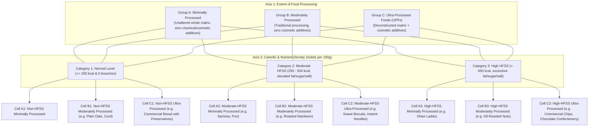

# YumSure — Phase 1A.3: Nutrient Reference & Documentation Audit (Verified)

**Audit Version**: 3.0.0 (Phase 1A.3 Verification)  
**Audit Date**: November 2026 (Verified as of 3 November 2026)  
**Auditor**: Nutrition Research Analyst, YumSure Technical & Regulatory Architecture Team  
**Governing Mandate**: Comprehensive audit of foundational project specifications (`NUTRITION_RULES.md`, `DATABASE_DESIGN.md`, `PROJECT_ARCHITECTURE.md`, `DATA_SOURCES_AND_LICENCES.md`, `IMPLEMENTATION_PROGRESS.md`, `KNOWN_LIMITATIONS.md`) against primary statutory and institutional publications:
1. **FSSAI (Advertising and Claims) Regulations** (Consolidated Version III dated 04-10-2022 + applicable amendments).
2. **FSSAI (Labelling and Display) Regulations, 2020** (Enforceable 1 July 2022).
3. **ICMR-NIN Dietary Guidelines for Indians (DGI), May 2024** (Guideline 15, Tables 15.1 & 15.2, pp. 93–102).
4. **ICMR-NIN RDA 2020 Report**.
5. **WHO SEARO Nutrient Profile Model 2017** (ISBN 978-92-9022-544-7).

---

## 1. Executive Audit Summary

The foundational documentation of YumSure was audited and verified against the official text of the *Dietary Guidelines for Indians (DGI) 2024*. Five systemic defects and their verified resolutions are documented below:

1. **Codified ICMR-NIN 2024 HFSS Framework Verified**:  
   The project documentation previously claimed that Indian authorities provide no product-level thresholds for HFSS foods. We have verified that the **ICMR-NIN DGI 2024, Guideline 15 (Tables 15.1 and 15.2, pp. 95–98)** codifies an exact dual-axis framework combining **Processing Extent (Groups A, B, and C)** and **Calorific / Nutrient Density (Categories 1, 2, and 3)**, yielding 9 distinct matrix cells (**A1 through C3**).
2. **Identification of Non-HFSS Ultra-Processed Foods (Cell C1)**:  
   Prior drafts incorrectly assumed that all Ultra-Processed Foods (UPFs) are automatically HFSS. The verified Table 15.2 demonstrates that **Cell C1 exists**: an industrially formulated food can have energy $\le 250\text{ kcal/100g}$ and stay within Table 15.1 nutrient cutoffs (e.g., plain commercial sliced bread with preservatives/emulsifiers, or reformulated low-calorie UPFs). Thus, **processing level (UPF) and nutritional density (HFSS) are distinct, independent axes**.
3. **Rejection of the "Single-Additive" UPF Fallacy**:  
   Prior documentation over-simplified UPF detection by asserting that any product containing an additive is Group C. In official food science and under ICMR-NIN guidelines, the presence of a single functional additive (e.g., INS 330 citric acid as an antioxidant, INS 500 sodium bicarbonate as leavening, or mandatory micronutrient fortification) does **not** make a whole-food product ultra-processed. Group C requires matrix deconstruction and **cosmetic formulation** (artificial flavours, synthetic colours, intense sweeteners, industrial emulsifiers).
4. **Solid vs. Liquid Applicability Boundary**:  
   Table 15.2's energy tiers ($250\text{ kcal}$, $250\text{--}500\text{ kcal}$, and $>500\text{ kcal}$) apply strictly **per 100g of solid food**. Liquids are governed by Table 15.1's ceiling of **$70\text{ kcal/100ml}$**, $>2.0\text{ g}$ added sugar, $>1.5\text{ g}$ added fat, and $>175\text{ mg}$ salt. Extending secondary 250–500 kcal bands to beverages is officially ungrounded and flagged as **`RESEARCH_REQUIRED`**.
5. **Inaccurate and Fabricated FSSAI Claim Rules Excised**:  
   All fabricated thresholds ($12.5\text{g}$ sugar, $4.0\text{g}$ sat fat, $600\text{mg}$ UK sodium) have been excised. FSSAI Schedule I claim criteria have been fully aligned with Consolidated Version III (dated 04-10-2022), incorporating per-100 kcal alternatives for protein and fibre, the strictly less-than operator (`< 0.2 g`) for trans fat free, the secondary $\le 10\%$ energy condition for saturated fat, and all four Regulation 6(1) cumulative conditions for "No Added Sugar".

---

## 2. Verified ICMR-NIN 2024 HFSS Framework (Guideline 15)

### 2.1 Table 15.1: Threshold Criteria for Nutrients of Concern (PDF Page 95)
Table 15.1 sets quantitative baseline ceilings per 100g (solids) and per 100ml (liquids). Exceeding these thresholds indicates elevated public health concern:

| Nutrient of Concern | Solids (per 100 g) | Liquids (per 100 ml) | Basis & Measurement Unit |
| :--- | :--- | :--- | :--- |
| **Energy (Calorie)** | **$> 250\text{ kcal}$** | **$> 70\text{ kcal}$** | Total energy from all macronutrients |
| **Salt (Sodium Chloride)** | **$> 625\text{ mg}$** | **$> 175\text{ mg}$** | Equivalent to $> 250\text{ mg}$ sodium (solids) / $> 70\text{ mg}$ sodium (liquids) |
| **Added Sugar** | **$> 3.0\text{ g}$** | **$> 2.0\text{ g}$** | Added mono- and disaccharides; intrinsic fruit/milk sugars excluded |
| **Added Fat** | **$> 4.2\text{ g}$** | **$> 1.5\text{ g}$** | Added visible cooking fats/oils; intrinsic grain/pulse lipids excluded |

---

### 2.2 Table 15.2: The $3 \times 3$ Dual-Axis Matrix (PDF Pages 97–98)

Table 15.2 cross-references **Degree of Industrial Processing** against **Calorific / Nutrient Density**:

#### Detailed Definitions of the 9 Cells:
- **A1**: Minimally processed foods within safe parameters ($\le 250\text{ kcal/100g}$). Whole grains, raw pulses, fresh vegetables, fresh milk, lean meat. -> **Non-HFSS, Minimally Processed**.
- **A2**: Minimally processed whole ingredients cooked with high oil, ghee, or sugar ($250\text{--}500\text{ kcal/100g}$). Traditional puris, samosas, halwas. -> **HFSS Food (Category 2), Minimally Processed**.
- **A3**: Minimally processed ingredients cooked into extremely energy-dense foods ($> 500\text{ kcal/100g}$). Ghee-laden laddus, rich traditional sweets. -> **High-HFSS Food (Category 3), Minimally Processed**.
- **B1**: Moderately processed foods without chemical additives ($\le 250\text{ kcal/100g}$). Unflavored rolled oats, plain curd/paneer, parboiled grains. -> **Non-HFSS, Moderately Processed**.
- **B2**: Moderately processed foods with added culinary fats/sugar ($250\text{--}500\text{ kcal/100g}$). Traditional bakery items without cosmetic additives. -> **HFSS Food (Category 2), Moderately Processed**.
- **B3**: Moderately processed foods with energy $> 500\text{ kcal/100g}$. Oil-roasted nuts with salt. -> **High-HFSS Food (Category 3), Moderately Processed**.
- **C1**: Ultra-processed formulations with cosmetic additives whose energy is $\le 250\text{ kcal/100g}$ and stay within Table 15.1 thresholds. Commercial sliced bread, plain breakfast flakes. -> **Non-HFSS, Ultra-Processed Food (UPF)**.
- **C2**: Ultra-processed formulations with energy $250\text{--}500\text{ kcal/100g}$ driven by added sugars/fats. Commercial biscuits, cakes, instant noodles. -> **HFSS Food (Category 2) & Ultra-Processed Food (UPF)**.
- **C3**: Ultra-processed formulations with energy $> 500\text{ kcal/100g}$. Packaged potato chips, confectionery, cream-filled biscuits. -> **High-HFSS Food (Category 3) & Ultra-Processed Food (UPF)**.

#### Critical Takeaways:
1. **HFSS Flag**: Assigned to any food in **Category 2 or Category 3** (A2, A3, B2, B3, C2, C3).
2. **UPF Flag**: Assigned to any food in **Group C** (C1, C2, C3).
3. **Dual Status**: Foods in **C2 and C3** carry both flags: **Ultra-Processed HFSS Food**.

---

## 3. The Additive Fallacy & Processing Classification Rules

### 3.1 Why a Single Additive Does Not Make a Food UPF
Under ICMR-NIN DGI 2024 and international food classification science:
- **Functional Additives**: Substances added strictly for microbiological preservation, safety, or basic culinary function (e.g., INS 330 citric acid, INS 300 ascorbic acid, INS 500(ii) sodium bicarbonate, yeast, natural vinegar, nutrient vitamins/minerals) do **not** convert a minimally or moderately processed food into an ultra-processed food.
- **Cosmetic Additives (Markers of Group C)**: Substances added to disguise low-quality base starches, impart synthetic color, or hyper-palatabilize the product:
  - Synthetic colours: Tartrazine (INS 102), Sunset Yellow (INS 110), Brilliant Blue (INS 133).
  - Nature-identical and artificial flavouring substances.
  - Non-nutritive intense sweeteners: Aspartame (INS 951), Sucralose (INS 955), Acesulfame K (INS 950).
  - Industrial emulsifiers/stabilizers: Polysorbates (INS 433), Carboxymethylcellulose (INS 466), Carrageenan (INS 407).
  - Chemical flavour enhancers: Monosodium Glutamate (INS 621), Disodium Guanylate (INS 627).
- **Matrix Alteration**: Group C requires deconstruction into isolated industrial fractions (protein isolates, maltodextrin, high-fructose corn syrup, interesterified fats).

### 3.2 Automated Classification Rule
- If an algorithm infers Group C merely from the presence of a single functional additive, it produces a **false positive**.
- Where label data does not provide conclusive evidence of cosmetic industrial formulation, the engine must set:  
  `processing_group: RESEARCH_REQUIRED (Ambiguous processing markers; requires formulation audit)`.

---

## 4. Corrected Statutory Claim Rules (FSSAI Consolidated Version III)

1. **Protein Claims (Schedule I, Item 3)**:
   - *Source*: $\ge 10\%$ RDA solid ($\ge 5.4\text{g/100g}$) OR $\ge 5\%$ RDA liquid ($\ge 2.7\text{g/100ml}$) OR $\ge 5\%$ RDA per 100 kcal ($\ge 2.7\text{g/100 kcal}$).
   - *High*: $\ge 20\%$ RDA solid ($\ge 10.8\text{g/100g}$) OR $\ge 10\%$ RDA liquid ($\ge 5.4\text{g/100ml}$) OR $\ge 10\%$ RDA per 100 kcal ($\ge 5.4\text{g/100 kcal}$).
2. **Dietary Fibre Claims (Schedule I, Item 8)**:
   - *Source*: $\ge 3.0\text{g/100g}$ solid OR $\ge 1.5\text{g/100ml}$ liquid OR $\ge 1.5\text{g/100 kcal}$.
   - *High*: $\ge 6.0\text{g/100g}$ solid OR $\ge 3.0\text{g/100ml}$ liquid OR $\ge 3.0\text{g/100 kcal}$.
3. **Trans Fat Free Claim (Schedule I, Item 2)**:
   - **Strictly less than 0.2 g** (`< 0.2 g`) per 100g/ml;
   - AND saturated fat $\le 1.5\text{g/100g}$ (solid) or $\le 0.75\text{g/100ml}$ (liquid);
   - AND saturated fat provides $\le 10\%$ of total energy.
4. **Saturated Fat Claims (Schedule I, Item 2)**:
   - *Low*: $\le 1.5\text{g/100g}$ (solid) or $\le 0.75\text{g/100ml}$ (liquid), AND sat fat energy $\le 10\%$ of total energy.
   - *Free*: $\le 0.1\text{g/100g or 100ml}$.
5. **Low Sugars Claim (Schedule I, Item 6)**:
   - *Low sugars*: $\le 5.0\text{g}$ total sugars per 100g (solid) or $\le 2.5\text{g}$ per 100ml (liquid).
   - *Sugars Free*: $\le 0.5\text{g}$ total sugars per 100g or 100ml.
6. **No Added Sugar Claim (Regulation 6(1))**:
   - Requires all four cumulative conditions: (a) No sugars added; (b) No ingredients containing added sugars; (c) No sugar substitutes added; (d) Sugar content not enzymatically increased. Plus mandatory disclosure: *"CONTAINS NATURALLY OCCURRING SUGARS"*.
7. **Sodium Claims (Schedule I, Item 4)**:
   - *Low*: $\le 0.12\text{g}$ ($120\text{mg}$); *Very Low*: $\le 0.04\text{g}$ ($40\text{mg}$); *Free*: $\le 0.005\text{g}$ ($5\text{mg}$) per 100g/ml.

---

## 5. WHO SEARO NPM Licensing Summary

- Published under **Creative Commons Attribution-NonCommercial-ShareAlike 3.0 IGO (CC BY-NC-SA 3.0 IGO)**.
- **Commercial Use Restriction**: Copying the complete model thresholds into a commercial application database is prohibited without written permission from WHO.
- Preserved strictly as an academic reference; not seeded into production database tables.
