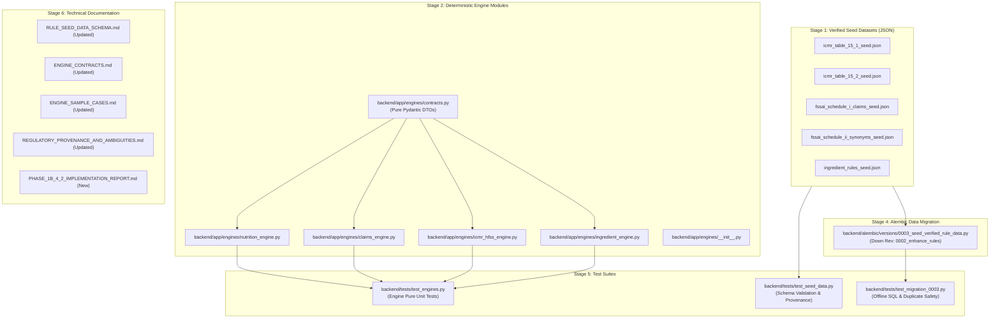

# YumSure — Phase 1B.4 & Phase 2 Implementation Plan

**Document Version**: 1.0.0  
**Date**: November 2026 (Verified as of 3 November 2026)  
**Author**: Senior Backend Architect & Nutrition Regulatory Intelligence Lead  
**Collaborator**: Tejas (Backend Foundation Lead)  
**Status**: APPROVED IMPLEMENTATION PLAN

---

## 1. Stage 0 Inspection & Revision Resolution

### 1.1 Alembic Revision Discrepancy Resolved
- **Issue**: Tejas referred to the current revision as `0002_enhance_rules`, while previous reports referenced `0002_enhance_rules_and_ingredients`.
- **Actual File & Alembic Inspection**:
  - Filename on disk: `backend/alembic/versions/0002_enhance_rules_and_ingredients.py`.
  - Line 20 of file: `revision: str = '0002_enhance_rules'`.
  - Alembic command output (`alembic heads`):
    ```
    0002_enhance_rules (head)
    ```
  - Alembic history output (`alembic history`):
    ```
    0001_initial_foundation -> 0002_enhance_rules (head)
    <base> -> 0001_initial_foundation
    ```
- **Conclusion**: The **actual, unique revision identifier is strictly `'0002_enhance_rules'`**.
- **Down Revision for 0003**: The new data migration `0003_seed_verified_rule_data.py` must set:
  ```python
  down_revision: Union[str, None] = '0002_enhance_rules'
  ```

### 1.2 Table & Foreign Key Dependency Analysis
1. `icmr_nutrient_threshold_rules.nutrient_code` has a strict Foreign Key to `nutrients.nutrient_code`.
   - Seed prerequisite: `nutrients` table must contain canonical records for `added_sugars`, `sodium`, `added_fat`, `energy`, `protein`, `total_fat`, `saturated_fat`, `trans_fat`, `dietary_fibre`.
2. `ingredient_rules.ingredient_code` has a strict Foreign Key to `ingredients.ingredient_code`.
   - Seed prerequisite: `ingredients` table must contain canonical records for referenced additives (`ins_951_aspartame`, `ins_965_maltitol`, `ins_211_sodium_benzoate`, etc.).
3. `icmr_matrix_rules` has **zero** foreign key dependencies.
4. `regulatory_claim_rules` has **zero** foreign key dependencies.

---

## 2. Proposed File Changes & Deliverables Architecture



---

## 3. Strict Safety & Ownership Boundaries

1. **Tejas's Ownership**:
   - `0003_seed_verified_rule_data.py` will be generated and tested via offline static SQL (`alembic upgrade --sql 0002_enhance_rules:head`).
   - No live database migration (`alembic upgrade head`) will be executed. Tejas reviews and applies it.
2. **Abhishek's Ownership**:
   - Pure evaluation engine logic in `backend/app/engines/`.
   - Verified regulatory seed datasets.
   - 100% test coverage using Python `unittest` without external network or DB dependencies.
3. **No AI API / LLM Calls**:
   - Zero LLM tokens, zero AI prompts, zero OpenAI/Grok/NIM dependencies in engines.
4. **No Health Score**:
   - No composite health index or star rating is computed.

---

## 4. Execution Sequence

- **Step 1**: Create seed JSON datasets in `backend/app/data/seeds/`.
- **Step 2**: Implement engine contracts and DTOs in `backend/app/engines/contracts.py`.
- **Step 3**: Implement deterministic engines (`nutrition_engine.py`, `claims_engine.py`, `icmr_hfss_engine.py`, `ingredient_engine.py`).
- **Step 4**: Prepare data migration `0003_seed_verified_rule_data.py` with `down_revision = '0002_enhance_rules'`.
- **Step 5**: Implement and run comprehensive automated test suites.
- **Step 6**: Generate offline SQL and verify upgrade/downgrade.
- **Step 7**: Compile final documentation and implementation report.

