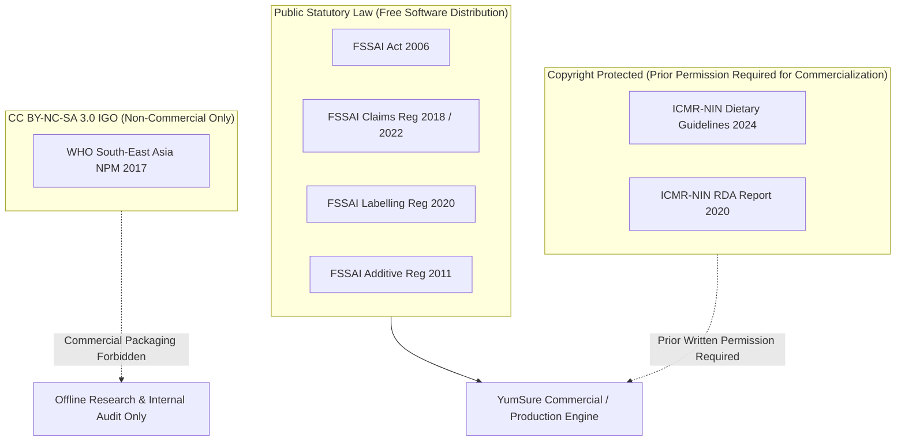

# YumSure — Phase 1B.4: Regulatory Provenance & Unresolved Ambiguities

**Document Version**: 1.0.0  
**Status**: REGULATORY & SCIENTIFIC LEDGER  
**Author**: Senior Backend Architect & Nutrition Regulatory Intelligence Lead  
**Collaborator**: Tejas (Backend Foundation Lead)  
**Governing Documents**:
- `SOURCE_PROVENANCE_REGISTER.md` (v4.0.0)
- `NUTRIENT_CLASSIFICATION_RESEARCH.md` (v4.0.0)
- `ICMR_TABLE_15_2_VERIFICATION.md` (v4.0.0)

---

## 1. Regulatory Provenance Register

Every numerical cutoff, rule condition, and statutory label requirement utilized by YumSure's deterministic engines traces directly to official government gazettes or institutional dietary guidelines.

| Source Authority | Governing Document | Version / Date | Official URL / Gazette Ref | Licensing / Copyright Terms |
| :--- | :--- | :--- | :--- | :--- |
| **FSSAI** | Food Safety and Standards (Advertising and Claims) Regulations, 2018 | Version III (04-10-2022) | `https://fssai.gov.in/food-law/regulations/amendments/advertising-claims` | Public Statutory Law (Govt of India). Free to implement in software. |
| **FSSAI** | Food Safety and Standards (Labelling and Display) Regulations, 2020 | Gazette 17-11-2020 (Eff: 01-07-2022) | `https://fssai.gov.in/food-law/regulations/amendments/labelling-display` | Public Statutory Law (Govt of India). Free to implement in software. |
| **FSSAI** | Food Safety and Standards (Food Products Standards and Food Additives) Regulations, 2011 | Consolidated Compendium | `https://www.fssai.gov.in/food-law/regulations` | Public Statutory Law (Govt of India). Free to implement in software. |
| **ICMR - NIN** | Dietary Guidelines for Indians (DGI) 2024 | May 2024 (1st Edition) | `https://nin.res.in/dietaryguidelines/pdfjs/locale/DGI_2024.pdf` | **Copyright Reserved ICMR-NIN**. Commercial use or proprietary redistribution requires prior written permission. |
| **ICMR - NIN** | Nutrient Requirements for Indians (RDA & EAR) | 2020 Report | `https://www.nin.res.in/` | Institutional Scientific Reference. |
| **WHO** | Nutrient Profile Model for South-East Asia Region | 2017 (ISBN 978-92-9022-544-7) | `https://www.who.int/publications/i/item/9789290225447` | **CC BY-NC-SA 3.0 IGO (Non-Commercial)**. Strictly prohibited from commercial database bundling without WHO agreement. |

---

## 2. Six Critical Regulatory Ambiguities & Engine Resolutions

During the Phase 1A research audit and Phase 1B database design, six critical regulatory ambiguities were identified where Indian statutory mandates either conflict, omit clear mechanisms, or diverge from international norms.

The table below documents each ambiguity, its statutory evidence, the deterministic engine resolution, and the required operational handling.

### Ambiguity 1: Omission of Liquid Scope in ICMR Table 15.2
- **Statutory / Scientific Fact**: Table 15.1 of DGI 2024 provides explicit thresholds of concern for both solid foods (`per 100g`) and liquid beverages (`per 100ml`). However, Table 15.2 (the $3 \times 3$ matrix) explicitly defines Categories 1, 2, and 3 solely by solid energy bands ($>250\text{ kcal}$ and $>500\text{ kcal}$). The text provides **no calorific bands for beverages**.
- **Engine Resolution**:
  - `icmr_matrix_rules` sets `applicable_food_form = 'solid'`.
  - When a beverage (`food_form == 'liquid'`) is passed into `evaluate_icmr_hfss()`, the engine evaluates Table 15.1 (yielding `PASS` or `FAIL` for Sugar, Salt, Added Fat, and Energy per 100ml), but marks Table 15.2 Matrix as **`NOT_APPLICABLE`**.
  - **Audit Guarantee**: The engine never fabricates calorific bands for liquids or guesses liquid matrix placement.

### Ambiguity 2: Non-Declaration of Added Fat on Packaged Food Labels
- **Statutory / Scientific Fact**: ICMR Table 15.1 defines an explicit threshold of concern for Added Fat ($>4.2\text{g/100g}$ solid, $>1.5\text{g/100ml}$ liquid). However, under FSSAI Labelling Regulations 2020 Reg 5(3)(b), only **Total Fat, Saturated Fat, and Trans Fat are mandatory declarations**. Added fat declaration is voluntary and rarely declared on Indian packaged foods.
- **Engine Resolution**:
  - The engine **never infers added fat from total fat** (e.g. whole peanuts have 49g total fat from natural oils, but 0g added fat).
  - If a product label omits `added_fat` (`data_status == 'NOT_DECLARED'`), the Table 15.1 Added Fat rule immediately returns **`INSUFFICIENT_DATA`** with `missing_evidence = ['added_fat']`.

### Ambiguity 3: Fruit Juice Concentrate Sugar Classification (Intrinsic vs Added Free Sugar)
- **Statutory / Scientific Fact**: Under WHO Free Sugar guidelines, sugars naturally present in fruit juice concentrates and purees are defined as *free sugars* because the intact cellular fruit matrix has been disrupted. Conversely, under Indian FSSAI Regulation 6(1) for "No Added Sugar", concentrates are permitted only if they do not substitute for added sugar, but enforcement guidance remains uncodified.
- **Engine Resolution**:
  - Fruit juice concentrates and purees with deconstructed cellular matrices are cataloged under `sugar_classification = 'ADDED_FREE_SUGAR'`.
  - Intact whole fruits or dried whole fruits are cataloged under `sugar_classification = 'INTRINSIC_SUGAR'`.
  - Claims evaluating "No Added Sugar" that contain fruit juice concentrates fail with explanatory statutory notice.

### Ambiguity 4: Boundary Between Culinary Additives and Cosmetic UPF Additives
- **Statutory / Scientific Fact**: ICMR DGI 2024 Guideline 15 warns against Ultra-Processed Foods (Group C). However, Indian packaged foods frequently use simple functional additives (e.g. INS 330 Citric Acid, INS 500 Sodium Bicarbonate, INS 300 Ascorbic Acid) in otherwise traditional or whole food recipes. The guideline does not publish an exhaustive botanical/chemical boundary list.
- **Engine Resolution**:
  - A single functional additive in a whole-food base does **not** automatically trigger Group C.
  - Group C requires evidence of **industrial matrix deconstruction** (e.g. isolated soy protein, maltodextrin, high-fructose corn syrup) OR **cosmetic additives** (artificial colours, synthetic flavours, intense artificial sweeteners, emulsifiers/thickeners designed to mimic culinary mouthfeel).
  - Ambiguous products evaluate to **`INDETERMINATE`** with an explicit notice: *"Requires recipe audit to confirm culinary vs industrial formulation."*

### Ambiguity 5: FSSAI Statutory Definition of "Low Sugars" (Total Sugar vs Added Sugar)
- **Statutory / Scientific Fact**: Schedule I Entry 3(b) of FSSAI Advertising and Claims Regulations defines "Low Sugars" as: $\le 5\text{g/100g}$ (solids) or $\le 2.5\text{g/100ml}$ (liquids). The statutory text specifies **Sugars** (plural, chemically meaning total mono- and disaccharides), NOT added sugars. Some manufacturers attempt to make "Low Sugar" claims on foods low in added sugar but high in natural lactose or fructose.
- **Engine Resolution**:
  - The deterministic `claims_engine.py` evaluates `total_sugars` against the $5.0\text{g/100g}$ (or $2.5\text{g/100ml}$) threshold.
  - If a product has $0\text{g}$ added sugar but $8.0\text{g}$ natural fruit sugar, the "Low Sugars" claim returns **`FAIL`** under Schedule I statutory terms.

### Ambiguity 6: Saturated Fat Percentage-of-Energy Secondary Condition
- **Statutory / Scientific Fact**: Under FSSAI Schedule I Entry 4(c) and 4(b), claims for "Low Saturated Fat" and "Trans Fat Free" require that saturated fat not exceed $\le 1.5\text{g/100g}$ (solids) AND not provide more than $\le 10\%$ of total energy. If an imported or artisanal product omits total energy (`energy == 'NOT_DECLARED'`), the secondary percentage-of-energy condition cannot be calculated.
- **Engine Resolution**:
  - Secondary percentage-of-energy conditions evaluate to **`INSUFFICIENT_DATA`** if total energy is missing.
  - Saturated fat energy is calculated using the official conversion factor: $\text{Energy from Sat Fat (kcal)} = \text{Sat Fat (g)} \times 9.0$.

---

## 3. Legal Copyright & Licensing Governance

### Governing Rules for Team Deployment:
1. **FSSAI Regulations**: Public statutory laws of India. Permitted for unlimited commercial embedding in YumSure backend services.
2. **ICMR-NIN DGI 2024**: Director, ICMR-NIN holds copyright. Institutional research use in development is standard; commercial SaaS launch requires prior written licensing request.
3. **WHO SEARO NPM 2017**: Strictly Non-Commercial (`NC`). Must remain in research files; must NOT be incorporated into paid commercial SaaS tiers.

