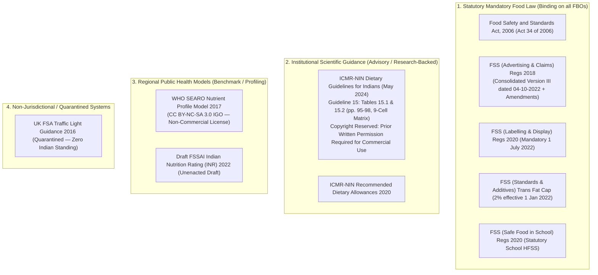

# YumSure — Phase 1A.4: Source Provenance & Regulatory Authority Register (Corrected)

**Document Version**: 4.0.0 (Phase 1A.4 Logic Corrections)  
**Effective Date**: November 2026 (Verified as of 3 November 2026)  
**Auditor**: Nutrition Research Analyst, YumSure Technical & Regulatory Architecture Team  
**Governing Mandate**: Complete legal and scientific provenance tracking for statutory instruments, dietary guidelines, and nutrient profiling models.

---

## 1. Hierarchy of Authority

---

## 2. Statutory Instruments (FSSAI — Legally Binding Food Law)

### 2.1 Food Safety and Standards (Advertising and Claims) Regulations, 2018 (Consolidated Version III)
- **Issuing Body**: Food Safety and Standards Authority of India (FSSAI), Ministry of Health and Family Welfare, Government of India.
- **Statutory Authority**: Sections 16, 23, 24, and 92 of the Food Safety and Standards Act, 2006 (Act 34 of 2006).
- **Consolidated Official Text**: **Version III dated 04-10-2022** (File No. Std/SP-08/A-1.2022/N-02).
- **Subsequent Amendments**: Second Amendment Regulations, 2022 (notified December 2022; comprehensive substitution of Schedules I, II, and III).
- **Effective Date**: 1 July 2019 (Consolidated Version III and subsequent amendments fully enforceable as of 3 November 2026).
- **Specific Structural Role**:
  - **Schedule I**: *Nutrient Content Claims* — Defines strict quantitative thresholds and alternatives for Energy, Fats, Saturated Fats, Trans Fats, Sugars, Protein, Dietary Fibre, Sodium, and Micronutrients per 100g, 100ml, or 100 kcal.
  - **Schedule II**: *Synonyms which may be used for claims* (e.g., "Zero", "Rich", "Reduced", "Source").
  - **Schedule IIA**: *Permitted claims for Edible Vegetable Oils*.
  - **Regulation 6(1)**: *Non-addition of sugars* — Enforces four cumulative statutory conditions before a "No Added Sugar" claim can be made.
- **Public URLs**:
  - `https://www.fssai.gov.in/food-law/regulations`
  - `https://fssai.gov.in/food-law/regulations/amendments/advertising-claims`
- **Licensing & Legal Status**: Public Gazette of India; unrestricted public access for regulatory adherence.

---

### 2.2 Food Safety and Standards (Labelling and Display) Regulations, 2020
- **Issuing Body**: FSSAI.
- **Gazette Identifier**: Gazette Notification F. No. 1-94/FSSAI/SP (L&C/A)/2009, dated 17 November 2020.
- **Enforcement Date**: Mandatory nationwide compliance took effect **1 July 2022**.
- **Specific Structural Role**:
  - **Regulation 5(3)(a)**: Prescribes mandatory nutritional declaration per 100g/100ml and per serving for: Energy, Protein, Carbohydrates, Total Sugars, Added Sugars, Total Fat, Saturated Fat, Trans Fat, and Sodium.
  - **Regulation 5(3)(b)**: Establishes standardized adult daily reference diet (2,000 kcal baseline) for calculating `% Contribution to RDA (% DV)`:
    - Energy: 2,000 kcal
    - Total Fat: 67 g
    - Saturated Fat: 22 g
    - Trans Fat: 2 g
    - Added Sugars: 50 g
    - Sodium: 2,000 mg (equivalent to 5 g salt)
  - **Schedule II**: Specific mandatory cautionary statements for foods containing intense sweeteners, polyols, caffeine, etc.
- **Public URL**: `https://www.fssai.gov.in/food-law/regulations/amendments/labelling-display`
- **Licensing**: Public Domain Government Regulation.

---

### 2.3 FSS (Food Products Standards and Food Additives) Mandatory Trans Fat Cap
- **Issuing Body**: FSSAI.
- **Gazette Identifier**: Gazette Notification No. Std/SP-08/A-1.2019/N-01, dated 29 December 2020.
- **Enforcement Date**: **1 January 2022**.
- **Legal Scope**: Mandates that all fats/oils and all packaged food products containing fats/oils in India must not exceed **2% by weight of total oils/fats** as industrial trans-fatty acids.
- **Public URL**: `https://www.fssai.gov.in/food-law/regulations`
- **Licensing**: Public Domain Government Regulation.

---

### 2.4 FSS (Safe Food and Balanced Diets for Children in School) Regulations, 2020
- **Issuing Body**: FSSAI.
- **Gazette Identifier**: Gazette Notification F. No. 15(1)2016/School Children/Reg/FSSAI-2019, dated 4 September 2020.
- **Effective Date**: 4 September 2020.
- **Specific Role**: Statutory prohibition of HFSS food sales within school premises and within 50 meters of gates based on quantitative cutoffs: Added Fat $>4.2\text{ g/100g}$ (solids) / $>1.5\text{ g/100ml}$ (liquids); Added Sugar $>3\text{ g/100g}$ (solids) / $>2\text{ g/100ml}$ (liquids); Salt $>0.625\text{ g/100g}$ (solids) / $>0.175\text{ g/100ml}$ (liquids).
- **Public URL**: `https://www.fssai.gov.in/food-law/regulations`
- **Licensing**: Public Domain Government Regulation.

---

## 3. Institutional Scientific Advisory (ICMR-NIN)

### 3.1 ICMR-NIN Dietary Guidelines for Indians (DGI), May 2024
- **Issuing Body**: Indian Council of Medical Research - National Institute of Nutrition (ICMR-NIN), Hyderabad.
- **Publication Date**: May 2024.
- **Document Title**: *Dietary Guidelines for Indians* (Official Manual, 17 Guidelines).
- **Official URL**: `https://nin.res.in/dietaryguidelines/pdfjs/locale/DGI_2024.pdf`
- **Key Sections**:
  - **Guideline 15 (pp. 93–102)**: *"Minimise the consumption of high-fat, sugar, salt (HFSS) and ultra-processed foods (UPFs)"*.
    - **Table 15.1 (p. 95)**: Threshold criteria for nutrients of concern per 100g/ml for Calories ($>250\text{ kcal}$ solid / $>70\text{ kcal}$ liquid), Salt ($>625\text{ mg}$ solid / $>175\text{ mg}$ liquid), Added Sugar ($>3\text{ g}$ solid / $>2\text{ g}$ liquid), and Added Fat ($>4.2\text{ g}$ solid / $>1.5\text{ g}$ liquid).
    - **Table 15.2 (pp. 97–98)**: The $3 \times 3$ matrix (Cells A1 through C3) cross-referencing processing groups (Group A: Minimally processed; Group B: Moderately processed without chemical additives; Group C: Ultra-Processed Foods with cosmetic additives) against calorific tiers (Category 1: Normal $\le 250\text{ kcal}$; Category 2: Moderate HFSS $250\text{--}500\text{ kcal}$; Category 3: High HFSS $> 500\text{ kcal}$ per 100g solid).
  - **Guideline 17 (pp. 105–106)**: Consumer literacy on reading food labels and checking nutrition facts panels.
  - **Guidelines 7, 8, 9**: Daily dietary guidance on total fat ($20\text{--}30\%$), saturated fat ($<7\%$), free sugars ($<5\%$), and salt ($<5\text{ g/day}$).
- **Copyright & Intellectual Property Notice**:  
  **© Copyright: ICMR-National Institute of Nutrition (NIN), Hyderabad. All rights reserved.**
- **Licensing Terms & Legal Restrictions**:
  1. Free download and dissemination are permitted for **personal, non-profit, educational, and public health awareness**.
  2. **Commercial Exploitation Prohibited**: Reproduction, reprinting, or exploiting the document or its core contents for commercial purposes is **not permitted without prior written authorization from the Director, ICMR-NIN**.
  3. Formal institutional clearance or intimation to the Director, NIN is required before embedding proprietary tables or scoring algorithms into commercial software products.
- **Operational Directive for YumSure**: Sourced purely as educational public health citations. Commercial software integration requires formal written approval from ICMR-NIN.

---

### 3.2 ICMR-NIN Recommended Dietary Allowances for Indians (RDA), 2020
- **Issuing Body**: ICMR-NIN Expert Committee.
- **Publication Date**: 2020.
- **Document Title**: *Nutrient Requirements for Indians: Recommended Dietary Allowances and Estimated Average Requirements*.
- **Scope**: Biological nutrient intake benchmarks based on Reference Man (65 kg) and Reference Woman (55 kg).
- **Legal Scope**: Population daily dietary intake targets. Not product classification thresholds.
- **Official URL**: `https://www.nin.res.in/`
- **Licensing**: Public Research Report.

---

## 4. International Public Health Profiling Models

### 4.1 WHO Nutrient Profile Model for South-East Asia Region (SEARO NPM), 2017
- **Issuing Body**: World Health Organization, Regional Office for South-East Asia (New Delhi).
- **Publication Date**: 2017.
- **Document Identifier**: ISBN 978-92-9022-544-7; WHO IRIS: `https://iris.who.int/handle/10665/253459`.
- **Download URI**: `https://iris.who.int/bitstream/handle/10665/253459/9789290225447-eng.pdf`
- **License Type**: **Creative Commons Attribution-NonCommercial-ShareAlike 3.0 IGO (CC BY-NC-SA 3.0 IGO)**.
- **Detailed Legal Analysis & Commercial Restrictions**:
  1. **Non-Commercial Restriction (NC)**: The license explicitly prohibits commercial reuse:  
     > *"Under the terms of this licence, you may copy, redistribute and adapt the work for non-commercial purposes..."*  
     If YumSure is deployed as a commercial software product, distributed on app stores with monetization, or utilized within a commercial API, **verbatim copying of the model's complete category thresholds into the application's commercial production database is prohibited without prior written authorization from WHO**.
  2. **Adaptation & ShareAlike (SA)**: Any adaptation must be licensed under the exact same CC BY-NC-SA 3.0 IGO license.
  3. **Mandatory Disclaimer**: If adapted, the following disclaimer is legally required:  
     > *"This is an adaptation of an original work by the World Health Organization (WHO). Views and opinions expressed in the adaptation are the sole responsibility of the author(s) of the adaptation and are not endorsed by WHO."*
  4. **Attribution & Trademark**: WHO logo and emblem cannot be used. Proper academic citation must be maintained.
- **Operational Directive**: WHO SEARO NPM thresholds must not be directly hardcoded into YumSure's commercial PostgreSQL tables without licensing resolution. It is maintained in documentation purely as a scientific benchmark.

---

## 5. Non-Jurisdictional / Quarantined System Ledger

### 5.1 UK Food Standards Agency (FSA) Front-of-Pack Traffic Light Guidance (2016)
- **Issuing Body**: UK Department of Health / FSA.
- **Document Title**: *Guide to creating a front of pack (FoP) nutrition label for pre-packed products sold through retail outlets* (2016).
- **Quarantined Status**: Sourced the borrowed sodium cutoffs ($\le 120\text{mg}$ / $> 600\text{mg}$) that were previously misattributed to FSSAI in `NUTRITION_RULES.md`.
- **Legal Standing in India**: **ZERO JURISDICTION**. Strictly quarantined and excised from active Indian evaluation engines.

---

## 6. Master Provenance Ledger Table

| Source Key | Official Instrument Name | Issuing Authority | Publication / Effective Date | Identifier / Gazette | Legal Jurisdiction | Regulatory Classification | Public URL |
| :--- | :--- | :--- | :--- | :--- | :--- | :--- | :--- |
| `FSSAI_CLAIMS_V3` | FSS (Advertising & Claims) Regulations, Version III | FSSAI (Govt. of India) | 04 Oct 2022 / Enforceable Nov 2026 | Std/SP-08/A-1.2022/N-02 | India | Statutory Marketing Claims (Sched. I & Reg 6) | [fssai.gov.in](https://fssai.gov.in/food-law/regulations/amendments/advertising-claims) |
| `FSSAI_LABELLING_2020`| FSS (Labelling & Display) Regulations, 2020 | FSSAI (Govt. of India) | 17 Nov 2020 / 1 Jul 2022 | F.No. 1-94/FSSAI/SP(L&C/A)/2009 | India | Mandatory Panels & 2,000 kcal RDIs | [fssai.gov.in](https://www.fssai.gov.in/food-law/regulations/amendments/labelling-display) |
| `FSSAI_TRANSFAT_2022` | Mandatory Industrial Trans Fat 2% Cap | FSSAI (Govt. of India) | 29 Dec 2020 / 1 Jan 2022 | Std/SP-08/A-1.2019/N-01 | India | Mandatory Product Safety Ceiling ($\le 2\%$) | [fssai.gov.in](https://www.fssai.gov.in/food-law/regulations) |
| `FSSAI_SCHOOL_2020` | FSS (Safe Food in School) Regulations, 2020 | FSSAI (Govt. of India) | 4 Sep 2020 | 15(1)2016/School Children/Reg | India | Statutory School HFSS Restriction | [fssai.gov.in](https://www.fssai.gov.in/food-law/regulations) |
| `ICMR_DGI_2024` | Dietary Guidelines for Indians, May 2024 | ICMR-NIN | May 2024 | NIN Publication (17 Guidelines) | India | Copyright Reserved; Prior Written Approval Required for Commercial Use | [nin.res.in](https://nin.res.in/dietaryguidelines/pdfjs/locale/DGI_2024.pdf) |
| `ICMR_RDA_2020` | RDA and Nutrient Requirements for Indians | ICMR-NIN | 2020 | Expert Group Report | India | Population Biological RDAs | [nin.res.in](https://www.nin.res.in/) |
| `WHO_SEARO_NPM_2017` | Nutrient Profile Model for South-East Asia Region | WHO SEARO | 2017 | ISBN 978-92-9022-544-7 | Regional (India) | CC BY-NC-SA 3.0 IGO (Non-Commercial Model) | [who.int](https://iris.who.int/handle/10665/253459) |
| `UK_FSA_TFL_2016` | Front of Pack Nutrition Label Guidance | UK FSA | Nov 2016 | FSA Guidance | UK Only | Quarantined / Non-Jurisdictional | [food.gov.uk](https://www.food.gov.uk/) |
