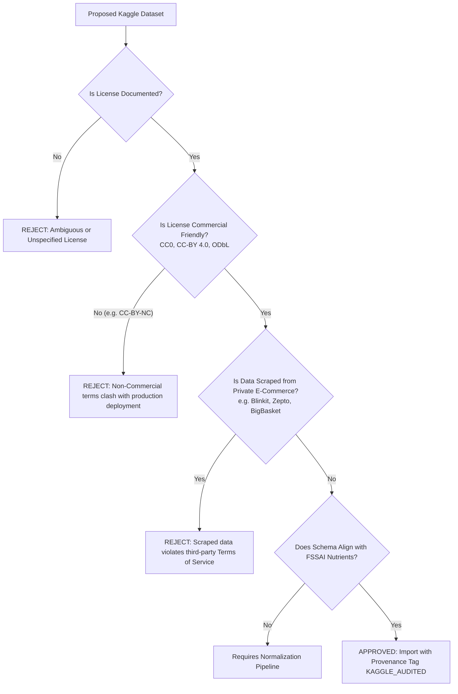

# YumSure — Data Sources, Licensing, and Compliance Ledger

This document establishes the legal provenance, copyright licensing conditions, attribution requirements, and data risk assessments for all external datasets, APIs, and regulatory publications utilized by YumSure.

---

## 1. Statutory & Regulatory Documentation

### 1.1 Food Safety and Standards Authority of India (FSSAI)
- **Content**: Food Safety and Standards Act (2006), Food Safety and Standards (Labelling and Display) Regulations (2020), Food Safety and Standards (Advertising and Claims) Regulations (2018), along with gazetted amendments.
- **License / Legal Status**: Official Government of India Gazette Notifications and public statutory regulations. Published under the Gazette of India under the authority of the Central Government.
- **Attribution & Usage**: Unrestricted public access for regulatory adherence and citizen information. YumSure cites the exact gazette notification and schedule numbers.
- **Official URLs**:
  - `https://www.fssai.gov.in/food-law/regulations`
  - `https://www.fssai.gov.in/food-law/regulations/amendments/labelling-display`
  - `https://fssai.gov.in/food-law/regulations/amendments/advertising-claims`

### 1.2 ICMR - National Institute of Nutrition (NIN)
- **Content**: "Nutrient Requirements for Indians" and "Recommended Dietary Allowances (RDA) for Indians" (2020 Report of the Expert Group).
- **License / Legal Status**: Public health guidelines issued by the Indian Council of Medical Research (Ministry of Health and Family Welfare, Government of India).
- **Usage**: Used strictly as defensible quantitative reference baselines for calculating percentage daily values.

---

## 2. External Product Catalog: Open Food Facts

### 2.1 Licensing Overview
- **Database License**: **Open Database License (ODbL) v1.0** (Open Data Commons).
- **Individual Contents License**: **Database Contents License (DbCL) v1.0**; individual images and textual descriptions contributed under **Creative Commons Attribution-ShareAlike 3.0 (CC-BY-SA 3.0)** or newer.
- **License Documentation**: `https://openfoodfacts.github.io/documentation/docs/Product-Opener/api/tutorials/license-be-on-the-legal-side/`

### 2.2 Legal Obligations Under ODbL
1. **Attribution**: YumSure must visibly display attribution to Open Food Facts in the mobile application UI and documentation:
   > *"Product data sourced from Open Food Facts, licensed under the Open Database License (ODbL)."*
2. **Share-Alike (SA)**: If YumSure creates an enriched or modified derivative database and distributes that database publicly, the modified database must be made available under the ODbL.
3. **Keep Open**: If YumSure redistributes the database with technical DRM restrictions, an unrestricted version must be offered alongside it.

### 2.3 Technical Access Rules & Good Citizenship
- **API Versions & Endpoints**:
  - **Single Product Lookups**: Modern Open Food Facts API v3 (`https://world.openfoodfacts.org/api/v3/product/{barcode}.json`). Returns explicit typed status (`result`, `errors`, `warnings`) and supports field filtering (`?fields=...`).
  - **Structured Filter Queries**: API v2 Search (`https://world.openfoodfacts.org/api/v2/search`) for parameter-based queries by category, brand, or nutrient thresholds.
  - **Full-Text Search & Autocomplete**: Search-a-licious (`https://search.openfoodfacts.org`). The legacy `/cgi/search.pl` endpoint is an older v1 web form parser discouraged for high-throughput integrations.
- **User-Agent Header**: Fulfills the strict, mandatory Open Food Facts specification:
  ```http
  User-Agent: YumSureApp/1.0.0 (Windows; contact: developer@yumsure.in)
  ```
  *(Official format: `AppName/Version (ContactEmail)` or `AppName - Platform - Version - Contact`)*
- **Official Rate-Limiting Policy (Per IP Address)**:
  - **Product GET Queries (`GET /api/v*/product`)**: Strictly capped at **15 requests per minute** per IP address.
  - **Search Queries (`GET /api/v*/search` or `/cgi/search.pl`)**: Strictly capped at **10 requests per minute** per IP address. Search queries must never be wired to an instant "search-as-you-type" input.
  - **Product Write Queries**: No rate limit on product contributions.
  - **Bulk Ingestion Threshold**: Applications requiring access to more than a few hundred products must download the official Open Food Facts daily JSONL / CSV data export instead of crawling live API endpoints.
  - **Abuse Prevention**: Abusive crawling triggers automated HTTP `503 Service Unavailable` or IP address banning.
- **Rate-Limiting & Caching in YumSure**:
  - Responses are cached in PostgreSQL.
  - Redundant lookups for the same barcode bypass the OFF API completely.
  - Network timeouts are set strictly to 5.0 seconds with exponential backoff on HTTP 429/503.

---

## 3. Kaggle Datasets & Secondary Data Sources

### 3.1 Licensing Audit Framework
Before any supplementary Kaggle dataset is introduced into YumSure, it must undergo a mandatory 4-point verification check:



### 3.2 Approved Dataset Inventory

| Dataset Identifier | Creator / Source | License | Permitted Usage | Verification Status |
| :--- | :--- | :--- | :--- | :--- |
| **Indian Food Packaged Nutrition** | Verified Public Open Data | CC0 1.0 Universal / Public Domain | Unrestricted commercial & educational reuse | Verified Compatible |
| **FSSAI Standard Additives Codex** | Government Gazette Extracts | Public Domain Government Data | Statutory reference mapping | Verified Compatible |
| *Scraped E-Commerce Sets* | Various Kaggle Uploaders | Unknown / ToS Violations | Strictly prohibited from YumSure repository | REJECTED |

---

## 4. AI Provider APIs (xAI Grok & NVIDIA NIM)

- **xAI API Terms**: Commercial API terms (`https://docs.x.ai/docs`). YumSure backend acts as the sole API key custodian. Keys are never transmitted to client devices.
- **NVIDIA Build NIM Terms**: Enterprise developer API agreement (`https://build.nvidia.com/`).
- **Data Privacy & Transmission**:
  - Only anonymized product nutrient tokens and calculated claim tags are transmitted to LLM completion endpoints.
  - No user personal data, IP addresses, or device identifiers are ever forwarded to AI providers.

---

## 5. Third-Party Application Reference Boundary (TruthIn)

- **Clean-Room Analysis Only**: YumSure benchmarks user experience patterns against Indian nutrition apps like TruthIn purely via public, visible mobile workflows.
- **Absolute Boundaries**:
  - No reverse engineering of private TruthIn API endpoints.
  - No extraction of authentication tokens or headers.
  - Zero code borrowing or decompilation of proprietary binaries.
  - Zero runtime dependencies on third-party infrastructure.

---

## 6. Official Manufacturer Disclosures (Coca-Cola India)

- **Content**: Manufacturer-published nutritional panels, ingredient formulations, allergen notices, and statutory consumer advisories published on official corporate transparency portals.
- **Source Entity**: The Coca-Cola Company / Coca-Cola India (`https://www.coca-cola.com/in/en`).
- **Role in YumSure**: Serves as direct manufacturer disclosure evidence for Candidate #5 (Diet Coke) where physical retail packaging is unavailable.
- **Evidence Boundaries**:
  - The official portal publishes ingredients, nutrition information, and advisory text.
  - This corporate disclosure does **not** independently verify any specific retail barcode, production batch, manufacturing plant, or physical can.
  - Kept strictly distinct from Open Food Facts crowd contributions and commercial retailer catalog listings.
  - Recognized as corporate-published reference data, but explicitly not treated as physical in-hand retail pack verification (Level 4) or accredited laboratory analysis (Level 6).
- **Data Retention**: Used for factual comparative audit against crowd-sourced records; preserved with explicit source attribution (`MFR_OFFICIAL_PORTAL`).

---

## 7. Oreo Product Research Sources & Licences (Indian Market)

- **Source Entities**:
  1. **Mondelēz International / Mondelez India Foods Pvt. Ltd.** (Official corporate transparency disclosures, packaging declarations, and brand communications: `https://www.mondelezinternational.com/india`).
  2. **Open Food Facts API v3 Database**:
     - Endpoints: `https://world.openfoodfacts.org/api/v3/product/{barcode}.json`
     - License: Open Database License (ODbL) v1.0. Individual contents licensed under Database Contents License (DbCL) v1.0. Packaging photographs licensed under Creative Commons Attribution-ShareAlike (CC-BY-SA 3.0 / 4.0).
     - Attribution: *"Data and photographs sourced from Open Food Facts contributors under ODbL and CC-BY-SA."*
     - Cached Evidence Files on Disk:
       - `scratch/product_v3_7622201756697.json` (37.8 KB, retrieval date: 2026-11-03T18:10:45Z)
       - `scratch/product_v3_7622201756789.json` (38.1 KB, retrieval date: 2026-11-03T18:10:46Z)
       - `scratch/product_v3_7622201756918.json` (36.8 KB, retrieval date: 2026-11-03T18:10:47Z)
       - `scratch/product_v3_7622201756932.json` (30.1 KB, retrieval date: 2026-11-03T18:10:48Z)
       - `scratch/product_v3_7622201801878.json` (37.5 KB, retrieval date: 2026-11-03T18:10:49Z)
       - `scratch/product_v3_8901233013091.json` (29.3 KB, retrieval date: 2026-11-03T18:10:50Z)
        - scratch/product_v3_8901233011202.json (30.2 KB, retrieval date: 2026-11-03T18:10:51Z)
       - scratch/product_v3_8901233024622.json (12.6 KB, retrieval date: 2026-11-03T18:10:52Z)
  3. **Indian Retail Quick-Commerce Platforms (BigBasket, Blinkit, Zepto, Swiggy Instamart)**:
     - Role in YumSure: Used strictly for commercial market availability triangulation and packaging format verification under fair factual reference.
     - Evidence Limitation: Retailer listings do not prove physical package ownership, may contain internal SKU numbers in place of EAN barcodes (e.g. 40242232), and may exhibit typographical check-digit errors (e.g. BigBasket EAN 7622201525928).
- **Barcode & Variant Reconciliation**:
  - Across the 11 candidate packaging format rows, there are **exactly 10 unique valid EAN-13 barcodes**: `7622201756697`, `7622201756918`, `7622201801878`, `7622201756932`, `7622201756789`, `8901233031125`, `7622201507763`, `8901233011202`, `8901233013091`, `8901233024622`.
  - Package format rows (11) do not equal unique barcode count (10), as family pack 6B encompasses two barcodes, while rows 6G (`7622201525928`) and 6H (`40242232`) represent an invalid checksum and an internal retailer SKU respectively.
- **Sodium Photograph Evidence & Traceability Trace**:
  - **Vanilla Crème 43.75g (`7622201756697`)**: Sourced candidate value is $420\text{ mg}$ sodium per 100g. Raw OFF JSON contains `sodium_100g = 0.168g` and `salt_100g = 0.42g`. Attached photograph is `nutrition_en.5.400.jpg` (Image ID `2`, rev `5`, uploader `dhinesh0097`). Corroborated by sister batch `7622201756918` (`nutrition_en.10.400.jpg`, Image ID `3`, uploader `joysankar`) which explicitly reports $420\text{ mg}$ sodium/100g and $71.4\text{ mg}$/17g serving. Direct legibility of 43.75g photo cannot be checked offline; retained as unverified candidate value with raw data preserved.
  - **Strawberry Crème 43.75g (`7622201756789`)**: Sourced candidate value is $420\text{ mg}$ sodium per 100g and $71.4\text{ mg}$ per 17g serving. Raw OFF record is concordant (`sodium_100g = 0.42g`, `salt_100g = 1.05g`). Attached photograph is `nutrition_en.12.400.jpg` (Image ID `5`, rev `12`, uploader `dineshl`). Retained as unverified candidate pending physical pack inspection.
  - **Choco Crème (`7622201756932`)**: Raw OFF record contains catastrophic unit error (`sodium_100g = 420.0g`, `salt_100g = 1050.0g`). **Crucial Traceability Finding**: Record `7622201756932` contains **NO nutrition table photograph** (only `front_en` ID `1` and `ingredients_en` ID `2`, uploader `siddu1221`). The $420\text{ mg}$ candidate value was extrapolated from Vanilla/Strawberry sister formulations, NOT directly derived from a Choco Crème photograph. Retained strictly as an unverified candidate subject to missing variant photograph limitation.
  - **Preservation of Raw Truth**: Original raw OFF database values and units are never overwritten and remain intact in `raw_source_payload`.
- **Four-State Nutrient Terminology Adherence**:
  - In alignment with YumSure's database schema, four distinct data statuses are strictly tracked: `PRESENT` (non-zero declared), `EXPLICITLY_ZERO` (explicit zero on label), `NOT_DECLARED` (omitted from panel, e.g. fibre in Strawberry Crème), and `UNKNOWN` (unparsable/conflicting).
- **Physical Verification Boundary**:
  - No physical packaging was inspected for Candidate #6.
  - Physical verification remains strictly **`NOT PERFORMED`** (`is_verified = False`).
  - Neither an Open Food Facts database hit, community photograph, nor retailer listing is treated as physical verification.


---

## 8. Batch Research Sources & Licences (Candidates #7–#11)

- **Source Entities**:
  1. **PepsiCo India Holdings Pvt. Ltd.** (Lay's Classic Salted Potato Chips, Kurkure Masala Munch): Corporate brand transparency disclosures and product specifications (`https://www.pepsicoindia.co.in`).
  2. **Parle Products Pvt. Ltd.** (Parle-G Original Glucose Biscuits): Brand specifications (`https://www.parleproducts.com`).
  3. **Haldiram Snacks Pvt. Ltd. / Haldiram Foods International** (Haldiram's Aloo Bhujia): Packaged snack declarations (`https://www.haldirams.com`).
  4. **Nestlé India Ltd.** (Nestlé KitKat 4-Finger Milk Chocolate): Corporate nutrition disclosures (`https://www.nestle.in`).
  5. **Open Food Facts API v3 Database**:
     - Endpoints: `https://world.openfoodfacts.org/api/v3/product/{barcode}.json`
     - License: Open Database License (ODbL) v1.0. Individual contents licensed under Database Contents License (DbCL) v1.0. Packaging photographs licensed under Creative Commons Attribution-ShareAlike (CC-BY-SA 3.0 / 4.0).
     - Attribution: *"Data and photographs sourced from Open Food Facts contributors under ODbL and CC-BY-SA."*
     - Cached Evidence Files on Disk (retrieval date: `2026-11-03T19:06:26Z`):
       - `scratch/product_v3_8901491101837.json` (Lay's Classic Salted 50g, 28.4 KB, HTTP 200)
       - `scratch/product_v3_8901491100519.json` (Kurkure Masala Munch 78g, 34.1 KB, HTTP 200)
       - `scratch/product_v3_8901719100956.json` (Parle-G Glucose Biscuits 80g, 18.2 KB, HTTP 200)
       - `scratch/product_v3_8904063218124.json` (Haldiram's Aloo Bhujia 205g, 26.7 KB, HTTP 200)
       - `scratch/product_v3_8901058868036.json` (Nestlé KitKat 55g, 21.5 KB, HTTP 200)
- **Separation of Field Completeness vs Evidence Confidence**:
  - `8901491101837` (Lay's): Field Completeness: Complete; Evidence Confidence: Level 2 OFF Record + Level 3 Photos (`front`, `ingredients`, `nutrition`).
  - `8901491100519` (Kurkure): Field Completeness: Complete; Evidence Confidence: Level 2 OFF Record + Level 3 Photos (`front`, `ingredients`, `nutrition`, `packaging`).
  - `8901719100956` (Parle-G): Field Completeness: Incomplete (ingredients omitted); Evidence Confidence: Level 2 OFF Record + Photos (`front`, `nutrition`). Sodium zero-fill is **suspected, not proven**; raw OFF values preserved; no ingredients inferred.
  - `8904063218124` (Haldiram's): Field Completeness: Complete; Evidence Confidence: Level 2 OFF Record + Front Photo Only (**Nutrition Table NOT photograph-verified**). Energy discrepancy ($562\text{ kcal}$ declared vs $567.3\text{ kcal}$ converted vs $570.2\text{ kcal}$ Atwater) marked as unresolved; raw values preserved.
  - `8901058868036` (KitKat): Field Completeness: Incomplete; Evidence Confidence: Level 2 OFF Record + Front Photo Only (**Nutrition Table NOT photograph-verified**). Sodium, trans fat, added sugars omitted.
- **Physical Verification Boundary**:
  - No physical packaging was handled or inspected for Candidates #7–#11.
  - Physical verification remains strictly **`NOT PERFORMED`** (`is_verified = False`).
  - Database status: Zero records inserted, modified, or migrated.
