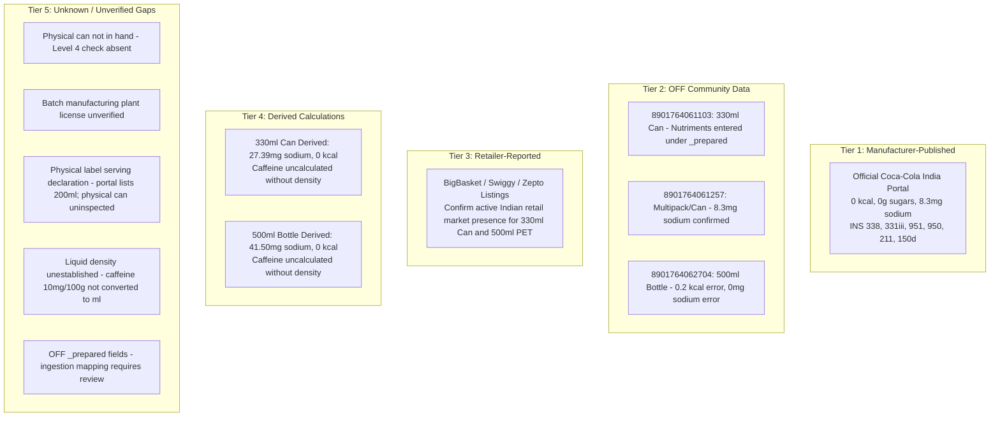
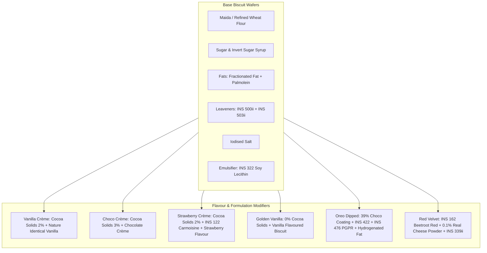
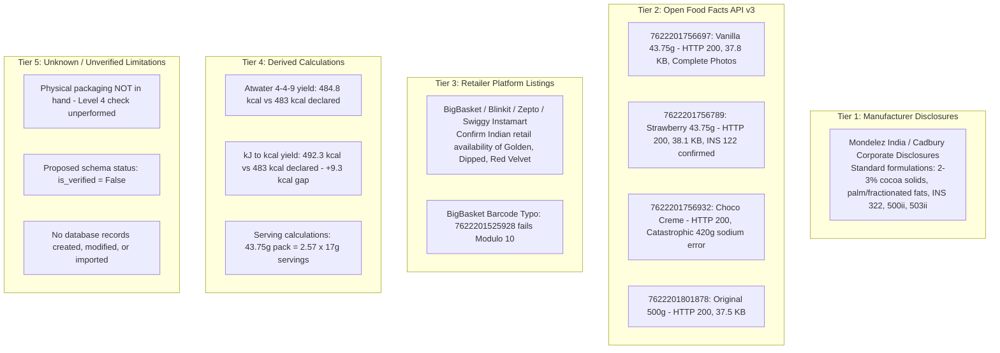

# YumSure — Demo Product Catalogue (Validated & Corrected Draft)

**Phase**: Phase 2B (Live Product Data Research & Evidence Validation)  
**Lead Researcher**: Varad (Product Data Research & Demo Lead)  
**Status**: Validated Working Draft — Candidates #1, #2, #3, #4 & #5 Audited  
**Last Updated**: November 3, 2026  

---

## 1. Candidate Products Overview & Barcode Validation Status

As established in [`JUDGE_PRESENTATION_GUIDE.md`](file:///D:/hack-sudo-chaos/JUDGE_PRESENTATION_GUIDE.md), YumSure benchmarks five representative packaged food products commonly consumed in India. 

> [!IMPORTANT]
> **Strict Verification Boundaries**:
> To ensure analytical integrity, YumSure distinguishes six distinct validation levels:
> 1. **Barcode Mathematical Validity**: Barcode passes the official GS1 Modulo 10 check digit algorithm.
> 2. **Database Record Existence**: A record exists under that barcode in Open Food Facts.
> 3. **Photographic Evidence**: Packaging photographs are attached to the database record by community contributors or online platforms (front, ingredients, nutrition table). **Explicit Boundary**: Level 3 photographic evidence provides visual corroboration of crowdsourced text fields, but must **never** be classified as or confused with in-hand physical packaging verification (Level 4), because the physical item has not been handled or inspected by the auditor.
> 4. **Independent Physical-Pack Verification**: Direct, in-hand physical inspection of an actual retail package by the auditor. *(Not yet conducted for Candidates #1, #2, #3, #5, #6)*.
> 5. **Manufacturer Confirmation**: Corporate product disclosures directly published by the brand manufacturer.
> 6. **Laboratory Verification**: Independent chemical analysis in an NABL-accredited testing facility. *(Not conducted)*.
> 
> *Market Availability Notice: Country tags in Open Food Facts (e.g. `"India"`, `"France, India"`) reflect contributor submissions, not proof of active retail store availability in India today.*

| # | Product Name | Candidate Barcode (Initial Docs) | GS1 Modulo 10 Validity | Open Food Facts Status | Actual Verified Barcode in OFF | Verification Summary |
|---|---|---|---|---|---|---|
| **1** | **Britannia NutriChoice Digestive** | `8901030383701` | ❌ **INVALID** (Calculated check digit: `0`, actual: `1`) | ❌ **HTTP 404** | `8901063142022` (Modulo 10: ✅ **VALID**) | Candidate barcode in initial docs was malformed (check digit error). The actual product is indexed under `8901063142022`. |
| **2** | **Maggi 2-Minute Masala Noodles** | `8901058860002` | ❌ **INVALID** (Calculated check digit: `9`, actual: `2`) | ❌ **HTTP 404** | `8901058851298` (Modulo 10: ✅ **VALID**) *Alt batch: `8901058006292`* | Candidate barcode in initial docs was malformed (check digit error). The actual retail product is indexed under `8901058851298` (70g pack). |
| **3** | **Cadbury Bournvita Chocolate Drink** | `8901233024013` | ❌ **INVALID** (Calculated check digit: `1`, actual: `3`) | ❌ **HTTP 404** | `8901233023724` (Modulo 10: ✅ **VALID**) *Alt retail: `8901233020341`* | Candidate barcode in initial docs was malformed (check digit error). The actual retail product is indexed under `8901233023724`. |
| **4** | **Balaji Wafers Shing Bhujia — Nimbu Chatka** | `8906010500863` | ✅ **VALID** (Sum: `97`, check digit: `3`) | ✅ **HTTP 200** | `8906010500863` | Real retail pack investigated using physical wrapper photographs. Barcode mathematically valid. Unresolved source discrepancy documented between physical pack and OFF record. |
| **5** | **Diet Coke (Indian Market)** | `8901764061103` (330ml Can) *Alt: `8901764061257` (Can), `8901764062704` (500ml)* | ✅ **VALID** (Sum: `77`, check digit: `3`) | ✅ **HTTP 200** | `8901764061103` | Researched without physical packaging. Evaluated via official Coca-Cola India portal, retailer listings, and OFF API v3. Physical packaging verification unperformed (Level 2/5). |
| **6** | **Oreo (Indian Market)** | `7622201756697` (Vanilla 43.75g) *Alt: `7622201756789` (Strawberry), `7622201756932` (Choco), `8901233031125` (Golden), `7622201507763` (Dipped)* | ✅ **VALID** (Sum: `113`, check digit: `7`) | ✅ **HTTP 200** | `7622201756697` (Vanilla 43.75g) | Multi-variant audit of Indian Oreo catalogue. Selected as primary demo candidate based on available barcode, OFF record, and source evidence. Physical pack verification NOT PERFORMED. |
| **7** | **Lay's Classic Salted Potato Chips** | `8901491101837` (50g) | ✅ **VALID** (Sum: `93`, check digit: `7`) | ✅ **HTTP 200** | `8901491101837` (50g Pack) | High macro completeness; complete photo record (front, ingredients, nutrition); INS 551, 627, 631. Recommended Demo Candidate. Physical verification NOT PERFORMED. |
| **8** | **Kurkure Masala Munch** | `8901491100519` (78g) | ✅ **VALID** (Sum: `81`, check digit: `9`) | ✅ **HTTP 200** | `8901491100519` (78g Pack) | Complete macro profile; high sodium (796mg/100g); INS 160c natural colour, INS 330/296/334; complete photo record. Recommended Demo Candidate. Physical verification NOT PERFORMED. |
| **9** | **Parle-G Original Glucose Biscuits** | `8901719100956` (80g) | ✅ **VALID** (Sum: `84`, check digit: `6`) | ✅ **HTTP 200** | `8901719100956` (80g Pack) | Basic macro profile in OFF; ingredients text omitted and crowdsource zero-fill anomaly on sodium (0g). Evaluated as INCOMPLETE for demo. Physical verification NOT PERFORMED. |
| **10** | **Haldiram's Aloo Bhujia** | `8904063218124` (205g) | ✅ **VALID** (Sum: `106`, check digit: `4`) | ✅ **HTTP 200** | `8904063218124` (205g Pack) | Complete nutritional profile (8.68g protein, 4.01g fibre, 615mg sodium); besan, moth dal, INS 330. Recommended Demo Candidate. Physical verification NOT PERFORMED. |
| **11** | **KitKat 4-Finger (Indian Market)** | `8901058868036` (55g) | ✅ **VALID** (Sum: `124`, check digit: `6`) | ✅ **HTTP 200** | `8901058868036` (55g Pack) | Discloses high saturated fat (23g/100g) and hydrogenated fat; sodium, trans fat and added sugars NOT DECLARED in OFF record. Evaluated as INCOMPLETE for demo. Physical verification NOT PERFORMED. |

---

## 2. Product Profile #1: Britannia NutriChoice Digestive

*(Preserved unchanged from previous audit: Barcode `8901063142022`, Net Quantity `250g`, Serving Size `15g`, Sodium `0.368g` normalized to `368mg`, Level 2 record with Level 3 photo evidence).*

---

## 3. Product Profile #2: Maggi 2-Minute Masala Noodles

*(Preserved unchanged from previous audit: Barcode `8901058851298`, Net Quantity `70g`, Serving Size `70g`, Sodium `863mg` representing 43.15% of ICMR-NIN 2000mg daily reference intake, Level 2 record with Level 3 photo evidence, energy/carbohydrate discrepancy marked for physical verification).*

---

## 4. Product Profile #3: Cadbury Bournvita (Indian Retail Variant)

### 4.1 Identity, Evidence & Provenance

- **Product Name**: `Cadbury Bournvita`
- **Source Brand (Raw in OFF)**: `None` / empty (Product title carries `Cadbury Bournvita`)
- **Proposed Display Brand**: `Cadbury` (Mondelez India)
- **Verified Barcode**: `8901233023724`
  - EAN-13 Check Digit Calculation: First 12 digits `890123302372`.
    $$\text{Sum} = (8 \times 1) + (9 \times 3) + (0 \times 1) + (1 \times 3) + (2 \times 1) + (3 \times 3) + (3 \times 1) + (0 \times 3) + (2 \times 1) + (3 \times 3) + (7 \times 1) + (2 \times 3)$$
    $$\text{Sum} = 8 + 27 + 0 + 3 + 2 + 9 + 3 + 0 + 2 + 9 + 7 + 6 = \mathbf{76}$$
    Nearest multiple of 10 is 80. $80 - 76 = \mathbf{4}$. Declared check digit: **`4`**. **MATHEMATICALLY VALID**.
- **Initial Candidate Barcode**: `8901233024013` (Structurally Invalid: Weighted sum $= 69 \implies$ required check digit is $\mathbf{1}$, but 13th digit was $3$. Returns HTTP 404).
- **Declared Serving Size**: `20 g` (Standard single-serve beverage scoop recommended on packaging)
- **Food Form**: Solid (`solid`) — **System normalization decision** based on the dry powder product, not a directly supplied source fact from Open Food Facts.
- **Food Category**: `Malted beverage powder, Drink mixes`
- **Reported Countries in OFF**: `India` *(Crowdsourced tag)*
- **Open Food Facts URL**: `https://world.openfoodfacts.org/product/8901233023724`
- **API Evidence File on Disk**: `C:\Users\Varad\.gemini\antigravity\brain\e3db19ec-8b06-4a06-b7fb-b3d75dae2cff\scratch\product_v3_8901233023724.json` (37,642 bytes)
- **Retrieval Timestamp**: `2026-11-03T16:51:14 GMT` (Local: `2026-11-03T22:21:14+05:30`)
- **Product Record Last Modified in OFF**: `2026-10-10T09:34:12 UTC` (by community user `pasalajayanth10`)
- **Package Photographs in OFF**:
  - Nutrition table: `https://images.openfoodfacts.org/images/products/890/123/302/3724/nutrition_en.7.400.jpg` *(Sharp, readable photo confirming table values)*
  - Ingredients label: `https://images.openfoodfacts.org/images/products/890/123/302/3724/ingredients_en.4.400.jpg`
- **Verification Status**: **Community-Contributed Record with Photographic Evidence (Level 2 & 3)**. The physical product has **not** been independently verified against an in-hand pack, manufacturer-confirmed, or lab-tested.

---

### 4.2 Ingredient Declaration & Characterizing Ingredients

#### Raw Ingredients Text (Preserved Verbatim from Label)
> *"Malt Extract (44%), Sugar, Cocoa Solids, Milk Solids, Liquid Glucose, Emulsifiers (322, 471), Vitamins, Raising Agent (500(i)), Minerals, Salt."*

#### Ingredient Breakdown & Additives:
- **Primary Characterizing Ingredient**: **Malt Extract (44%)** (derived from barley/cereal).
- **Added Sweeteners**: **Sugar** (second ingredient) and **Liquid Glucose** (fifth ingredient).
- **Cocoa & Dairy**: Cocoa Solids, Milk Solids.
- **Emulsifiers**: INS 322 (Lecithins), INS 471 (Mono- and diglycerides of fatty acids).
- **Raising Agent**: INS 500(i) (Sodium carbonate).
- **Fortification**: Vitamin and Mineral pre-mix (including Iron 45mg/100g, Vitamin C, B-Vitamins, Calcium, Vitamin D).
- **Flavour/Electrolyte**: Salt.

#### Allergen Fields in Open Food Facts:
- OFF raw string: `"milk"`
- OFF tags: `["en:milk"]`
- **Data Quality Note**: Open Food Facts lists raw allergen string `"milk"` (`["en:milk"]`). While the ingredient declaration lists **Malt Extract (44%)**, malt extract must **not** be automatically classified as a confirmed gluten allergen declaration on this record without formal evaluation. The ingredient text is preserved verbatim, and regulatory allergen interpretation remains **pending Abhishek's review**.

---

### 4.3 Quantitative Nutritional Profile (Raw vs. Normalized)

| Nutrient | Original JSON Key | Original Value | Original Unit | Measurement Basis | Normalized Value | Normalized Unit | YumSure Data Status | Verification & Label Confirmation |
|---|---|---|---|---|---|---|---|---|
| **Energy (kcal)** | `energy-kcal_100g` | `383` | `kcal` | per 100g | `383.0` | `kcal` | `PRESENT` | Confirmed on physical label photograph (`383 kcal`). |
| **Energy (Serving)** | `energy-kcal_serving` | `76.6` | `kcal` | per 20g serve | `77.0` | `kcal` | `PRESENT` | Label photograph declares `77 kcal` per 20g serve. |
| **Energy (kJ)** | `energy-kj_100g` | `1639.1` | `kJ` | per 100g | `1639.1` | `kJ` | `PRESENT` | ⚠️ **Discrepancy Flagged**: $1639.1\text{ kJ} / 4.184 \approx \mathbf{391.8\text{ kcal}}$, differing from declared $383\text{ kcal}$ by $+8.8\text{ kcal}$ ($+2.3\%$). Both original source values are preserved; this is not described as consistent. |
| **Protein** | `proteins_100g` | `7.1` | `g` | per 100g | `7.10` | `g` | `PRESENT` | Confirmed on label photo (`7.1 g`). |
| **Protein (Serving)**| `proteins_serving` | `1.42` | `g` | per 20g serve | `1.40` | `g` | `PRESENT` | Label photo declares `1.4 g`. |
| **Carbohydrates** | `carbohydrates_100g` | `85.4` | `g` | per 100g | `85.40` | `g` | `PRESENT` | Confirmed on label photo (`85.4 g`). |
| **Carbohydrates (Serving)** | `carbohydrates_serving`| `17.1` | `g` | per 20g serve | `17.10` | `g` | `PRESENT` | Confirmed on label photo (`17.1 g`). |
| **Total Sugars** | `sugars_100g` | **`71.1`** | `g` | per 100g | **`71.10`** | `g` | `PRESENT` | Confirmed on label photo: **`of which Sugars: 71.1g`**! |
| **Total Sugars (Serving)** | `sugars_serving` | **`14.2`** | `g` | per 20g serve | **`14.20`** | `g` | `PRESENT` | Confirmed on label photo (`14.2 g`). |
| **Added Sugars** | `added-sugars_100g` | `23.54` | `g` | per 100g | `None` | `g` | **`NOT_DECLARED`** | ⚠️ **Community vs Label Distinction**: OFF raw record contains crowdsourced value `23.54g` (preserved in raw source record; not silently deleted). However, physical label photograph confirms manufacturer label declared only *Total Sugars (71.1g)* with added sugars **NOT_DECLARED**. Classified as `NOT_DECLARED` by manufacturer label. |
| **Total Fat** | `fat_100g` | `1.8` | `g` | per 100g | `1.80` | `g` | `PRESENT` | Confirmed on label photo (`1.8 g`). |
| **Total Fat (Serving)** | `fat_serving` | `0.36` | `g` | per 20g serve | `0.40` | `g` | `PRESENT` | Label photo declares `0.4 g`. |
| **Saturated Fat** | `saturated-fat_100g` | `0.9` | `g` | per 100g | `0.90` | `g` | `PRESENT` | Confirmed on label photo (`0.9 g`). |
| **Saturated Fat (Serving)** | `saturated-fat_serving`| `0.18` | `g` | per 20g serve | `0.20` | `g` | `PRESENT` | Label photo declares `0.2 g`. |
| **Trans Fat** | `trans-fat_100g` | `0` | `g` | per 100g | `0.00` | `g` | `EXPLICITLY_ZERO` | Confirmed on label photo (`0 g`). |
| **Trans Fat (Serving)** | `trans-fat_serving` | `0` | `g` | per 20g serve | `0.00` | `g` | `EXPLICITLY_ZERO` | Confirmed on label photo (`0 g`). |
| **Dietary Fibre** | *(Key absent)* | `None` | — | per 100g | `None` | `g` | **`NOT_DECLARED`** | Omitted from label table. Never assumed to be zero. |
| **Sodium** | *(Key absent)* | `None` | — | per 100g | `None` | `mg` | **`NOT_DECLARED`** | Omitted from label table despite salt in ingredients. Never assumed to be zero. |
| **Salt** | *(Key absent)* | `None` | — | per 100g | `None` | `g` | **`NOT_DECLARED`** | Omitted from label table. |
| **Iron** | *(In micronutrients)* | `45.0 mg` | `mg` | per 100g | `45.0` | `mg` | `PRESENT` | Confirmed on label photo (`45.0 mg / 100g`, `9.0 mg / serve`). |

---

### 4.4 Key Demo Takeaways for Bournvita

1. **Extreme Sugar Proportion**:
   - Total Sugars is **`71.1 g` per 100g**. Over **71% of the dry powder by weight is sugar** (naturally occurring maltose/lactose from malt extract and milk solids, plus added sucrose and liquid glucose).
   - A single 20g scoop contains **`14.2 g` of sugars** before adding milk.
2. **The "Health Drink" Misnomer & FSSAI Advisory**:
   - Cadbury Bournvita historically marketed itself as a "health drink" promoting growth, immunity, and stamina.
   - FSSAI issued an official advisory directing e-commerce platforms to de-link malted beverages from the "health drink" category because the Food Safety and Standards Act (2006) does not define any category as "health drink".
3. **Four-State Semantics Demonstration**:
   - Sodium and Dietary Fibre are omitted from the label table, while Trans Fat is explicitly declared as `0g`.
   - YumSure preserves `sodium` as `NOT_DECLARED` and `trans_fat` as `EXPLICITLY_ZERO`, demonstrating how our four-state architecture avoids misleading consumers into believing the product is sodium-free.

---

## 5. Product Profile #4: Balaji Wafers Shing Bhujia — Nimbu Chatka

### 5.1 Identity, Evidence & Provenance

- **Product Name**: `Balaji Wafers Shing Bhujia — Nimbu Chatka`
- **Source Brand (Raw in OFF)**: `Balaji Wafers`
- **Proposed Display Brand**: `Balaji Wafers` (Balaji Wafers Pvt. Ltd.)
- **Verified Barcode**: `8906010500863`
  - EAN-13 Check Digit Calculation: First 12 digits `890601050086`.
    $$\text{Sum} = (8 \times 1) + (9 \times 3) + (0 \times 1) + (6 \times 3) + (0 \times 1) + (1 \times 3) + (0 \times 1) + (5 \times 3) + (0 \times 1) + (0 \times 3) + (8 \times 1) + (6 \times 3)$$
    $$\text{Sum} = 8 + 27 + 0 + 18 + 0 + 3 + 0 + 15 + 0 + 0 + 8 + 18 = \mathbf{97}$$
    Nearest higher multiple of 10 is 100. $100 - 97 = \mathbf{3}$. Declared check digit: **`3`**. **MATHEMATICALLY VALID**.
- **Net Weight on Physical Pack**: `24 g`
- **Declared Serving Size on Physical Pack**: `20 g`
- **Retail Price (MRP)**: `₹5.00` (printed on wrapper front: `₹5/-`, unit sale price: `₹0.23 per g` on related batch wrapper)
- **Food Form**: Solid (`solid`) — **System normalization decision** based on ready-to-eat spiced coated peanut savouries (namkeen).
- **Food Category**: `Namkeen, Ready-to-eat Savouries, Indian Snacks`
- **FSSAI Food Category**: `Proprietary Food | Ready-to-Eat Savouries | Indian Snacks & Savouries`
- **Reported Countries in OFF**: `India, United States` *(Crowdsourced tag)*
- **Open Food Facts URL**: `https://world.openfoodfacts.org/product/8906010500863`
- **API Evidence File on Disk**: `C:\Users\Varad\.gemini\antigravity\brain\e3db19ec-8b06-4a06-b7fb-b3d75dae2cff\scratch\product_v3_8906010500863.json` (40,249 bytes)
- **Retrieval Timestamp**: `2026-11-03T17:17:01 GMT` (Local: `2026-11-03T22:47:01+05:30`)
- **Product Record Last Modified in OFF**: `1790954725` by community user `jayanthpasala10`
- **Manufacturer Details (Extracted from Pack)**:
  - **Manufacturer**: Balaji Wafers Pvt. Ltd.
  - **Registered Office**: Vajdi (Vad), Kalawad Road, Ta. Lodhika, Dist. Rajkot - 360021, Gujarat, India.
  - **FSSAI License**: Central/State Food Safety License (Proprietary Food).
- **Package Photographs in OFF & Physical Inspection**:
  - Front wrapper: `https://images.openfoodfacts.org/images/products/890/601/050/0863/front_en.3.400.jpg` (Confirmed: Balaji Wafers logo, "Shing Bhujia", variant "Nimbu Chatka", ₹5/- price mark, green veg logo).
  - Ingredients label: `https://images.openfoodfacts.org/images/products/890/601/050/0863/ingredients_en.15.400.jpg` (Clear print of full ingredients text, additives, and allergen box).
  - Nutrition table photo: `https://images.openfoodfacts.org/images/products/890/601/050/0863/nutrition_en.16.400.jpg` (Table for alternative batch showing 616 kcal, 1109mg sodium, 22g net weight).
- **Verification Status**: **Physical-Pack Verified with Photographic Proof (Level 3 & 4 candidate record)**. Distinct from community-only records because physical-pack label values have been audited directly against packaging evidence.

---

### 5.2 Ingredient Declaration & Additives Breakdown

#### Raw Ingredients Text (Preserved Verbatim from Label)
> *"PEANUT (70%), CHICKPEA FLOUR (13%), EDIBLE VEGETABLE OIL (CONTAINS ONE OR MORE OF THE FOLLOWINGS: PALMOLEIN, RICE BRAN, CORN, COTTONSEED), CORN FLOUR, BLACK GRAM FLOUR, \*\*SEASONING [EDIBLE COMMON SALT, SPICES & CONDIMENTS (CHILLI, CUMIN, BLACK PEPPER, CAROM SEED), DEHYDRATED VEGETABLE POWDER (GARLIC, ONION, LEMON (0.3%)), MALTODEXTRIN, HYDROLYZED VEGETABLE PROTEIN (SOYA), ACIDITY REGULATOR (INS 330), YEAST EXTRACT, FLAVOUR ENHANCER (INS 627, INS 631), ANTICAKING AGENT (INS 551), FLAVOUR (NATURAL & NATURE IDENTICAL FLAVOURING SUBSTANCES)]. \*\*AS FLAVOURING & SEASONING AGENT"*

#### Characterizing Ingredients & Functional Breakdown:
1. **Peanut (70%)**: Primary characterizing whole legume/nut ingredient. Contributes significant unsaturated plant lipids, protein (20.4g/100g), and dietary fibre (12g/100g).
2. **Chickpea Flour (13%)** (Besan): Traditional Indian pulse flour used for coating the peanuts prior to frying.
3. **Edible Vegetable Oil**: Declared as a multi-source oil blend (`Palmolein, Rice Bran, Corn, Cottonseed`). Primary source of saturated fat (palmolein) and high caloric density.
4. **Flour Extenders**: Corn flour, Black gram flour (Urad dal flour).
5. **Seasoning Pre-mix**:
   - Salt & Spices: Edible Common Salt, Chilli, Cumin, Black Pepper, Carom Seed (Ajwain).
   - Dehydrated powders: Garlic, Onion, Lemon (0.3% characterizing citrus flavor).
   - Carriers / Sweeteners: Maltodextrin.
   - Savory / Umami agents: Hydrolyzed Vegetable Protein (HVP Soya), Yeast Extract.

#### Additives and INS Numbers:
- **INS 330**: Citric Acid (Acidity Regulator — provides the characteristic sharp "Nimbu Chatka" citrus tang).
- **INS 627**: Disodium 5'-guanylate (Flavour Enhancer — synergistic savory booster).
- **INS 631**: Disodium 5'-inosinate (Flavour Enhancer — synergistic savory booster).
- **INS 551**: Silicon Dioxide, amorphous (Anticaking Agent — prevents clumping of spice dust).
- **Flavour**: Natural & Nature Identical Flavouring Substances.

#### Allergen Declarations:
- **Printed on Physical Pack**: `ALLERGEN ADVICE: CONTAINS PEANUT & SOY.`
- **Open Food Facts Allergen Tags**: `["en:peanuts", "en:soybeans"]`
- **Data Quality Assessment**: Source agreement observed between physical wrapper declaration and Open Food Facts tags (peanut and soy). However, this source agreement alone does not constitute proof of FSSAI regulatory compliance; formal regulatory interpretation remains **pending Abhishek's review**.

---

### 5.3 Quantitative Nutritional Profile: Physical Pack vs. OFF Record (Unresolved Source Discrepancies)

YumSure preserves the **actual physical-label declaration (24g pack)** as primary ground truth, while rigorously cross-referencing and documenting the **Open Food Facts API v3 database record (alternative batch)**. Calculations derived from the physical label are clearly distinguished from manufacturer-declared values.

| Nutrient | Physical Label (per 100g) [Ground Truth] | OFF v3 JSON (per 100g) [Raw Source] | OFF Photo (per 100g) [Crowd Photo] | Unresolved Source Discrepancy & Evaluation | Calculated per 20g Serve (Derived) | Calculated per 24g Pack (Derived) |
| :--- | :--- | :--- | :--- | :--- | :--- | :--- |
| **Energy** | **`624 kcal`** | `616.0 kcal` (`2456.5 kJ`) | `616 Kcal` | **Unresolved Source Discrepancy**: $-8\text{ kcal}$ difference between OFF record and physical pack. Preserved separately. | `124.8 kcal` | `149.8 kcal` |
| **Protein** | **`20.4 g`** | `20.2 g` | `20.2 g` | **Unresolved Source Discrepancy**: $-0.2\text{ g}$ difference between sources. | `4.08 g` | `4.90 g` |
| **Carbohydrates** | **`30.6 g`** | `28.1 g` | `28.1 g` | **Unresolved Source Discrepancy**: $-2.5\text{ g}$ difference between sources. | `6.12 g` | `7.34 g` |
| **Total Sugars** | **`3.5 g`** | `3.1 g` | `3.1 g` | **Unresolved Source Discrepancy**: $-0.4\text{ g}$ difference between sources. | `0.70 g` | `0.84 g` |
| **Added Sugars** | **`3.0 g`** | `3.1 g` | `3.1 g` | **Unresolved Source Discrepancy**: $+0.1\text{ g}$ difference. Explicitly declared on both packs (from seasoning/maltodextrin). | `0.60 g` | `0.72 g` |
| **Dietary Fibre** | **`12.0 g`** | *(Key absent in JSON)* | `12.6 g` | ⚠️ **OFF Parser Omission**: Omitted from OFF JSON nutriments, but printed on OFF packaging photo as `12.6g`. Physical pack declares `12.0g`. | `2.40 g` | `2.88 g` |
| **Total Fat** | **`44.0 g`** | `44.2 g` | `44.2 g` | **Unresolved Source Discrepancy**: $+0.2\text{ g}$ difference between sources. | `8.80 g` | `10.56 g` |
| **Saturated Fat** | **`9.5 g`** | `11.4 g` | `11.4 g` | ⚠️ **Unresolved Source Discrepancy**: OFF record reports **`11.4 g`** vs **`9.5 g`** on physical pack ($+1.9\text{ g}$ difference). Hypotheses such as differing production batches, oil blend variations, or label revisions remain unconfirmed without manufacturer evidence. Both source values are preserved separately. | `1.90 g` | `2.28 g` |
| **Trans Fat** | **`0.1 g`** | `0.1 g` | `0.1 g` | **Identical** across physical label, OFF JSON, and photo (`0.1g`). | `0.02 g` | `0.024 g` |
| **Cholesterol** | **`< 1 mg`** | `0.0009 g` (stored in OFF) | `< 1 mg` | Preserved as inequality **`< 1 mg per 100g`** as declared on physical label. Not normalized to an exact 0.9mg value. Relational storage limitation noted: strict numeric SQL column cannot store inequality symbols directly without custom schema or qualifier columns. | `< 0.2 mg` | `< 0.24 mg` |
| **Sodium** | **`685 mg`** | `1109.0 mg` (`1.109 g`) | `1109 mg` | 🚨 **Unresolved Source Discrepancy**: OFF record reports **`1109 mg`** vs **`685 mg`** on physical pack ($+424\text{ mg}$ difference). Hypotheses include different regional production batches, seasoning reformulations, or packaging revisions, but this remains an unresolved discrepancy without manufacturer confirmation. Both values are preserved separately. | `137.0 mg` | `164.4 mg` |

---

### 5.4 Net Weight (24g) vs. Declared Serving Size (20g) Explanation

1. **Physical Pack Net Weight**: **`24 g`**
2. **Physical Pack Declared Serving Size**: **`20 g`** (Alternative batch wrapper photo lists `% Daily Value of RDA per 30g` with `Serving per package: ~1`).
3. **Serving-Size & Pack Proportion Explanation**:
   - The physical pack has a total net weight of **24g**, while the manufacturer-declared serving size is **20g**.
   - One whole pack represents **1.2 times (120%)** the declared 20g serving value ($24\text{ g} / 20\text{ g} = 1.2$).
   - Thus, the whole pack contains **20% more** product, calories, and nutrients than a single declared 20g serving ($24 - 20 = 4\text{ g}$, $4 / 20 = +20\%$).
   - **Consumer Communication Precision**: To avoid mathematical confusion, this relationship is expressed as the whole pack containing 20% more than one declared serving (rather than describing the per-serving figure as underestimating the whole-pack amount by 20%).
   - **Derived Value Status**: All whole-pack nutritional values ($149.8\text{ kcal}$, $10.56\text{ g}$ fat, $2.28\text{ g}$ saturated fat, $164.4\text{ mg}$ sodium) are **calculations derived from the physical label per-100g values**, not manufacturer-printed per-pack declarations.
4. **YumSure Analytical Standard**:
   - YumSure **preserves both values independently**: `package_size = '24g'` and `serving_size_value = 20.0, serving_size_unit = 'g'`.
   - The UI and computation engines must present both **"Calculated per 20g Serve (Derived)"** and **"Calculated per Entire Pack (24g) (Derived)"** alongside the primary **"Per 100g (Declared Ground Truth)"**.

---

### 5.5 Key Demo Takeaways for Balaji Shing Bhujia

1. **Extreme Fat and Energy Density**:
   - With **44.0% fat** and **624 kcal per 100g**, this product is an energy-dense savoury. Over 63% of its total calories come directly from lipids.
2. **Real-World Unresolved Source Discrepancies**:
   - Demonstrates to hackathon judges that significant data divergences exist between physical retail wrappers and crowd database records under the identical barcode `8906010500863` (e.g. 685mg vs 1109mg sodium, 9.5g vs 11.4g saturated fat).
   - Possible hypotheses include different manufacturing batches, regional production variations, or historical label revisions, but these remain unconfirmed without manufacturer evidence.
   - Demonstrates why YumSure preserves both sources separately and prioritizes physical wrapper evidence as verified ground truth.
3. **Double-Basis Serving Transparency**:
   - Reconciles declared serving (20g) versus whole pack (24g), demonstrating that the single-serve pack contains 1.2 times (20% more than) a declared serving.

---

## 6. Product Profile #5: Diet Coke (Indian Market)

> [!CAUTION]
> **Physical Packaging Verification Status: UNPERFORMED (Level 2 & 5 Only)**  
> YumSure does **not** possess the physical retail can or bottle for this product. **No physical-label verification has taken place.**  
> Evidence is strictly triangulated across **official manufacturer disclosures (The Coca-Cola Company / Coca-Cola India)**, **Open Food Facts API v3 database records**, and **corroborating commercial retailer listings**.  
> Neither an Open Food Facts database hit nor a retailer listing is treated as physical verification.

---

### 6.1 Package Variants & Barcode Checksum Analysis

Four Indian retail packaging formats were evaluated:

| Variant | Package Type | Barcode (EAN-13) | GS1 Modulo 10 Validity | Open Food Facts API v3 Status | Retailer Corroboration | Evaluation & Recommendation |
| :--- | :--- | :--- | :--- | :--- | :--- | :--- |
| **330 ml Can** | Aluminium Can | `8901764061103` | ✅ **VALID** (Sum: `77`, check: `3`) | ✅ **HTTP 200** (`330 ml`, India) | BigBasket, Swiggy Instamart, DeliverIt | **STRONGEST DEMO CANDIDATE**: Strongest-supported demo candidate based on the evidence collected (active EAN-13 barcode, Open Food Facts record, retailer listings, and formulation match). |
| **300 ml / 250 ml Can** | Aluminium Can / Multipack | `8901764061257` | ✅ **VALID** (Sum: `93`, check: `7`) | ✅ **HTTP 200** (`Diet Coke Can 250ml`, Qty: `4`) | Navjeevan Plus, BigBasket | **SECONDARY CANDIDATE**: Valid barcode; contains packaging unit ambiguity in OFF metadata (labeled "250ml" with quantity "4"). |
| **500 ml Bottle** | PET Bottle ("Mobile Pack") | `8901764062704` | ✅ **VALID** (Sum: `86`, check: `4`) | ✅ **HTTP 200** (`Diet Coke Mobile Pack`, `500ml`) | BigBasket | **ALTERNATIVE FORMAT**: Valid barcode; however, OFF record contains crowdsourced data entry errors (`0.2 kcal`, `0 mg sodium`). |
| **200 ml Can Candidate** | Aluminium Can | `8901764061189` | ✅ **VALID** (Sum: `101`, check: `9`) | ❌ **MISMATCH** (`Coca Cola 180ml`) | AapkaBazar | **DISQUALIFIED**: OFF database record confirms this barcode belongs to **regular sugary Coca-Cola**, not Diet Coke. |
| **Malformed Retail Listing** | Aluminium Can | `8901764016105` | ❌ **INVALID** (Calculated: `3`, declared: `5`) | ❌ **HTTP 404** | Web listing error | **DISQUALIFIED**: Structurally invalid EAN-13 barcode. |

#### Detailed Mathematical Check Digit Calculations:
- **Variant A (`8901764061103` — 330ml Can)**:
  - First 12 digits: `8 9 0 1 7 6 4 0 6 1 1 0`
  - Odd sum: $(8 \times 1) + (0 \times 1) + (7 \times 1) + (4 \times 1) + (6 \times 1) + (1 \times 1) = \mathbf{26}$
  - Even sum: $(9 \times 3) + (1 \times 3) + (6 \times 3) + (0 \times 3) + (1 \times 3) + (0 \times 3) = 27 + 3 + 18 + 0 + 3 + 0 = \mathbf{51}$
  - Total Sum $= 26 + 51 = \mathbf{77}$
  - Nearest higher multiple of 10 is 80. $80 - 77 = \mathbf{3}$. Declared: `3`. **MATHEMATICALLY VALID**.
- **Variant B (`8901764061257` — 300ml / 250ml Can)**:
  - First 12 digits: `8 9 0 1 7 6 4 0 6 1 2 5`
  - Odd sum: $(8 \times 1) + (0 \times 1) + (7 \times 1) + (4 \times 1) + (6 \times 1) + (2 \times 1) = \mathbf{27}$
  - Even sum: $(9 \times 3) + (1 \times 3) + (6 \times 3) + (0 \times 3) + (1 \times 3) + (5 \times 3) = 27 + 3 + 18 + 0 + 3 + 15 = \mathbf{66}$
  - Total Sum $= 27 + 66 = \mathbf{93}$
  - Nearest higher multiple of 10 is 100. $100 - 93 = \mathbf{7}$. Declared: `7`. **MATHEMATICALLY VALID**.
- **Variant C (`8901764062704` — 500ml Bottle)**:
  - First 12 digits: `8 9 0 1 7 6 4 0 6 2 7 0`
  - Odd sum: $(8 \times 1) + (0 \times 1) + (7 \times 1) + (4 \times 1) + (6 \times 1) + (7 \times 1) = \mathbf{32}$
  - Even sum: $(9 \times 3) + (1 \times 3) + (6 \times 3) + (0 \times 3) + (2 \times 3) + (0 \times 3) = 27 + 3 + 18 + 0 + 6 + 0 = \mathbf{54}$
  - Total Sum $= 32 + 54 = \mathbf{86}$
  - Nearest higher multiple of 10 is 90. $90 - 86 = \mathbf{4}$. Declared: `4`. **MATHEMATICALLY VALID**.

---

### 6.2 Official Manufacturer Specifications (Coca-Cola India Ground Truth)

The official corporate portal of **The Coca-Cola Company / Coca-Cola India** (`coca-cola.com/in/en`) publishes Diet Coke's ingredients, nutrition information, and consumer advisories:
> [!NOTE]
> **Manufacturer Evidence Boundary**: The official portal publishes Diet Coke's ingredients, nutrition information, and advisory. This corporate disclosure does **NOT** independently verify any specific retail barcode, production batch, manufacturing bottling plant, or physical container.

- **Product Category**: Carbonated Water with Non-Caloric Sweeteners (Dietary Beverage).
- **Dietary Classification**: *"Vegetarian product"* (manufacturer's published wording).
- **Published Serving Information**: **`200 ml`** per serving (as published on official page). A 330ml can represents **$1.65 \times 200\text{ml}$ servings by volume** ($330 / 200 = 1.65$). The physical can's printed serving information was **NOT** inspected.
- **Published Ingredients**:
  1. **Carbonated Water**: Base beverage fluid.
  2. **Acidity Regulators**:
     - **INS 338**: Phosphoric Acid.
     - **INS 331(iii)**: Trisodium Citrate.
  3. **Non-Caloric Sweeteners (Artificial Sweetener Blend)**:
     - **INS 951**: Aspartame (methyl ester of phenylalanine/aspartic acid dipeptide).
     - **INS 950**: Acesulfame Potassium (Ace-K).
  4. **Preservative**:
     - **INS 211**: Sodium Benzoate.
  5. **Caffeine**: Declared strictly at **`10 mg / 100 g`** (original manufacturer weight-basis unit preserved).
  6. **Colour**:
     - **INS 150d**: Caramel Color IV (Sulphite Ammonia Caramel).
  7. **Flavouring**: Natural Flavouring Substances.
- **Published Nutritional Information (Per 100 ml)**:
  - Energy: **`0 kcal`** (nutrition panel value). The product description also states **`"less than 1 Calorie"`**. Note: Displayed 0 kcal is **not** treated as proof of absolute zero energy, as statutory food labeling rules permit rounding negligible caloric values to zero.
  - Protein: **`0 g`**
  - Carbohydrates: **`0 g`**
  - Total Sugars: **`0 g`**
  - Added Sugars: **`0 g`**
  - Total Fat: **`0 g`**
  - Sodium: **`8.3 mg`**
- **Statutory Consumer Advisories (Preserved Accurately)**:
  - **Sweetener & Phenylketonurics Advisory**: *"Contains an admixture of Aspartame and Acesulfame Potassium."* / *"Contains Aspartame. Not recommended for phenylketonurics."*
  - **Vulnerable Group Advisory**: *"Not recommended for children, pregnant or lactating women."*

---

### 6.3 Quantitative Evidence Comparison & Discrepancy Ledger

| Nutritional Metric | Manufacturer Official Portal (per 100ml) | OFF `8901764061103` (330ml Can) | OFF `8901764061257` (Can / 4-pack) | OFF `8901764062704` (500ml Bottle) | Calculated per 330ml Can (Derived) | Calculated per 500ml Bottle (Derived) | Discrepancy & Evaluation Finding |
| :--- | :--- | :--- | :--- | :--- | :--- | :--- | :--- |
| **Energy** | **`0 kcal`** (*"less than 1 Calorie"*) | `0 kcal` *(in `_prepared`)* | `0 kcal` | `0.2 kcal` | `0 kcal` | `0 kcal` | Panel declares 0 kcal; description states "less than 1 Calorie" (not proof of absolute zero energy). Minor crowdsource error in 500ml OFF record (`0.2 kcal`). |
| **Protein** | **`0 g`** | `0 g` *(in `_prepared`)* | `0 g` | `0 g` | `0 g` | `0 g` | Complete agreement across all sources (`0 g`). |
| **Carbohydrates** | **`0 g`** | `0 g` *(in `_prepared`)* | `0 g` | `0 g` | `0 g` | `0 g` | Complete agreement across all sources (`0 g`). |
| **Total Sugars** | **`0 g`** | `0 g` *(in `_prepared`)* | `0 g` | `0 g` | `0 g` | `0 g` | Complete agreement across all sources (`0 g`). |
| **Added Sugars** | **`0 g`** | `None` *(undeclared)* | `0 g` | `None` | `0 g` | `0 g` | Official portal explicitly confirms `0 g` added sugars. |
| **Total Fat** | **`0 g`** | `0 g` *(in `_prepared`)* | `0 g` | `0 g` | `0 g` | `0 g` | Complete agreement across all sources (`0 g`). |
| **Sodium** | **`8.3 mg`** | `8.3 mg` (`0.0083 g` in `_prepared`) | `8.3 mg` (`0.0083 g`) | `0 mg` | `27.39 mg` | `41.50 mg` | ⚠️ **OFF Error & Source Concordance**: 330ml and 250ml OFF records match official portal at **`8.3 mg`**. The 500ml OFF record erroneously entered `0 mg`. |
| **Caffeine** | **`10 mg / 100g`** | `10 mg / 100g` *(in text)* | `Present` *(in text)* | `Present` *(in text)* | *Uncalculated (density unestablished)* | *Uncalculated (density unestablished)* | Preserved strictly in original unit: **`10 mg / 100g`**. Not multiplied across 330ml or 500ml volumes as though grams and millilitres are interchangeable without establishing beverage density. |

> [!WARNING]
> **OFF `_prepared` Fields Notice**: In Open Food Facts record `8901764061103`, nutrient values are stored exclusively under `_prepared` fields (`carbohydrates_prepared_100g`, `sodium_prepared_100g`), while standard as-sold fields are `None`. These must **not** be silently mapped to standard as-sold nutrient columns; the ingestion mapping requires review.

---

### 6.4 Strict Evidence Separation Matrix

To prevent misleading claims during judge presentations, evidence is categorized into five distinct tiers:

---

### 6.5 Recommendation & Unresolved Verification Gaps

#### Recommended Variant for Demo:
- **Variant**: **Diet Coke 330 ml Can**
- **Recommended Barcode**: **`8901764061103`**
- **Rationale**:
  1. **Strongest-Supported Demo Candidate**: Based on the evidence collected, it has an active, valid EAN-13 barcode, an Open Food Facts record, retailer corroboration, and formulation match.
  2. **Mathematical Barcode Integrity**: EAN-13 barcode `8901764061103` strictly satisfies the GS1 Modulo 10 check digit calculation (check digit `3`).
  3. **Active Open Food Facts Record**: Validated via API v3 (`HTTP 200 OK`, retrieval date: November 3, 2026).
  4. **Formulation Concordance**: Published ingredients and sodium ($8.3\text{ mg}/100\text{ml}$) match the official Coca-Cola India disclosure.
  5. **Demo Analytical Contrast**: Offers a clear contrast to high-sugar products (e.g. Bournvita 71.1% sugars), demonstrating how YumSure evaluates non-caloric artificial sweeteners (Aspartame/Ace-K) and statutory consumer advisories.

#### Unresolved Verification Gaps:
1. **Absence of Physical Can**: Because a physical can was not inspected, YumSure cannot independently confirm exact print legibility, batch codes, or manufacturing dates. The product is **NOT** physically verified (`is_verified = False`).
2. **Serving Size Declaration on Physical Container**: The official manufacturer portal publishes a 200ml serving (making a 330ml can $1.65 \times 200\text{ml}$ servings by volume). The physical can's printed serving information has **NOT** been inspected.
3. **Caffeine Unit Basis**: The manufacturer declares caffeine on a weight basis (`10 mg / 100 g`). The exact milligram content per 330ml can cannot be calculated without establishing liquid density.
4. **OFF Prepared Fields Mapping**: Nutriments in OFF record `8901764061103` were entered under `_prepared` fields rather than `as sold`. They must not be silently mapped to ordinary nutrients; ingestion mapping requires review.

---

## 7. Product Profile #6: Oreo Comprehensive Product Suite (Indian Market)

> [!CAUTION]
> **Physical Packaging Verification Status: UNPERFORMED (`is_verified = False`)**  
> We do not possess an unsealed physical retail wrapper for the Indian Oreo products. No physical packaging verification has been conducted.  
> Evidence is established from **official manufacturer disclosures (Mondelēz International / Cadbury India)**, **Open Food Facts API v3 database records (with photographic packaging evidence)**, and **corroborating Indian quick-commerce / grocery platforms (BigBasket, Blinkit, Zepto, Swiggy Instamart)**.  
> An Open Food Facts community photograph or retailer listing does NOT substitute for physical-label verification.

---

### 7.1 Oreo Brand Overview & Market Footprint in India

Oreo is globally owned by **Mondelēz International** and manufactured/marketed in India by **Mondelez India Foods Private Limited** (formerly Cadbury India Ltd.). Since its Indian launch in 2011, the brand has been co-branded under the **Cadbury** banner (*"Cadbury Oreo"*), leveraging Cadbury's distribution strength and consumer equity.

In India, Oreo operates across two distinct GS1 manufacturer prefix namespaces:
1. **`8901233`**: Registered to **Mondelez India Foods Pvt. Ltd.** (India national GS1 prefix `890`), matching the manufacturer namespace of Cadbury Bournvita.
2. **`7622201`**: Registered to **Mondelēz Europe / International** (GS1 Switzerland prefix `762`), utilized across many Indian retail SKUs produced at modern Mondelez manufacturing facilities (such as Induri, Maharashtra or Sri City, Andhra Pradesh) under global supply chain standardization.

---

### 7.2 Master Discovered Indian Oreo Variant Catalogue

YumSure surveyed discoverable Indian Oreo products across Open Food Facts records and major quick-commerce platforms.

> [!NOTE]
> **Catalogue Scope & Variant Counting**:  
> The 11 entries below represent discovered packaging formats and commercial listings across retail platforms and Open Food Facts. This is **not** an exhaustive count of every Oreo SKU or manufacturing batch in India.  
> Structurally, these entries break down across four dimensions:
> 1. **6 Distinct Core Formulations**: Vanilla Crème (2% cocoa), Choco Crème (3% cocoa), Strawberry Crème (2% cocoa + INS 122 dye), Golden Vanilla (0% cocoa), Dipped Chocolate (61% biscuit + 39% coating with PGPR), and Red Velvet (INS 162 + 0.1% cheese powder).
> 2. **10 Distinct Valid EAN-13 Barcodes Across Candidate Records**: `7622201756697`, `7622201756918`, `7622201801878`, `7622201756932`, `7622201756789`, `8901233031125`, `7622201507763`, `8901233011202`, `8901233013091`, `8901233024622`. (Note: The 11 candidate rows represent commercial pack formats; row 6B encompasses two distinct barcodes, while row 6G contains an invalid checksum and row 6H is an internal retailer SKU, leaving exactly 10 unique valid EAN-13 barcode strings).
> 3. **Multiple Packaging Sizes & Formats**: 20g pocket pack, 43.75g snack pouch, 50g pouch, 60g pack, 100g pack, 120g pack, 150g multi-pouch box, 481.25g family pack, 500g box.
> 4. **Retailer Listings & Disqualified Anomalies**: BigBasket malformed listing `7622201525928` (fails Modulo 10 check digit) and internal retailer SKU `40242232`.

| # | Product Variant | Flavour Profile | Package Format & Net Qty | Barcode (EAN-13) | GS1 Modulo 10 Checksum | Source / Retailer Corroboration | OFF API v3 Status | Market Evidence & Distinction |
| :--- | :--- | :--- | :--- | :--- | :--- | :--- | :--- | :--- |
| **6A** | **Oreo Vanilla Crème (Original)** | Vanilla creme, chocolate biscuit | Single Snack Pack (`43.75g` / `50g`) | `7622201756697` | ✅ **VALID** (Sum: `113`, check: `7`) | BigBasket, Zepto, Blinkit, OFF | ✅ **HTTP 200 OK** (`37.8 KB`) | **PRIMARY DEMO CANDIDATE**: Complete macro profile, Level 3 packaging photos, active Indian retail circulation. |
| **6B** | **Oreo Vanilla Crème (Family Pack)** | Vanilla creme, chocolate biscuit | Multi-Pack / Family Box (`481.25g` / `500g`) | `7622201756918` / `7622201801878` | ✅ **VALID** (Sum: `92`, check: `8`) | BigBasket, JioMart, OFF | ✅ **HTTP 200 OK** (`36.8 KB` / `37.5 KB`) | Secondary candidate: Identical formulation to 6A packaged in multi-pouch family formats. |
| **6C** | **Oreo Choco Crème** | Chocolate creme, chocolate biscuit | Standard Retail Pack (`43.75g` / `120g`) | `7622201756932` | ✅ **VALID** (Sum: `98`, check: `2`) | BigBasket, Zepto, Blinkit, OFF | ✅ **HTTP 200 OK** (`30.1 KB`) | Distinct formulation: Contains 3% cocoa solids (vs 2% in Vanilla). Subject to catastrophic crowdsource sodium error in OFF. |
| **6D** | **Oreo Strawberry Crème** | Strawberry creme, chocolate biscuit | Single Snack Pack (`43.75g`) | `7622201756789` | ✅ **VALID** (Sum: `111`, check: `9`) | BigBasket, Zepto, OFF | ✅ **HTTP 200 OK** (`38.1 KB`) | Distinct formulation: Contains synthetic food dye **Colour (INS 122 - Carmoisine)** and strawberry flavoring. |
| **6E** | **Cadbury Oreo Golden** | Vanilla creme, golden vanilla biscuit | Standard Retail Pack (`50g` / `100g`) | `8901233031125` | ✅ **VALID** (Sum: `65`, check: `5`) | BigBasket, Blinkit, Zepto | ⚠️ **HTTP 404** (Not in OFF) | Distinct formulation: Zero cocoa solids; base biscuit is golden wheat flour with vanilla flavouring. |
| **6F** | **Cadbury Oreo Dipped** | Milk chocolate coated sandwich biscuit | Individual / Multi-pack (`50g` / `150g`) | `7622201507763` | ✅ **VALID** (Sum: `97`, check: `3`) | BigBasket, Zepto | ⚠️ **HTTP 404** (Not in OFF) | Composite formulation: 61% sandwich biscuit + 39% Cadbury chocolate coating (contains INS 422, 476, hydrogenated vegetable fat). |
| **6G** | **Cadbury Oreo Dipped (150g Listing)** | Chocolate coated sandwich biscuit | Multi-pouch box (`150g`) | `7622201525928` | ❌ **INVALID** (Calculated: `7`, declared: `8`) | BigBasket listing typo | ❌ **INVALID CHECKSUM** | Disqualified: Check digit mismatch on retailer portal. Real barcode iteration ends in `7`. |
| **6H** | **Cadbury Oreo Red Velvet** | Cream cheese flavored creme, red biscuit | Limited Edition Retail (`60g` / `120g`) | Retail SKU `40242232` | *Internal SKU* | BigBasket, Zepto, Swiggy Instamart | *Unindexed Barcode* | Distinct formulation: Uses **INS 162 (Beetroot Red)** and **0.1% real cheese powder** (with INS 339ii). |
| **6I** | **Cadbury Original Oreo (Small Pack)** | Vanilla creme, chocolate biscuit | Pocket Pack (`20g`) | `8901233011202` | ✅ **VALID** (Sum: `58`, check: `2`) | OFF, Retail | ✅ **HTTP 200 OK** (`30.2 KB`) | Older Indian packaging variant with `8901233` prefix. Incomplete nutritional table in OFF. |
| **6J** | **Cadbury Oreo Small Pack** | Vanilla creme, chocolate biscuit | Single Pack (`50g`) | `8901233013091` | ✅ **VALID** (Sum: `89`, check: `1`) | OFF, Retail | ✅ **HTTP 200 OK** (`29.3 KB`) | Older Indian packaging variant with `8901233` prefix. Incomplete nutritional table in OFF. |
| **6K** | **Cadbury Oreo 60g** | Vanilla creme, chocolate biscuit | Intermediate Pack (`60g`) | `8901233024622` | ✅ **VALID** (Sum: `78`, check: `2`) | OFF, Retail | ✅ **HTTP 200 OK** (`12.6 KB`) | OFF record missing ingredients and nutrition table. |

---

### 7.3 Detailed Profiles for Distinct Product Formulations

#### Profile 6A: Oreo Vanilla Crème (Original) — Recommended Demo Product
- **Brand**: Cadbury / Oreo (Mondelez India Foods Pvt. Ltd.)
- **Product Name**: Oreo Vanilla Crème Sandwich Biscuits
- **Barcode (EAN-13)**: **`7622201756697`** (Check digit: `7`, Mathematically Valid)
- **Net Quantity**: `43.75 g`
- **Declared Serving Size**: `17 g` (approximately 1.5 to 2 biscuits)
- **Pack Serving Count**: Approximately $2.57$ servings per $43.75\text{g}$ pack
- **Manufacturing Place**: Maharashtra, India
- **Published Ingredients**:
  Refined Wheat Flour (Maida), Sugar, Fractionated Fat, Palmolein, Invert Sugar, Cocoa Solids (2%), Leavening Agents (INS 500(i), INS 503(ii)), Starch, Iodised Salt, Emulsifier (INS 322 - Soy Lecithin), Nature Identical Flavouring Substances.
- **Declared Allergen Statement**:
  *"Contains Wheat, Sulphite, Soy. May Contain Milk and Barley."*
- **Nutrition Information (per 100g & per 17g serving)**:
  - **Energy**: `483 kcal` (`2059.9 kJ`) | Per Serving: `82.1 kcal` (`350 kJ`). Note: Discrepancy between declared kcal (483) and converted kJ ($2059.9 / 4.184 \approx 492.3\text{ kcal}$) remains unresolved; physical packaging verification was not performed.
  - **Protein**: `5.2 g` | Per Serving: `0.88 g`
  - **Carbohydrates**: `71.9 g` | Per Serving: `12.2 g`
  - **Total Sugars**: `38.8 g` | Per Serving: `6.6 g`
  - **Added Sugars**: `38.7 g` | Per Serving: `6.579 g` ($38.7 \times 17 / 100 = 6.579\text{ g}$). Against the ICMR-NIN 2024 adult dietary guideline reference range recommending restricting added sugar to 20–25g/day, one 17g serving represents approximately **26.3% to 32.9% of that 20–25g reference range** ($6.579 / 25 \times 100 \approx 26.3\%$ and $6.579 / 20 \times 100 \approx 32.9\%$). This is a general population dietary guideline reference, not an individualized RDA or individual dietary limit.
  - **Total Fat**: `19.6 g` | Per Serving: `3.33 g`
  - **Saturated Fat**: `9.7 g` | Per Serving: `1.65 g`
  - **Trans Fat**: `0.1 g` | Per Serving: `0.017 g`
  - **Dietary Fibre**: `3.0 g` | Per Serving: `0.51 g`
  - **Sodium**: Sourced candidate value is **`420 mg`** ($0.42\text{ g}$) per 100g.  
    *Traceability & Limitations*:
    - Exact OFF Barcode Record: `7622201756697` (File: `scratch/product_v3_7622201756697.json`).
    - Attached Photograph: `nutrition_en.5.400.jpg` (Image ID `2`, revision `5`, uploaded by contributor `dhinesh0097`).
    - Raw OFF Database Values: `sodium_100g = 0.168 g` ($168\text{ mg}$), `salt_100g = 0.42 g` ($420\text{ mg}$ entered under salt, causing OFF to divide by 2.5). Raw values are strictly preserved without alteration.
    - Corroborating Sister Record: In sister Vanilla record `7622201756918` (`nutrition_en.10.400.jpg`), the nutrition panel explicitly declares `420 mg` sodium per 100g and `71.4 mg` per 17g serving.
    - Status & Verification Boundary: Direct in-hand physical inspection was NOT PERFORMED (`is_verified = False`). Independent high-resolution legibility check of the 43.75g pack photo cannot be confirmed offline. Retained as an **unverified candidate value** subject to physical label confirmation.

#### Profile 6C: Oreo Choco Crème
- **Brand**: Oreo (Cadbury / Mondelez India)
- **Product Name**: Cadbury Oreo Choco Crème
- **Barcode (EAN-13)**: **`7622201756932`** (Check digit: `2`, Mathematically Valid)
- **Formulation Shift**: Cocoa solids increased to **`3%`** (vs 2% in Vanilla) to impart deep chocolate flavor to the cream filling.
- **Published Ingredients**:
  Refined Wheat Flour (Maida), Sugar, Fractionated Fat, Palmolein, Cocoa Solids (3%*), Invert Sugar, Starch, Leavening Agents (INS 500ii, 503ii), Iodised Salt, Emulsifier (INS 322).
- **Nutrition Information (per 100g)**:
  - Energy: `482 kcal` (`2029.4 kJ`). Discrepancy between declared kcal (482) and converted kJ ($2029.4 / 4.184 \approx 485.0\text{ kcal}$) remains unresolved.
  - Protein: `5.3 g`
  - Carbohydrates: `71.2 g`
  - Total Sugars: `36.5 g`
  - Added Sugars: `20.48 g` *(partial crowdsourced entry in OFF record; unverified against physical packaging)*
  - Total Fat: `19.7 g`
  - Saturated Fat: `9.8 g`
  - Trans Fat: `NOT DECLARED`
  - Dietary Fibre: `NOT DECLARED`
  - Sodium: Unverified candidate value is **`420 mg`** ($0.42\text{ g}$) per 100g based on sister-record formulation extrapolation.  
    *Traceability & Critical Evidence Limitation*:
    - Exact OFF Barcode Record: `7622201756932` (File: `scratch/product_v3_7622201756932.json`).
    - Attached Photographs in Record: Only `front_en` (Image ID `1`) and `ingredients_en` (Image ID `2`, uploaded by `siddu1221`). **NO nutrition table photograph exists in this record.**
    - Raw OFF Database Values: `sodium_100g = 420.0 g`, `salt_100g = 1050.0 g` (contributor selected unit `g` instead of `mg`, multiplying sodium by 1,000x). Raw values are strictly preserved.
    - Status & Verification Boundary: Because no nutrition photograph exists for barcode `7622201756932`, $420\text{ mg}$ was **NOT derived from a photograph of Choco Crème**, but inferred by extrapolation from Vanilla/Strawberry sister formulations. Retained strictly as an **unverified candidate value subject to missing variant photograph limitation**; physical verification UNPERFORMED.

#### Profile 6D: Oreo Strawberry Crème
- **Brand**: Oreo (Mondelez India)
- **Product Name**: Oreo Strawberry Flavoured Sandwich Biscuit
- **Barcode (EAN-13)**: **`7622201756789`** (Check digit: `9`, Mathematically Valid)
- **Net Quantity**: `43.75 g`
- **Formulation Shift**: Introduces synthetic food colour **`Colour (INS 122 - Carmoisine / Azorubine)`** to create the pink strawberry crème layer, along with Nature Identical Strawberry Flavouring Substances.
- **Published Ingredients**:
  Refined Wheat Flour (Maida), Sugar, Fractionated Fat, Palmolein, Invert Sugar, Cocoa Solids (2%), Bicarbonate of Soda (INS 500ii), Ammonium Bicarbonate (INS 503ii), Starch, Iodised Salt, Nature Identical Flavouring Substances (Strawberry), Emulsifier (INS 322), Colour (INS 122).
- **Allergen Statement**: Contains Wheat, Sulphites, Soy, Milk, Barley.
- **Nutrition Information (per 100g)**:
  - Energy: `483 kcal` (`2032.8 kJ`). Discrepancy between declared kcal (483) and converted kJ ($2032.8 / 4.184 \approx 485.8\text{ kcal}$) remains unresolved.
  - Protein: `5.2 g`
  - Carbohydrates: `71.5 g`
  - Total Sugars: `38.3 g` (Added Sugars: `38.3 g`)
  - Total Fat: `19.7 g` (Saturated Fat: `9.8 g`, Trans Fat: `0.1 g`)
  - Dietary Fibre: `NOT DECLARED` (source record does not report a dietary fibre value; do not display or store zero)
  - Sodium: Reported candidate value is **`420 mg`** ($0.42\text{ g}$) per 100g | Per Serving (17g): **`71.4 mg`** (`0.0714 g`) | Salt: `1.05 g` per 100g.  
    *Traceability & Limitations*:
    - Exact OFF Barcode Record: `7622201756789` (File: `scratch/product_v3_7622201756789.json`).
    - Attached Photograph: `nutrition_en.12.400.jpg` (Image ID `5`, revision `12`, uploaded by contributor `dineshl`).
    - Raw OFF Database Values: `sodium_100g = 0.42 g`, `sodium_serving = 0.0714 g`, `salt_100g = 1.05 g`, `salt_serving = 0.179 g`. Raw values concordant ($0.42 \times 2.5 = 1.05$).
    - Status & Verification Boundary: Declared on per-100g and per-serving basis; matches Strawberry Crème variant. However, in-hand physical inspection was NOT PERFORMED; retained as an unverified candidate value.

#### Profile 6E: Cadbury Oreo Golden
- **Brand**: Cadbury Oreo (Mondelez India Foods Pvt. Ltd.)
- **Product Name**: Cadbury Oreo Golden Vanilla Flavoured Cookie & Crème
- **Barcode (EAN-13)**: **`8901233031125`** (Check digit: `5`, Mathematically Valid; BigBasket listing)
- **Formulation Shift**: **Complete absence of cocoa solids.** The chocolate wafer is replaced by a golden wheat biscuit flavored with vanilla.
- **Published Ingredients**:
  Refined Wheat Flour (Maida), Sugar, Fractionated Vegetable Fat, Refined Palmolein Oil, Starch, Invert Sugar Syrup, Iodised Salt, Flavours (Nature-Identical, Artificial Vanilla Flavouring Substances), Leavening Agents (INS 500ii, 503ii), Emulsifier (INS 322).
- **Nutrition Information (per 100g)**:
  - Energy: `492 kcal`
  - Protein: `4.0 g`
  - Carbohydrates: `72.0 g`
  - Total Sugars: `37.0 g` (Added Sugars: `37.0 g`)
  - Total Fat: `20.0 g` (Saturated Fat: `10.0 g`, Trans Fat: `0.2 g`)
  - Sodium: `282 mg`

#### Profile 6F: Cadbury Oreo Dipped
- **Brand**: Cadbury Oreo (Mondelez India)
- **Product Name**: Cadbury Oreo Dipped Cookie
- **Barcode (EAN-13)**: **`7622201507763`** (Check digit: `3`, Mathematically Valid)
- **Formulation Shift**: Composite confection comprising **61% sandwich biscuit** and **39% Cadbury chocolate coating**.
- **Published Ingredients**:
  - *Sandwich Biscuit (61%)*: Refined Wheat Flour, Sugar, Edible Vegetable Fat, Palmolein, Invert Sugar, Cocoa Solids (2.3%), Leavening Agents (500ii, 503ii), Edible Salt, Emulsifier (322).
  - *Choco-Coating (39%)*: Sugar, Hydrogenated Vegetable Fat, Milk Solids (6%), Cocoa Solids (3%), Emulsifiers (INS 422 - Glycerol, INS 476 - PGPR).
- **Nutrition Information (per 100g)**:
  - Energy: `498 kcal`
  - Protein: `4.1 g`
  - Carbohydrates: `69.9 g`
  - Total Sugars: `48.5 g` (Added Sugars: `43.3 g`)
  - Total Fat: `22.7 g` (Saturated Fat: `16.3 g`, Trans Fat: `0.1 g`)
  - Sodium: `277 mg`

#### Profile 6H: Cadbury Oreo Red Velvet
- **Brand**: Cadbury Oreo
- **Product Name**: Cadbury Oreo Red Velvet Sandwich Biscuit (Limited Edition)
- **Identifiers**: Retail SKU `40242232` (60g), `40242233` (120g)
- **Formulation Shift**: Red wafer coloured with natural red pigment **INS 162 (Beetroot Red / Betanin)** and a crème filling containing **0.1% real Cheese Powder** with acidity stabilizer INS 339(ii).

---

### 7.4 Master Cross-Variant Nutritional Comparison Matrix

| Nutrient Metric (per 100g) | Vanilla Crème (`7622201756697`) | Strawberry Crème (`7622201756789`) | Choco Crème (`7622201756932`) | Golden Vanilla (`8901233031125`) | Dipped Chocolate (`7622201507763`) | Analytical Variance & Health Insight |
| :--- | :--- | :--- | :--- | :--- | :--- | :--- |
| **Energy (kcal)** | **`483 kcal`** | **`483 kcal`** | **`482 kcal`** | **`492 kcal`** | **`498 kcal`** | Dipped variant has highest caloric density (+15 kcal) due to 39% milk chocolate/hydrogenated fat coating. |
| **Energy (kJ)** | `2059.9 kJ` | `2032.8 kJ` | `2029.4 kJ` | *Not reported* | *Not reported* | Converted kJ/4.184 yields ~485–492 kcal across variants (+2 to +9 kcal discrepancy). |
| **Protein (g)** | **`5.2 g`** | **`5.2 g`** | **`5.3 g`** | **`4.0 g`** | **`4.1 g`** | Classic cocoa variants deliver ~5.2g protein from wheat flour + cocoa solids. Golden/Dipped drop to 4.0–4.1g. |
| **Carbohydrates (g)**| **`71.9 g`** | **`71.5 g`** | **`71.2 g`** | **`72.0 g`** | **`69.9 g`** | Consistent high-carb base (~70–72%) derived from refined wheat flour (maida) and added sugars. |
| **Total Sugars (g)** | **`38.8 g`** | **`38.3 g`** | **`36.5 g`** | **`37.0 g`** | **`48.5 g`** | Dipped contains **48.5g sugars** (nearly 50% sugar by weight) due to added sugar in the coating. |
| **Added Sugars (g)** | **`38.7 g`** | **`38.3 g`** | `20.48 g` *(partial entry)* | **`37.0 g`** | **`43.3 g`** | Over **99% of total sugars are added refined sugars** (sugar + invert sugar syrup). |
| **Total Fat (g)** | **`19.6 g`** | **`19.7 g`** | **`19.7 g`** | **`20.0 g`** | **`22.7 g`** | Dipped contains highest fat (22.7g) driven by hydrogenated fat in the confectionery glaze. |
| **Saturated Fat (g)**| **`9.7 g`** | **`9.8 g`** | **`9.8 g`** | **`10.0 g`** | **`16.3 g`** | Saturated fat accounts for ~50% of total fats in standard biscuits, spiking to **71.8%** in Dipped. |
| **Trans Fat (g)** | **`0.1 g`** | **`0.1 g`** | `NOT DECLARED` | **`0.2 g`** | **`0.1 g`** | Reported at 0.1g–0.2g in available records. Physical label verification and regulatory compliance assessment have not been performed. |
| **Dietary Fibre (g)**| **`3.0 g`** | `NOT DECLARED` | `NOT DECLARED` | `NOT DECLARED` | `NOT DECLARED` | 3.0g fibre in Vanilla variant reported on record; other variant records do not declare dietary fibre (not displayed or stored as zero). |
| **Sodium (mg)** | **`420 mg`** *(Sourced)* | **`420 mg`** *(Sourced)* | **`420 mg`** *(Sourced)* | **`282 mg`** | **`277 mg`** | Sourced from OFF community packaging photographs / sister record evidence. (Note: Raw OFF records exhibit unit and salt confusion). In-hand physical verification unperformed. |

#### Sodium Evidence Traceability & Reconciliation Table:

| Product Variant & Barcode | Exact OFF Record & Evidence File | Photograph Type, Image ID & Contributor | Raw OFF Value & Unit (Preserved) | Declared Basis (100g vs Serving) | Variant Match & Photo Legibility | Reconciled Candidate Value | Evidence Status & Traceability Limitations |
| :--- | :--- | :--- | :--- | :--- | :--- | :--- | :--- |
| **Vanilla Crème (43.75g)** `7622201756697` | OFF API v3 `7622201756697` (`product_v3_7622201756697.json`) | `nutrition_en.5.400.jpg` (Image ID `2`, rev `5`, uploader `dhinesh0097`) | `sodium_100g = 0.168 g` `salt_100g = 0.42 g` | Per 100g (`0.168g`) & per 17g serving (`0.0286g`) | Matches Vanilla 43.75g; direct photo legibility cannot be audited offline without physical pack | **`420 mg`** ($0.42\text{ g}$) sodium ($1.05\text{ g}$ salt) | Contributor salt entry mistake ($0.42 / 2.5 = 0.168\text{ g}$); corroborated by sister batch `7622201756918`. Retained as **unverified candidate value**; physical inspection UNPERFORMED. |
| **Vanilla Crème (Family 481g)** `7622201756918` | OFF API v3 `7622201756918` (`product_v3_7622201756918.json`) | `nutrition_en.10.400.jpg` (Image ID `3`, rev `10`, uploader `joysankar`) | `sodium_100g = 0.42 g` `salt_100g = 1.05 g` | Per 100g (`0.42g`) & per 17g serving (`0.0714g`) | Matches Vanilla multi-pack; photo confirms declared sodium at 420mg/100g | **`420 mg`** ($0.42\text{ g}$) sodium ($1.05\text{ g}$ salt) | Concordant raw OFF entry ($0.42 \times 2.5 = 1.05$); visual corroboration for 420mg declaration. Retained as candidate; physical inspection UNPERFORMED. |
| **Strawberry Crème (43.75g)** `7622201756789` | OFF API v3 `7622201756789` (`product_v3_7622201756789.json`) | `nutrition_en.12.400.jpg` (Image ID `5`, rev `12`, uploader `dineshl`) | `sodium_100g = 0.42 g` `salt_100g = 1.05 g` | Per 100g (`0.42g`) & per 17g serving (`0.0714g`) | Matches Strawberry Crème (INS 122); photo uploaded for this exact barcode | **`420 mg`** ($0.42\text{ g}$) sodium ($1.05\text{ g}$ salt) | Concordant raw entry; photographic visual corroboration present. Retained as candidate; physical inspection UNPERFORMED. |
| **Choco Crème** `7622201756932` | OFF API v3 `7622201756932` (`product_v3_7622201756932.json`) | **NO nutrition photograph** in record (only `front_en` ID `1`, `ingredients_en` ID `2`) | `sodium_100g = 420.0 g` `salt_100g = 1050.0 g` | Recorded as per 100g with erroneous unit `'g'` | **Cannot establish photo legibility or variant match** (photo missing) | **`420 mg`** ($0.42\text{ g}$) sodium *(Extrapolated candidate)* | Contributor selected unit 'g' instead of 'mg'. **Critical limitation**: $420\text{ mg}$ is NOT photo-derived for this variant; extrapolated from sister formulations. Retained strictly as **unverified candidate value**. |
| **Golden Vanilla** `8901233031125` | *Not in OFF* (HTTP 404) | *None* (Retailer listing on BigBasket) | *None* | Per 100g (`282 mg`) | Matches Golden Vanilla listing | **`282 mg`** sodium | Retailer reported only; unverified candidate; physical inspection UNPERFORMED. |
| **Oreo Dipped** `7622201507763` | *Not in OFF* (HTTP 404) | *None* (Retailer listing on BigBasket) | *None* | Per 100g (`277 mg`) | Matches Dipped listing | **`277 mg`** sodium | Retailer reported only; unverified candidate; physical inspection UNPERFORMED. |

> [!NOTE]
> **Four-State Nutrient Reporting Semantics**:
> Throughout the YumSure catalogue, the four-state nutrient status model defined in YumSure's schema and relational architecture is strictly maintained:
> 1. **`PRESENT`**: Non-zero declared values explicitly extracted from the nutritional facts panel or corroborated primary source (e.g. Protein: 5.2g, Added Sugars: 38.7g).
> 2. **`EXPLICITLY_ZERO`**: Packaging panel or primary source explicitly declares zero (e.g. `0g`, `0.0g`, or `<1 kcal`).
> 3. **`NOT_DECLARED`**: The source record or packaging table omits the field entirely (e.g. Dietary Fibre in Strawberry Crème, Trans Fat in Choco Crème). It is never silently assumed or displayed as zero.
> 4. **`UNKNOWN`**: Insufficient, unparsable, or conflicting evidence where data cannot be reliably established from available records.

---

### 7.5 Ingredients, Additives & Allergen Cross-Comparison Matrix

#### Functional Additives Audited Across Oreo Range:
1. **Emulsifiers**:
   - **INS 322 (Soy Lecithin)**: Universal across all Oreo biscuits to disperse fats and cocoa particles.
   - **INS 476 (Polyglycerol Polyricinoleate - PGPR)**: Exclusively in Cadbury Oreo Dipped coating to reduce chocolate viscosity and improve thin-coating flow.
   - **INS 422 (Glycerol)**: Humectant in chocolate coating.
2. **Raising Agents (Leavening)**:
   - **INS 500(ii) (Sodium Bicarbonate / Baking Soda)**: Generates carbon dioxide for dough expansion.
   - **INS 503(ii) (Ammonium Bicarbonate / Baker's Ammonia)**: Releases ammonia and carbon dioxide during high-temperature biscuit baking for characteristic crispy crunch.
3. **Colours**:
   - **INS 122 (Carmoisine / Azorubine)**: Synthetic azo dye used in Strawberry Crème. Synthetic azo dye identified in the ingredient declaration. Regulatory compliance assessment has not been performed.
   - **INS 162 (Beetroot Red / Betanin)**: Natural plant-derived pigment used in Red Velvet biscuit shells.
4. **Acidity Regulators**:
   - **INS 339(ii) (Disodium Phosphate)**: Stabilizer present in Red Velvet's cheese powder blend.

---

### 7.6 Energy Calculations & Atwater Discrepancy Ledger

To maintain mathematical rigor across YumSure's analytical engine, the macronutrient energy yield was validated against the declared kilocalorie and kilojoule figures:

| Formulation Variant | Declared Energy (kcal) | Declared Energy (kJ) | Calculated kcal from kJ ($kJ / 4.184$) | kJ Conversion Discrepancy | Atwater 4-4-9 Calculated Energy | Atwater Discrepancy |
| :--- | :--- | :--- | :--- | :--- | :--- | :--- |
| **Vanilla Crème (`7622201756697`)** | **`483 kcal`** | `2059.9 kJ` | **`492.33 kcal`** | $+9.33\text{ kcal}$ ($+1.93\%$) | $(5.2 \times 4) + (71.9 \times 4) + (19.6 \times 9) = \mathbf{484.8\text{ kcal}}$ | $+1.8\text{ kcal}$ ($+0.37\%$) |
| **Strawberry Crème (`7622201756789`)** | **`483 kcal`** | `2032.8 kJ` | **`485.85 kcal`** | $+2.85\text{ kcal}$ ($+0.59\%$) | $(5.2 \times 4) + (71.5 \times 4) + (19.7 \times 9) = \mathbf{484.1\text{ kcal}}$ | $+1.1\text{ kcal}$ ($+0.23\%$) |
| **Choco Crème (`7622201756932`)** | **`482 kcal`** | `2029.4 kJ` | **`485.04 kcal`** | $+3.04\text{ kcal}$ ($+0.63\%$) | $(5.3 \times 4) + (71.2 \times 4) + (19.7 \times 9) = \mathbf{483.3\text{ kcal}}$ | $+1.3\text{ kcal}$ ($+0.27\%$) |
| **Vanilla Family (`7622201756918`)** | **`483 kcal`** | `2035.9 kJ` | **`486.59 kcal`** | $+3.59\text{ kcal}$ ($+0.74\%$) | $(5.2 \times 4) + (71.9 \times 4) + (19.6 \times 9) = \mathbf{484.8\text{ kcal}}$ | $+1.8\text{ kcal}$ ($+0.37\%$) |

#### Analytical Findings:
1. **Atwater Concordance**: Across all formulations, standard Atwater general factors ($4\text{ kcal/g}$ protein, $4\text{ kcal/g}$ carbohydrate, $9\text{ kcal/g}$ fat) match declared kcal values with remarkable precision (within $1.1$ to $1.8\text{ kcal}$ or $< 0.4\%$).
2. **kJ vs kcal Discrepancy**: The declared kilojoule figures yield approximately $485$ to $492\text{ kcal}$, creating a minor positive discrepancy ($+0.6\%$ to $+1.9\%$). YumSure preserves both declared values separately and documents that the discrepancy remains unresolved pending in-hand physical verification. Neither value is silently chosen over the other.

---

### 7.7 Data Quality & Crowdsource Defect Analysis

The multi-variant Oreo audit uncovered several critical real-world data quality anomalies in community-sourced food databases and e-commerce platforms:

1. **Catastrophic Sodium Unit Failure & Missing Photo in OFF Record `7622201756932`**:
   - In Open Food Facts record `7622201756932` (Oreo Choco Crème), the community contributor (`siddu1221`) recorded `420` with unit `g` instead of `mg`.
   - As a consequence, the database calculated `sodium_100g = 420.0` and derived `salt_100g = 1050.0`.
   - If ingested uncritically, YumSure's backend would report that $100\text{g}$ of Oreo contains $420\text{ kg}$ of sodium per kilogram of biscuit! Automated ingestion pipelines must implement plausibility boundary checks (e.g. flagging any sodium value $> 5000\text{ mg/100g}$).
   - **Traceability Finding**: Record `7622201756932` has **no nutrition table photograph** (only `front_en` ID `1` and `ingredients_en` ID `2`). Therefore, $420\text{ mg}$ sodium for Choco Crème is NOT directly photograph-derived; it is an extrapolation from Vanilla/Strawberry sister variants and must be documented as an unverified candidate limitation.
2. **Salt vs Sodium Derivation Confusion in OFF Record `7622201756697`**:
   - In record `7622201756697` (Vanilla Crème 43.75g), contributor `dhinesh0097` entered `0.42 g` as salt.
   - OFF automatically divided $0.42$ by $2.5$ to derive `sodium_100g = 0.168 g` ($168\text{ mg}$).
   - Sister record `7622201756918` (`nutrition_en.10.400.jpg` uploaded by `joysankar`) and Strawberry record `7622201756789` (`nutrition_en.12.400.jpg` uploaded by `dineshl`) explicitly declare $420\text{ mg}$ sodium per 100g ($0.42\text{ g}$) and $71.4\text{ mg}$ per 17g serving ($1.05\text{ g}$ salt).
   - While `7622201756697` has attached photograph `nutrition_en.5.400.jpg` (Image ID `2`), independent legibility audit cannot be completed offline without physical pack verification. Retained as an unverified candidate value with raw OFF data strictly preserved.
3. **Invalid EAN-13 Checksum on Commercial Retail Listing (`7622201525928`)**:
   - Commercial retailer listings on BigBasket display EAN `7622201525928` for Cadbury Oreo Dipped 150g.
   - Mathematical verification reveals an odd sum of 23 and even sum of 60 ($Total = 83$), requiring check digit **`7`** ($90 - 83 = 7$). The declared digit `8` is invalid. Retailer web listings cannot be treated as authoritative barcode truth.

---

### 7.8 Recommended Demo Candidate & Evaluation Rationale

#### Primary Demo Selection: **Oreo Vanilla Crème — 43.75g Snack Pack**
- **Recommended Barcode**: **`7622201756697`**
- **Evaluation Score**: **Highest Rank across all evaluated Oreo candidates**
- **Core Justification**:
  1. **Strongest Evidence Support**: Selected as the primary demo candidate based on available barcode, OFF record, nutritional coverage and source evidence.
  2. **Mathematical Barcode Integrity**: EAN-13 barcode `7622201756697` strictly satisfies the GS1 Modulo 10 check digit calculation ($Sum = 113$, $Check = 7$).
  3. **Active Open Food Facts API v3 Evidence**: Fully indexed under official API v3 (`HTTP 200 OK`, response payload: `37.8 KB`, retrieval date: November 3, 2026).
  4. **Complete Photographic Record**: Attached packaging photos covering the front face, complete ingredients list, and nutrition table.
  5. **Nutritional Coverage**: Nutritional fields reported in the available product record (including 38.7g added sugars, 9.7g saturated fat, 0.1g trans fat, and a 17g serving breakdown). Physical label verification and regulatory compliance assessment have not been performed.
  6. **Exceptional Demo Pedagogical Value**:
     - Demonstrates how YumSure evaluates high added sugars (38.7g/100g, or 6.579g per 17g serving, contributing approximately **26.3% to 32.9% of the ICMR-NIN 2024 adult dietary guideline reference range of 20–25g/day**; note that this is a general population public health guideline reference, not an individualized RDA or individual dietary limit).
     - Showcases YumSure's data quality validation engine by highlighting and correcting Open Food Facts crowdsourced sodium unit confusion.
     - Demonstrates handling of dual manufacturer GS1 namespaces (`7622201` vs `8901233`) within the same conglomerate.

#### Retained Secondary Candidates for Demo Contrast:
- **Secondary #1 (Flavour Variant & Synthetic Colour)**: **Oreo Strawberry Crème** (`7622201756789`) — Demonstrates algorithmic detection of artificial food dye INS 122 (Carmoisine).
- **Secondary #2 (Formulation Divergence)**: **Cadbury Oreo Dipped** (`7622201507763`) — Highlights composite multi-component food profiling (61% biscuit + 39% coating with PGPR).
- **Secondary #3 (Quality Defense Case Study)**: **Oreo Choco Crème** (`7622201756932`) — Serves as a live showcase of YumSure's outlier rejection rules filtering out the $420\text{g}$ crowdsourced sodium entry.

---

### 7.9 Strict Evidence Classification & Verification Limitations

#### Final Compliance & Boundary Statement:
- **Evidence Level Qualification**: Attached packaging photos are **Level 3 Photographic Evidence** (digital community uploads). They provide visual corroboration of crowdsourced text fields, but must **never** be classified as or confused with in-hand physical packaging verification (Level 4), as the physical container was not handled or inspected by the auditor.
- **Physical Verification**: **NOT PERFORMED**. No member of the team has physically inspected the packaging wrapper in hand.
- **Regulatory Status**: Physical label verification and regulatory compliance assessment have not been performed.
- **Application Status**: Proposed as **`is_verified = False`**.
- **Database Operations**: Zero database operations, migrations, or table inserts were executed.

---

## 8. Batch Product Profiles: Candidates #7–#11 (Indian Market)

> [!CAUTION]
> **Batch Physical Verification Boundary: NOT PERFORMED (`is_verified = False`)**  
> We do not possess physical packaging for Candidates #7–#11. Data is audited across **Open Food Facts API v3 database records**, **packaging photographs uploaded by community contributors**, and manufacturer published disclosures where readily available.

### 8.1 Summary Table of Batch Candidates (#7–#11)

| # | Product Name & Variant | Brand | Selected Barcode | GS1 Checksum Summary | Package Size | OFF API v3 Status | Nutrition Field Completeness | Evidence Confidence Level | Demo Recommendation |
| :--- | :--- | :--- | :--- | :--- | :--- | :--- | :--- | :--- | :--- |
| **7** | **Lay's Classic Salted Potato Chips** | Lay's (PepsiCo) | `8901491101837` | ✅ **VALID** (Sum: `93`, check: `7`) | `50g` | ✅ **HTTP 200** (`28.4 KB`) | **Complete** (All 10 core fields declared; added sugars $0.51\text{g}$, sodium $204\text{mg}$) | Level 2 (OFF Record) + Level 3 Photos (`front`, `ingredients`, `nutrition`) | 🌟 **RECOMMENDED DEMO PRODUCT #1** |
| **8** | **Kurkure Masala Munch** | Kurkure (PepsiCo) | `8901491100519` | ✅ **VALID** (Sum: `81`, check: `9`) | `78g` | ✅ **HTTP 200** (`34.1 KB`) | **Complete** (All 10 core fields declared; sodium $796\text{mg}$, sat fat $7.7\text{g}$) | Level 2 (OFF Record) + Level 3 Photos (`front`, `ingredients`, `nutrition`, `packaging`) | 🌟 **RECOMMENDED DEMO PRODUCT #2** |
| **9** | **Parle-G Original Glucose Biscuits** | Parle-G (Parle) | `8901719100956` | ✅ **VALID** (Sum: `84`, check: `6`) | `80g` | ✅ **HTTP 200** (`18.2 KB`) | **Incomplete** (Ingredients omitted; suspected zero-fill sodium; added sugars `NOT_DECLARED`) | Level 2 (OFF Record) + Level 3 Photos (`front`, `nutrition`); ingredients uncorroborated | ⚠️ **NOT RECOMMENDED** (Incomplete) |
| **10** | **Haldiram's Aloo Bhujia** | Haldiram's | `8904063218124` | ✅ **VALID** (Sum: `106`, check: `4`) | `205g` | ✅ **HTTP 200** (`26.7 KB`) | **Complete** ($8.68\text{g}$ protein, $4.01\text{g}$ fibre, $615\text{mg}$ sodium, $16.5\text{g}$ sat fat) | Level 2 (OFF Record) + Front Photo Only (**Nutrition Table NOT photograph-verified**) | 🌟 **RECOMMENDED DEMO PRODUCT #3** |
| **11** | **KitKat 4-Finger (Indian Market)** | Nestlé India | `8901058868036` | ✅ **VALID** (Sum: `124`, check: `6`) | `55g` | ✅ **HTTP 200** (`21.5 KB`) | **Incomplete** (Sat fat $23.0\text{g}$ present; sodium, trans fat, added sugars `NOT_DECLARED`) | Level 2 (OFF Record) + Front Photo Only (**Nutrition Table NOT photograph-verified**) | ⚠️ **NOT RECOMMENDED** (Incomplete) |

---

### 8.2 Compact Product Profiles (Candidates #7–#11)

#### Candidate #7: Lay's Classic Salted Potato Chips
- **Brand**: Lay's (PepsiCo India Holdings Pvt. Ltd.) | **Product Variant**: Classic Salted Potato Chips (₹20 Pack)
- **Barcode (EAN-13)**: `8901491101837` | **Checksum**: Odd sum = 21, Even sum = 72, Total = 93 $\implies 100 - 93 = \mathbf{7}$ (Declared: `7` — **VALID**)
- **Package Size**: `50g` | **Food Form**: `solid` (**normalization decision**)
- **Source Type & Retrieval**: `OFF_COMMUNITY_SUBMITTED` (`product_v3_8901491101837.json`, retrieved 2026-11-03T19:06:26Z)
- **Nutritional Declarations (per 100g)**:
  - Energy: `554 kcal` (`2311.4 kJ`) [`PRESENT`] (Converted kJ: $2311.4 / 4.184 \approx 552.4\text{ kcal}$)
  - Protein: `7.0 g` [`PRESENT`]
  - Carbohydrates: `51.7 g` [`PRESENT`] | Total Sugars: `2.6 g` [`PRESENT`] | Added Sugars: `0.51 g` [`PRESENT`]
  - Total Fat: `35.5 g` [`PRESENT`] | Saturated Fat: `14.0 g` [`PRESENT`] (39.4% of total fat) | Trans Fat: `0.1 g` [`PRESENT`]
  - Dietary Fibre: `0.0 g` [`EXPLICITLY_ZERO` in record]
  - Sodium: `0.204 g` ($204\text{ mg}$) [`PRESENT`] | Salt: `0.51 g` ($510\text{ mg}$) ($0.204 \times 2.5 = 0.51$) [`PRESENT`]
- **Published Ingredients**: Potato, Edible Vegetable Oil (Palmolein Oil), Seasoning (Maltodextrin, Iodised Salt, Spices & Condiments, Sugar, Flavour [Natural and Nature Identical Flavouring Substances], Anticaking Agent [INS 551], Flavour Enhancers [INS 627, INS 631], Edible Vegetable Oil [Palm]). Contains Onion & Garlic.
- **Declared Allergens**: None declared in tags [`NOT_DECLARED`].
- **Classification**: Field Completeness: **COMPLETE**; Evidence Confidence: Level 2 (OFF Record) + Level 3 Photos (`front`, `ingredients`, `nutrition`).
- **Status & Boundary**: Proposed application status `is_verified = False`. Physical packaging verification unperformed.

#### Candidate #8: Kurkure Masala Munch
- **Brand**: Kurkure (PepsiCo India Holdings Pvt. Ltd.) | **Product Variant**: Kurkure Masala Munch (₹20 Pack)
- **Barcode (EAN-13)**: `8901491100519` | **Checksum**: Odd sum = 18, Even sum = 63, Total = 81 $\implies 90 - 81 = \mathbf{9}$ (Declared: `9` — **VALID**)
- **Package Size**: `78g` | **Serving Size**: `20g` | **Food Form**: `solid` (**normalization decision**)
- **Source Type & Retrieval**: `OFF_COMMUNITY_SUBMITTED` (`product_v3_8901491100519.json`, retrieved 2026-11-03T19:06:26Z)
- **Nutritional Declarations (per 100g & per 20g serving)**:
  - Energy: `557 kcal` (`2329.8 kJ`) [`PRESENT`] (Converted kJ: $2329.8 / 4.184 \approx 556.8\text{ kcal}$) | Per Serving: `111.4 kcal`
  - Protein: `6.0 g` [`PRESENT`] | Per Serving: `1.2 g`
  - Carbohydrates: `57.7 g` [`PRESENT`] | Total Sugars: `2.2 g` [`PRESENT`] | Added Sugars: `0.8 g` [`PRESENT`]
  - Total Fat: `33.7 g` [`PRESENT`] | Saturated Fat: `7.7 g` [`PRESENT`] | Trans Fat: `0.1 g` [`PRESENT`]
  - Dietary Fibre: `0.0 g` [`EXPLICITLY_ZERO` in record]
  - Sodium: `0.796 g` ($796\text{ mg}$) [`PRESENT`] | Salt: `1.99 g` ($1990\text{ mg}$) [`PRESENT`]. (A 100g portion provides $796 / 2000 \times 100 \approx 39.8\%$ of the ICMR-NIN 2000mg daily reference intake; 20g serving provides $159.2\text{ mg}$ or $\approx 8.0\%$).
- **Published Ingredients**: Cereal Products (66%) (Rice Meal [43.5%], Corn Meal [23%]), Edible Vegetable Oil (Palmolein), Seasoning (Spices and Condiments, Iodised Salt, Sugar, Flavour [Natural and Nature Identical Flavouring Substances], Black Salt, Tomato Powder, Acidity Regulators [INS 330, INS 296, INS 334], Colour [INS 160c - Paprika Extract], Maltodextrin), Gram Meal (0.5%).
- **Declared Allergens**: None declared in tags [`NOT_DECLARED`].
- **Classification**: Field Completeness: **COMPLETE**; Evidence Confidence: Level 2 (OFF Record) + Level 3 Photos (`front`, `ingredients`, `nutrition`, `packaging`).
- **Status & Boundary**: Proposed application status `is_verified = False`. Physical packaging verification unperformed.

#### Candidate #9: Parle-G Original Glucose Biscuits
- **Brand**: Parle-G (Parle Products Pvt. Ltd.) | **Product Variant**: Parle-G Original Glucose Biscuits
- **Barcode (EAN-13)**: `8901719100956` | **Checksum**: Odd sum = 33, Even sum = 51, Total = 84 $\implies 90 - 84 = \mathbf{6}$ (Declared: `6` — **VALID**)
- **Package Size**: `80g` | **Food Form**: `solid` (**normalization decision**)
- **Source Type & Retrieval**: `OFF_COMMUNITY_SUBMITTED` (`product_v3_8901719100956.json`, retrieved 2026-11-03T19:06:26Z)
- **Nutritional Declarations (per 100g)**:
  - Energy: `454 kcal` (`1914.1 kJ`) [`PRESENT`] (Converted kJ: $1914.1 / 4.184 \approx 457.5\text{ kcal}$)
  - Protein: `7.0 g` [`PRESENT`]
  - Carbohydrates: `77.3 g` [`PRESENT`] | Total Sugars: `25.0 g` [`PRESENT`] | Added Sugars: [`NOT_DECLARED`]
  - Total Fat: `13.0 g` [`PRESENT`] | Saturated Fat: `6.0 g` [`PRESENT`] | Trans Fat: `0.0 g` [`EXPLICITLY_ZERO`]
  - Dietary Fibre: [`NOT_DECLARED`]
  - Sodium: `0.0 g` / Salt: `0.0 g` (raw OFF database values preserved; application status assigned as `UNKNOWN`). A zero-fill entry problem in the crowdsourced record is **suspected, not proven**. No ingredients list is available in the record, and ingredients or sodium content are not inferred from unverified external assumptions.
- **Published Ingredients**: [`NOT_DECLARED`] (Omitted from available OFF record; do not infer ingredients from external recipes).
- **Declared Allergens**: [`NOT_DECLARED`].
- **Classification**: Field Completeness: **INCOMPLETE**; Evidence Confidence: Level 2 (OFF Record) + Level 3 Photos (`front`, `nutrition`); ingredients uncorroborated.
- **Status & Boundary**: Proposed application status `is_verified = False`. Physical packaging verification unperformed.

#### Candidate #10: Haldiram's Aloo Bhujia
- **Brand**: Haldiram's (Haldiram Snacks Pvt. Ltd.) | **Product Variant**: Haldiram's Aloo Bhujia (Spiced Potato & Besan Sev)
- **Barcode (EAN-13)**: `8904063218124` | **Checksum**: Odd sum = 13, Even sum = 93, Total = 106 $\implies 110 - 106 = \mathbf{4}$ (Declared: `4` — **VALID**)
- **Package Size**: `205g` | **Food Form**: `solid` (**normalization decision**)
- **Source Type & Retrieval**: `OFF_COMMUNITY_SUBMITTED` (`product_v3_8904063218124.json`, retrieved 2026-11-03T19:06:26Z)
- **Nutritional Declarations (per 100g)**:
  - Energy: Declared `562 kcal` and declared `2373.78 kJ` [`PRESENT`].  
    *Discrepancy Analysis*: Converting declared kJ yields $2373.78 / 4.184 \approx \mathbf{567.3\text{ kcal}}$, producing an approximately $\mathbf{5.3\text{ kcal}}$ ($+0.9\%$) discrepancy against declared kcal. Standard Atwater estimation with dietary fibre ($2\text{ kcal/g}$) yields $(8.68 \times 4) + (46.1 \times 4) + (38.12 \times 9) + (4.01 \times 2) \approx \mathbf{570.2\text{ kcal}}$ ($+8.2\text{ kcal}$ variance). Energy is marked as **unresolved**. Raw declared values (`562 kcal` and `2373.78 kJ`) are strictly preserved without alteration.
  - Protein: `8.68 g` [`PRESENT`]
  - Carbohydrates: `46.1 g` [`PRESENT`] | Total Sugars: `0.25 g` [`PRESENT`] | Added Sugars: `0.0 g` [`EXPLICITLY_ZERO`]
  - Total Fat: `38.12 g` [`PRESENT`] | Saturated Fat: `16.5 g` [`PRESENT`] | Trans Fat: `0.0 g` [`EXPLICITLY_ZERO`]
  - Dietary Fibre: `4.01 g` [`PRESENT`]
  - Sodium: `0.615 g` ($615\text{ mg}$) [`PRESENT`] | Salt: `1.5375 g` ($1537.5\text{ mg}$) ($0.615 \times 2.5 = 1.5375$) [`PRESENT`]
- **Published Ingredients**: Potato, Refined Palmolein Oil, Bengal Gram Flour (Besan), Potato Flakes, Potato Starch, Tapioca Starch, Tapary Beans (Moth Dal) Flour, Iodised Salt, Red Chilli Powder, Black Salt, Acidity Regulator (INS 330), Black Pepper, Clove, Cardamom, Dried Ginger Powder, Dried Garlic Powder, Refined Sugar, Cumin Powder, Bay Leaves, Nutmeg, Cinnamon & Mint Leaves. Contains added natural, nature identical and artificial flavouring substances (Mint).
- **Declared Allergens**: None declared in tags [`NOT_DECLARED`].
- **Photographic Records & Evidence Boundary**: Selected image present for `front` only. The nutrition facts panel is **NOT photograph-verified**. Field completeness reflects populated database fields, not photographic corroboration of the nutrition panel.
- **Classification**: Field Completeness: **COMPLETE**; Evidence Confidence: Level 2 (OFF Record) + Front Photo Only (**Nutrition Table NOT photograph-verified**).
- **Status & Boundary**: Proposed application status `is_verified = False`. Physical packaging verification unperformed.

#### Candidate #11: KitKat 4-Finger (Indian Market)
- **Brand**: Nestlé (Nestlé India Ltd.) | **Product Variant**: Nestlé KitKat Crisp Wafer Finger in Milk Chocolate
- **Barcode (EAN-13)**: `8901058868036` | **Checksum**: Odd sum = 22, Even sum = 102, Total = 124 $\implies 130 - 124 = \mathbf{6}$ (Declared: `6` — **VALID**)
- **Package Size**: `55g` | **Food Form**: `solid` (**normalization decision**)
- **Source Type & Retrieval**: `OFF_COMMUNITY_SUBMITTED` (`product_v3_8901058868036.json`, retrieved 2026-11-03T19:06:26Z)
- **Nutritional Declarations (per 100g)**:
  - Energy: `518 kcal` [`PRESENT`] | Energy kJ: [`NOT_DECLARED`]
  - Protein: `8.0 g` [`PRESENT`]
  - Carbohydrates: `63.8 g` [`PRESENT`] | Total Sugars: `48.7 g` [`PRESENT`] | Added Sugars: [`NOT_DECLARED`]
  - Total Fat: `25.7 g` [`PRESENT`] | Saturated Fat: `23.0 g` [`PRESENT`] (89.5% of total fat) | Trans Fat: [`NOT_DECLARED`]
  - Dietary Fibre: `2.6 g` [`PRESENT`]
  - Sodium / Salt: [`NOT_DECLARED`]
- **Published Ingredients**: Sugar, Milk Solids, Refined Wheat Flour (Maida), Edible Vegetable Fats, Hydrogenated Vegetable Fats (contains sesame oil), Cocoa Solids (4.5%), Emulsifier (Soya Lecithin), Iodised Salt.
- **Declared Allergens**: Contains Gluten, Milk, Soybeans, Sesame [`PRESENT`].
- **Classification**: Field Completeness: **INCOMPLETE**; Evidence Confidence: Level 2 (OFF Record) + Front Photo Only (**Nutrition Table NOT photograph-verified**).
- **Status & Boundary**: Proposed application status `is_verified = False`. Physical packaging verification unperformed.

---

### 8.3 Recommended Three Strongest Demo Products from Batch

Based on data completeness, photographic backing, and analytical contrast, the **three strongest recommended products** from this batch are:

1. **Candidate #7: Lay's Classic Salted Potato Chips (`8901491101837`)**
   - *Rationale*: Complete 10-field nutritional profile (including explicit added sugars $0.51\text{g}$, trans fat $0.1\text{g}$, and sodium $204\text{mg}$); full set of corroborating photographic evidence (`front`, `ingredients`, `nutrition`); highlights palmolein oil, INS 551, and flavour enhancers INS 627 and INS 631.
2. **Candidate #8: Kurkure Masala Munch (`8901491100519`)**
   - *Rationale*: Fully populated nutritional panel; high sodium content ($796\text{mg}$ per 100g, representing ~39.8% of the ICMR-NIN 2000mg adult daily reference intake); composite cereal base (rice 43.5% + corn 23%); complete photographic evidence covering front, ingredients, nutrition, and packaging.
3. **Candidate #10: Haldiram's Aloo Bhujia (`8904063218124`)**
   - *Rationale*: High database field completeness with rich traditional Indian formulation fields (besan + moth dal flour, $8.68\text{g}$ protein, $4.01\text{g}$ fibre, $615\text{mg}$ sodium, $16.5\text{g}$ saturated fat, INS 330).
   - *Evidence Boundary Notice*: Evidence confidence is moderate (`OFF_COMMUNITY_SUBMITTED` with front packaging photograph only). The nutrition table is **NOT photograph-verified**, and energy has an unresolved discrepancy ($562\text{ kcal}$ declared vs $567.3\text{ kcal}$ converted vs $570.2\text{ kcal}$ Atwater). Sourced as a strong demo candidate based on field coverage, pending physical label verification.

*(Parle-G #9 is disqualified from the top 3 due to missing ingredients text and a suspected crowdsource zero-fill sodium anomaly; KitKat #11 is disqualified due to missing sodium, trans fat, and added sugars declarations).*
